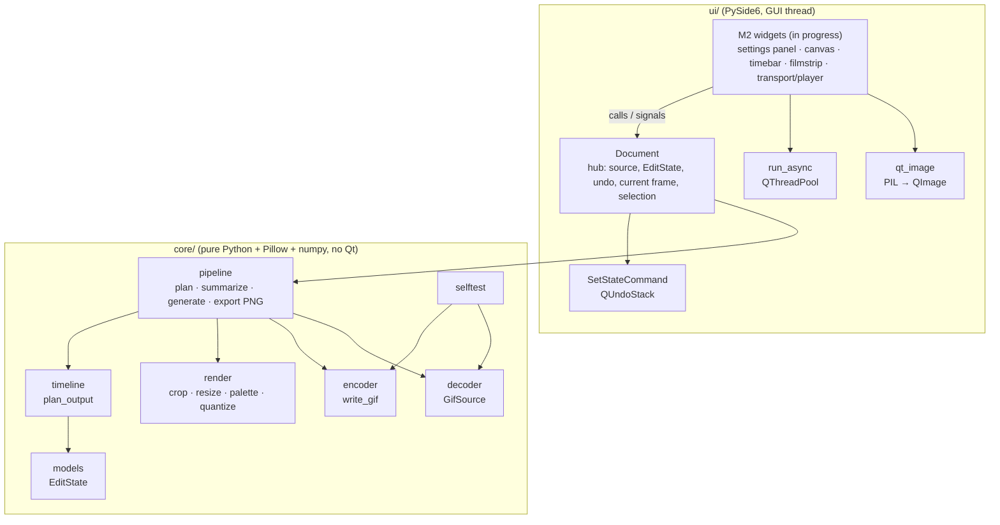
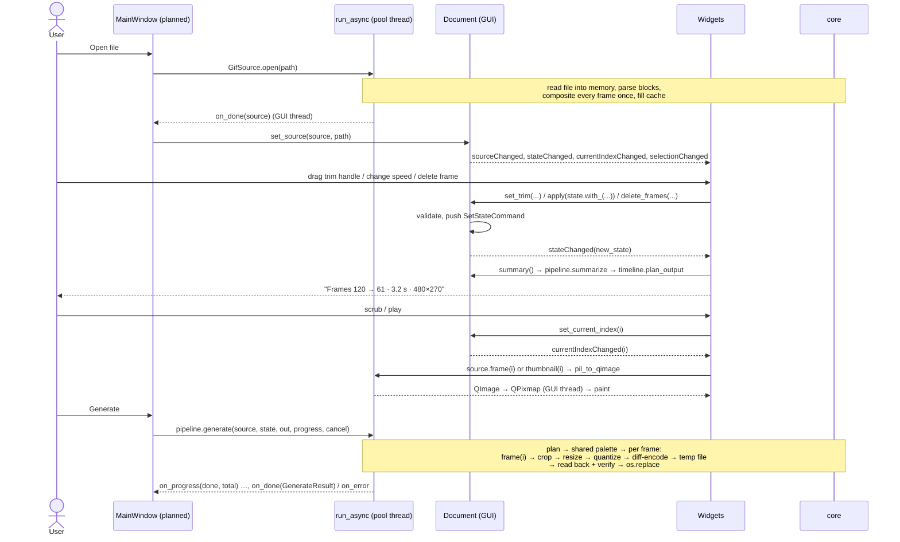
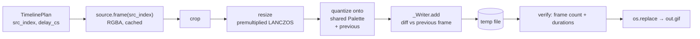

# 03 — Architecture (the code as it is today)

This page describes the code on `main` as of Milestone 2 (in progress). For the *intended* design see [02-plan.md](02-plan.md); for how we got here see [04-development-log.md](04-development-log.md). Every file has its own page under [codebase/](codebase/INDEX.md).

## 1. Layers



- **core** is a headless GIF engine. It has no Qt imports (an AGENTS.md rule), so it is fully unit-testable and could back a CLI. It depends only on Pillow and numpy. Pillow is used narrowly: LZW decode/encode, quantisation, resizing, and PNG writing.
- **ui** is PySide6. Widgets talk **only** to `Document`. Long work goes through `run_async`.

## 2. Directory tree

```
gif-editor/
├─ AGENTS.md                      contributor contract: rules, commands, interfaces, definition of done
├─ README.md                      short intro + Windows dev commands
├─ pyproject.toml                 pins, pytest config (pythonpath src+tests), ruff config
├─ requirements.txt               runtime pins (mirror of pyproject)
├─ requirements-dev.txt           runtime + pytest, pytest-qt, ruff
├─ .gitignore                     venv/caches/build output, .devlibs/, scratch
├─ .github/workflows/ci.yml       Windows CI: ruff + pytest (offscreen Qt)
├─ scripts/
│  ├─ test.sh                     lint + all tests headlessly in the Linux container
│  └─ fetch-devlibs.sh            fetch + SHA-check + unpack libegl1 into .devlibs/
├─ packaging/licenses/            (empty, M5: licence texts)
├─ src/gif_editor/
│  ├─ __init__.py                 package docstring + __version__
│  ├─ __main__.py                 `python -m gif_editor` → app.main()
│  ├─ app.py                      QApplication + placeholder window (MainWindow in M2)
│  ├─ resources/icons/            (empty)
│  ├─ core/
│  │  ├─ __init__.py              package marker ("no Qt")
│  │  ├─ models.py                EditState, CropRect, OutputSize, Quality (immutable)
│  │  ├─ decoder.py               GifSource: block parser, numpy compositor (browser disposal), LRU + checkpoints
│  │  ├─ timeline.py              plan_output(): trim → delete → speed → fps → min delay → cs rounding → split
│  │  ├─ render.py                crop, premultiplied LANCZOS resize, shared palette, quantize (anti-shimmer)
│  │  ├─ encoder.py               write_gif(): own container, lossless diff frames, atomic, progress/cancel/verify
│  │  ├─ pipeline.py              plan/summarize/generate/export_frame_png glue
│  │  └─ selftest.py              round trip through the Pillow internals we depend on
│  └─ ui/
│     ├─ __init__.py              package marker
│     ├─ document.py              Document: the hub every widget talks to
│     ├─ commands.py              SetStateCommand (old → new EditState, gesture merging)
│     ├─ workers.py               run_async(): QThreadPool + GUI-thread callbacks
│     ├─ qt_image.py              pil_to_qimage(), checkerboard_brush()
│     ├─ settings_panel.py        (in progress) output settings + summary
│     ├─ main_window.py           (planned, orchestrator)
│     └─ inspector/
│        ├─ __init__.py           package marker
│        ├─ canvas.py             (in progress) zoomable frame view
│        ├─ timebar.py            (in progress) playhead, ticks, trim handles
│        ├─ filmstrip.py          (in progress) thumbnails, selection, deleted state
│        ├─ transport.py          (in progress) play/step controls
│        ├─ player.py             (in progress) playback timer
│        └─ inspector.py          (planned, orchestrator) composes the right panel
└─ tests/
   ├─ conftest.py                 session corpus fixtures (no Qt)
   ├─ gifgen.py                   simple GIFs via Pillow
   ├─ corpus.py                   raw GIF89a writer + reference compositor + 13 entries
   ├─ core/test_*.py              one per core module + corpus tests
   └─ ui/conftest.py, test_*.py   pytest-qt tests (Document, workers, qt_image, smoke, widgets)
```

## 3. End-to-end data flow: open → edit → preview → generate



The **same** `timeline.plan_output` result drives the summary, the (M3) edited preview and Generate. That is why the preview can be guaranteed to match the output. Inside Generate, per frame:



## 4. EditState, Document and undo

- `EditState` (core/models.py) is a **frozen dataclass** holding every edit: trim, deleted frames, crop, speed, fps, size, quality. Edits produce new states (`state.with_(...)`), never mutate.
- `Document.apply(new, text, merge_key)` is the **only** way to change it:
  1. no-op if `new == state`;
  2. `new.validate(w, h, n)` against the open source; a `ValueError` changes nothing;
  3. push `SetStateCommand(doc, old, new, text, merge_key)`. Qt immediately calls `redo()`, which calls `doc._set_state_raw(new)`, which emits `stateChanged(new)`.
- Undo/redo swap whole states. Because states are values, **one** command class covers every edit type.
- **Gesture merging:** consecutive commands with the same `merge_key` (e.g. `"trim"` while dragging) merge into one undo step. If the gesture ends where it started, the step is dropped (`setObsolete`).
- **View state** (current frame, selection) lives in `Document`, but not in `EditState` and not on the undo stack.

See the [Document page](codebase/src/gif_editor/ui/document.md) for the sequence diagram and the [commands page](codebase/src/gif_editor/ui/commands.md).

## 5. Threading model

| Thread | Does | Must not |
|---|---|---|
| GUI thread | all widgets, `Document`, undo stack, `QPixmap` creation, painting, `summarize()` (cheap) | block more than about 16 ms: no `GifSource.open`, no `generate`, no bulk decoding |
| Pool threads (`QThreadPool.globalInstance()` via `run_async`) | `GifSource.open`, `frame()`/`thumbnail()` batches, `generate`, `export_frame_png`, `estimate_size`, `pil_to_qimage` | touch widgets or `Document`, create `QPixmap` |

- `run_async(fn, on_done, on_error, on_progress)` creates a `_Relay` QObject **on the calling (GUI) thread**. The worker emits its signals, and Qt queues them back to the GUI thread. Call it only from the GUI thread.
- `GifSource` is **thread-safe**: one lock per source guards decoding and the cache. `frame()` returns copies. Concurrent requests on one source are serialised, not parallel.
- **Cancellation** is cooperative: pass a `threading.Event` to `generate(..., cancel=ev)`. The encoder checks it between frames and before committing, and raises `encoder.Cancelled`, which arrives as `on_error`.
- Results come back in completion order. Widgets must ignore stale results (e.g. a thumbnail for a frame no longer needed, or a source that has since been closed).

## 6. Where each plan decision is implemented

### Timing model (`docs/02-plan.md` §2) → `core/timeline.py`
| Plan step | Code |
|---|---|
| 1. Trim in source time, synced with handles | `timeline._trim` (frames overlapping the window are kept and clipped); `Document.set_trim` |
| 2. Delete removes time | `plan_output` (filter by `state.deleted`); `Document.delete_frames`/`restore_frames` |
| 3. Speed divides delays | `plan_output` (`d / speed`); range in `models.MIN_SPEED`/`MAX_SPEED` |
| 4. FPS resample on a uniform grid, ≤ 50 and ≤ source rate, drop only | `timeline._resample`; `models.MAX_FPS`; the early return when the source is already slower |
| 5. Round to cs with carried error, ≥ 20 ms, warnings | `timeline._enforce_min_delay` + `timeline._round_cs`; warnings in `TimelinePlan.warnings` |
| 6. Output duration derived, read-only | `TimelinePlan.duration_ms` → `pipeline.Summary.duration_ms` |
| 7. Geometry crop → resize → quantize | `render.render_frame` + `render.quantize` via `pipeline.iter_output_frames` |
| (added) GIF max delay 655.35 s | split in `plan_output` |

### Other decisions
| Decision | Code |
|---|---|
| Source delays 0/10 ms → 100 ms | `decoder._effective_delay`, `FrameMeta.effective_delay_ms`, `SourceMeta.delays_ms` |
| Correct disposal + transparency on load (browser semantics) | `decoder._Compositor` |
| Transparency preserved; alpha < 128 → transparent | `render.ALPHA_THRESHOLD`, `pipeline.output_palette(transparent=meta.has_transparency)`, `encoder._Writer` |
| Loop: keep source behaviour | `pipeline.generate(loop=meta.loop)`, `encoder._write_header` |
| Safe write (temp + rename), progress, cancel, verify | `encoder.write_gif`, `pipeline._verifier` |
| Save current frame as PNG (original or edited) | `pipeline.export_frame_png(state=None|state)` |
| Live summary | `pipeline.summarize` (exact); file size via `encoder.estimate_size` (not wired yet) |
| Large GIFs / RAM | `decoder.Limits`, `_FrameCache` (LRU + pinned checkpoints ≤ ¼ budget) |
| Fast backward scrubbing | keyframe checkpoints + `_resume_point` |
| Pillow pinned, internals checked | `pyproject.toml` pins, `core/selftest.py` |

## 7. Error handling and limits

| Situation | Behaviour | Where |
|---|---|---|
| Missing file, not a GIF, unreadable | `GifLoadError` with a user-presentable message | `GifSource.open`, `_read_header` |
| Canvas > 2 × `Image.MAX_IMAGE_PIXELS` (≈ 179 Mpx) or side > 8192 | `GifLoadError` | `_parse` |
| Any frame side > 8192, area > 2 × MAX_IMAGE_PIXELS, or area > max(4 × canvas, 16 Mpx) | `GifLoadError` for the whole file (decompression-bomb guard) | `_check_frame_size` |
| More than 10 000 frames | `GifLoadError` | `_parse` |
| Truncated mid-frame / junk after frames / no trailer | load what is complete, add to `GifSource.warnings` | `_parse` |
| Short/corrupt LZW in a complete frame | keep the decoded pixels, warning | `_decode_indices` |
| Frame data undecodable during load | frame 0 → `GifLoadError`; later → stop there, warning | `GifSource._index` |
| Cache memory | ≤ `cache_budget_bytes` (512 MiB default), checkpoints ≤ ¼ of it | `_FrameCache` |
| Invalid edit values | `ValueError` from `EditState.with_` / `validate`; `Document.apply` pushes nothing | `models.py`, `document.py` |
| Delete every frame | `ValueError` from `Document.delete_frames` | `document.py` |
| Edits leave no frames (trim + deletes) | empty `TimelinePlan` with a warning; `generate` raises `ValueError("nothing to generate: …")` | `timeline.plan_output`, `pipeline.generate` |
| Speed/FPS/delays not exactly representable | warnings ("N frames dropped", "Delays rounded", "Long frame split") | `timeline.plan_output` |
| Cancel | `encoder.Cancelled`; temp file deleted; destination untouched | `write_gif` |
| Any error during writing | temp file deleted, exception re-raised, destination untouched | `write_gif` |
| Output doesn't read back as planned | `RuntimeError("written GIF failed verification…")`, destination untouched | `pipeline._verifier` |
| Pillow internals changed | `SelfTestError` (to be shown at startup) | `core/selftest.py` |
| Worker exception | `on_error(message, exc)` on the GUI thread + traceback on stderr | `ui/workers.py` |

## 8. Extension points: adding a new edit type end to end

Example: a hypothetical *Reverse* toggle (play frames backwards). The same steps apply to any edit.

1. **Model** (`core/models.py`): add a field with a no-op default (`reverse: bool = False`) and validate it in `_validate_fields`, plus `validate()` if it depends on the source. The default must keep `EditState()` the identity. Add cases to `tests/core/test_models.py`.
2. **Decide which stage owns it:**
   - **Which frames / how long** → `core/timeline.py`. This is the *only* place allowed (AGENTS.md). For Reverse: reverse the kept list after trim/delete and before speed. Document the step in the module docstring's numbered list, and add table and property tests to `test_timeline.py`. Preview, summary and Generate pick it up automatically.
   - **Per-frame pixels** (e.g. rotate, a filter) → `core/render.py` `render_frame` (keep the order crop → … → resize, or document a new order). Then `output_dimensions` if the size changes. `pipeline.render_output_frame` is shared with the preview, so they stay in sync.
   - **Palette/colour** → `render.build_palette`/`quantize` via `Quality` or a new field.
   - **Container-level** (e.g. a loop override) → `pipeline.generate` arguments to `encoder.write_gif`.
3. **Summary:** if it changes the size or frame count, check that `pipeline.summarize` reflects it (it does if you used the stages above).
4. **UI:** add a control in the owning widget (settings panel for global options). On change: `doc.apply(doc.state.with_(reverse=v), "Reverse", merge_key=None)`; use a `merge_key` for continuous controls. Update the control from `stateChanged` (block its own signals while doing so, to avoid feedback loops), so undo/redo moves the control too.
5. **Tests:**
   - core: unit tests for the stage, plus an end-to-end case in `test_pipeline.py` (generate → `read_back` matches `plan`);
   - UI: a pytest-qt test that the control calls `apply`, and that undo restores it.
6. **Docs:** update the module page(s), this page's table in §6 if it is a plan decision, the AGENTS.md interface block (orchestrator), and the INDEX line if a file was added.

## 9. M2 widgets (in progress)

These are being written in parallel by worker agents. Each owner writes its own page; the orchestrator will finalise this section. AGENTS.md's *UI interfaces* block defines only the `Document`/`commands`/`workers`/`qt_image` contract and the shared widget rules, not per-widget APIs. The roles below come from those rules and from `docs/02-plan.md` §2 and §5.

| Widget | File | Planned role | Talks to `Document` via |
|---|---|---|---|
| Settings panel | `ui/settings_panel.py` | Left panel: Speed, Output FPS, Start/Duration, Size (aspect lock / scale %), Quality preset + colours/dither; live summary line and warnings; the Generate button (per its module docstring) | `apply(state.with_(...), text, merge_key)`, `set_trim`; reads `summary()`; listens to `stateChanged`, `sourceChanged` |
| Frame canvas | `ui/inspector/canvas.py` | Zoomable view of the current frame (Fit / 100 %) on a checkerboard; crop rectangle in M3 | listens to `currentIndexChanged`, `sourceChanged`; reads `source.frame(i)` via `run_async`; M3: `apply(crop=…)` |
| Timebar | `ui/inspector/timebar.py` | Playhead, frame ticks, green/red trim handles in source time | `set_current_index`, `set_trim(..., merge_key="trim")`; uses `frame_start_ms` / `timeline.frame_at_time` |
| Filmstrip | `ui/inspector/filmstrip.py` | Thumbnail strip; multi-select; deleted frames greyed out, restorable | `set_selection`, `set_current_index`, `delete_frames`, `restore_frames`; `source.thumbnail(i)` via `run_async` |
| Transport | `ui/inspector/transport.py` | Play/pause, step back/forward, first/last, with shortcuts | drives the player and `set_current_index` |
| Player | `ui/inspector/player.py` | Timer that advances `current_index` using frame delays (source or edited timing) | `set_current_index`; reads `meta.delays_ms` / `plan()` |
| Inspector | `ui/inspector/inspector.py` | (planned, orchestrator) lays out canvas + timebar + filmstrip + transport | composition only |
| Main window | `ui/main_window.py` | (planned, orchestrator) menus, open (async), drag-and-drop, undo/redo actions, Generate with progress/cancel, Save frame | `set_source`, `undo_stack`, `run_async(generate…)` |

Shared widget rules (AGENTS.md):
- construct with `(doc, parent=None)`;
- refresh fully on `sourceChanged`;
- show a disabled/empty state when `doc.is_open` is False;
- never block the GUI thread for more than about 16 ms;
- use `merge_key` for continuous gestures;
- `setAccessibleName` on custom widgets;
- HiDPI-safe painting (cosmetic pens, logical pixels).

## Known drift between docs and code

Things noticed while writing these docs. The code is the truth.
- `core/selftest.py` says "the app calls it at startup"; `app.py` does not yet (it is still the M1 placeholder).
- `core/decoder.py`'s docstring names the LZW entry point as `Image.frombytes(mode, size, data, "gif", …)`; the code calls the instance method `Image.Image.frombytes(data, "gif", bits, interlace, -1)`.
- `scripts/fetch-devlibs.sh`'s header lists the full Debian trust chain, but the script only enforces the pinned SHA-256 (the rest was a one-time manual check).
- AGENTS.md's `run_async` signature omits the `pool=` keyword; AGENTS.md's pipeline block omits `render_output_frame`, `Summary` and `GenerateResult`.
- AGENTS.md's *UI interfaces* block has no per-widget interfaces for the M2 widgets.
- `docs/02-plan.md` sketches `OutputSize(width, height, keep_aspect)`, `write_gif(..., (P-image, delay_ms))`, a `summary()` in timeline, `crop_item.py`, and one command class per edit. The code has no `keep_aspect`, uses `delay_cs`, puts `summarize` in `pipeline.py`, uses one generic `SetStateCommand`, and has `player.py`/`inspector.py`, which are not in the plan's tree.
- `README.md` still says "Status: Milestone 1" and lists only docs 00-02.
- `encoder.estimate_size` exists but nothing calls it yet (the summary shows no size estimate).
