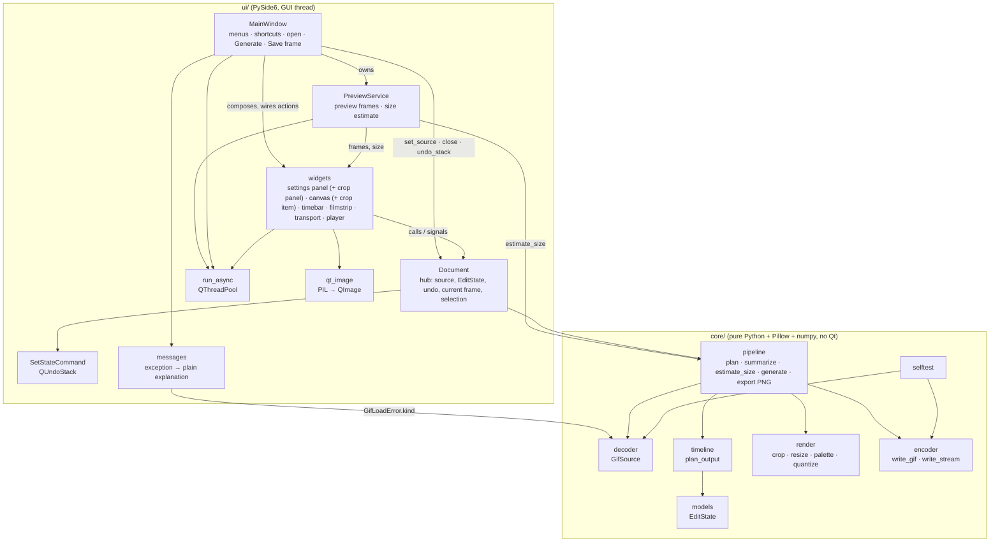
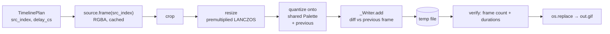
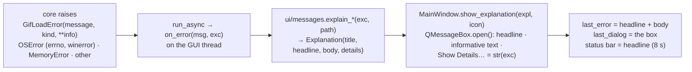
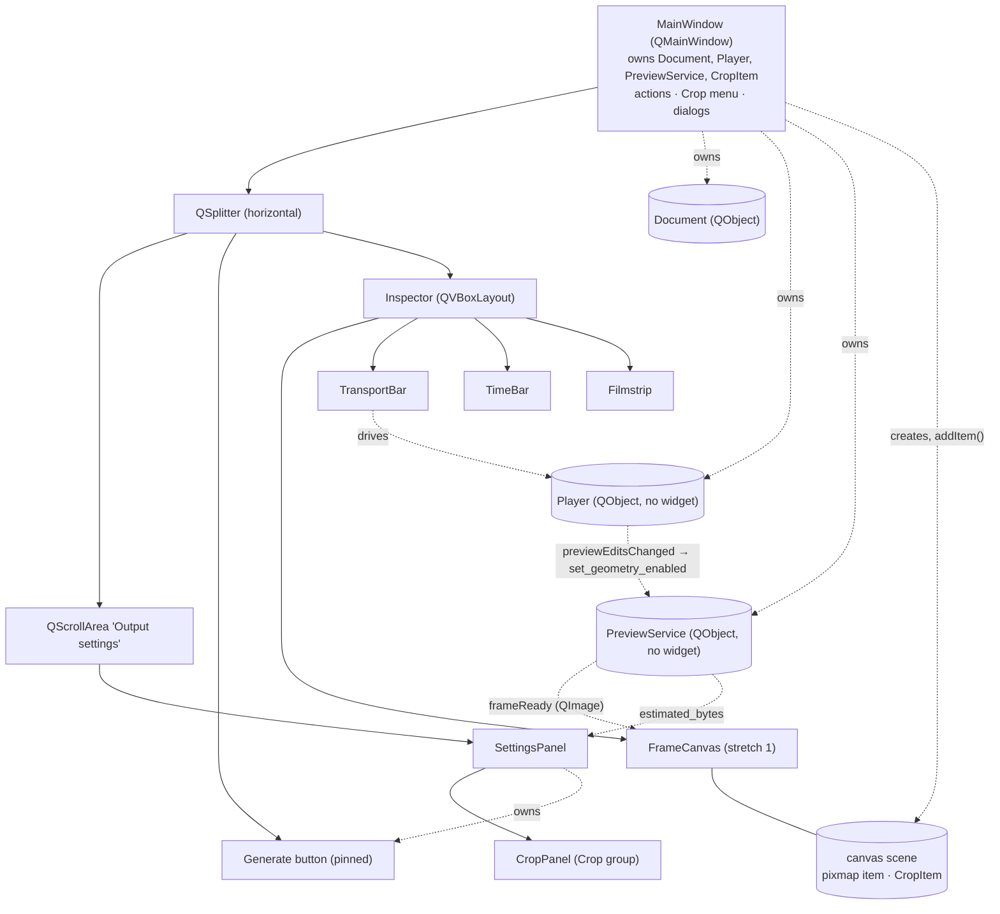

# 03 — Architecture (the code as it is today)

This page describes the code on `main` as of the end of Milestone 4 (hardening). For the *intended* design see [02-plan.md](02-plan.md); for how we got here see [04-development-log.md](04-development-log.md). Every file has its own page under [codebase/](codebase/INDEX.md).

## 1. Layers



- **core** is a headless GIF engine. It has no Qt imports (an AGENTS.md rule), so it is fully unit-testable and could back a CLI. It depends only on Pillow and numpy. Pillow is used narrowly: LZW decode/encode, quantisation, resizing, and PNG writing.
- **ui** is PySide6. Widgets talk **only** to `Document`; the main window composes them and wires menu actions to them (§9). Long work goes through `run_async`. `ui/messages.py` is the one ui module without Qt: it turns exceptions into the texts the main window's dialogs show (§7).

## 2. Directory tree

```
gif-editor/
├─ AGENTS.md                      contributor contract: rules, commands, interfaces, definition of done
├─ README.md                      short intro + Windows dev commands
├─ pyproject.toml                 pins, pytest config (pythonpath src+tests), ruff config
├─ requirements.txt               runtime pins (mirror of pyproject)
├─ requirements-dev.txt           runtime + pytest, pytest-qt, ruff
├─ .gitignore                     venv/caches/build output, .devlibs/, scratch
├─ .github/workflows/ci.yml       Windows CI: ruff + pytest (offscreen Qt)
├─ .github/workflows/build-exe.yml  Windows build (manual / v* tag): test, check, build, smoke-test, upload GifEditor.exe
├─ scripts/
│  ├─ test.sh                     lint + all tests headlessly in the Linux container (temp files under out/)
│  ├─ test-hidpi.sh               the UI tests at 150 % and 200 % scaling
│  ├─ offscreen-screen.json       virtual 3840×2160 screen for the offscreen Qt platform
│  ├─ fuzz_decoder.py             manual: damaged GIFs must load or be refused cleanly
│  ├─ stress_probe.py             manual: GUI-thread stalls with big/corrupt GIFs in the real window
│  ├─ fetch-devlibs.sh            fetch + SHA-check + unpack libegl1 into .devlibs/
│  ├─ build.py                    M5: Nuitka onefile recipe -> out/dist/GifEditor(.exe)
│  ├─ check_build_flags.py        M5: every build flag checked against Nuitka's own parser (both platforms)
│  ├─ make_icon.py                M5: draws the icon (PNGs + multi-size .ico); --check compares pixels
│  └─ smoke_build.py              M5: runs a built binary: clean failure, headless edit, --smoke-gui
├─ packaging/
│  ├─ build-requirements.txt      M5: build-only pins (nuitka, ordered-set, zstandard, patchelf on Linux)
│  └─ licenses/                   (empty: the licence bundle is still open)
├─ src/gif_editor/
│  ├─ __init__.py                 package docstring + __version__
│  ├─ __main__.py                 `python -m gif_editor` → app.main()
│  ├─ app.py                      main(): --edit-spec before any Qt import; QApplication, window icon, Pillow self-test,
│  │                              MainWindow, optional path arg, --smoke-gui self-exit, wait for pool at exit
│  ├─ headless.py                 M5: --edit-spec: parse a text spec, generate with no window (no Qt)
│  ├─ resources/
│  │  ├─ __init__.py              M5: resource_path()/icon_path(): source tree or Nuitka onefile (no Qt)
│  │  └─ icons/                   generated app icon (icon.ico + PNGs); buttons still use Qt standard icons
│  ├─ core/
│  │  ├─ __init__.py              package marker ("no Qt")
│  │  ├─ models.py                EditState, CropRect, OutputSize, Quality (immutable)
│  │  ├─ decoder.py               GifSource: block parser, numpy compositor (browser disposal), LRU + checkpoints,
│  │  │                           GifLoadError.kind, non-blocking frames_to_decode
│  │  ├─ timeline.py              plan_output(): trim → delete → speed → fps → min delay → cs rounding → split
│  │  ├─ render.py                crop, premultiplied LANCZOS resize, shared palette, quantize (anti-shimmer)
│  │  ├─ encoder.py               write_gif()/write_stream(): own container, lossless diff frames, atomic, progress/cancel/verify
│  │  ├─ pipeline.py              plan/summarize/estimate_size/generate/export_frame_png glue
│  │  └─ selftest.py              round trip through the Pillow internals we depend on
│  └─ ui/
│     ├─ __init__.py              package marker
│     ├─ document.py              Document: the hub every widget talks to
│     ├─ commands.py              SetStateCommand (old → new EditState, gesture merging)
│     ├─ workers.py               run_async(): plain callables on QThreadPool + GUI-thread callbacks
│     ├─ messages.py              Explanation + explain_*(): plain-language error texts (no Qt)
│     ├─ qt_image.py              pil_to_qimage(), checkerboard_brush()
│     ├─ settings_panel.py        SettingsPanel: timing/size/crop/quality, live summary + size estimate, Generate button
│     ├─ crop_panel.py            CropPanel: numeric Crop group (embedded in the settings panel)
│     ├─ main_window.py           MainWindow: layout (fits the screen, pinned Generate), actions/shortcuts, Crop menu,
│     │                           open, Generate, Save frame, show_explanation
│     └─ inspector/
│        ├─ __init__.py           package marker
│        ├─ canvas.py             FrameCanvas: zoomable/pannable frame view, deleted overlay, geometry preview,
│        │                        async source frames, Space+drag (spaceTapped)
│        ├─ crop_item.py          CropItem: draggable crop rectangle in the canvas scene
│        ├─ preview.py            PreviewService: off-thread preview frames + debounced size estimate (QObject)
│        ├─ timebar.py            TimeBar: playhead, ticks, snapping trim handles
│        ├─ filmstrip.py          Filmstrip: lazy thumbnails, selection, delete/restore, trim menu
│        ├─ transport.py          TransportBar: play/step buttons, preview toggle, frame info
│        ├─ player.py             Player: drift-free playback timer (QObject, no widget)
│        └─ inspector.py          Inspector: composes the right panel
└─ tests/
   ├─ conftest.py                 session corpus fixtures (no Qt)
   ├─ gifgen.py                   simple GIFs via Pillow
   ├─ corpus.py                   raw GIF89a writer + reference compositor + 13 entries
   ├─ core/test_*.py              one per core module + corpus tests; M5: headless, resources, build flags
   └─ ui/conftest.py, test_*.py   pytest-qt tests: foundation, messages, one file per widget, main-window + M3 integration
                                  (conftest's autouse _drain_workers drains the pool after every UI test)
```

## 3. End-to-end data flow: open → edit → preview → generate

```mermaid
sequenceDiagram
    actor U as User
    participant MW as MainWindow
    participant WK as run_async (pool thread)
    participant D as Document (GUI)
    participant V as Widgets
    participant C as core

    U->>MW: Open file
    MW->>WK: GifSource.open(path)
    Note over WK,C: read file into memory, parse blocks,<br/>composite every frame once, fill cache
    WK-->>MW: on_done(source) (GUI thread)
    MW->>D: set_source(source, path)
    D-->>V: sourceChanged, stateChanged, currentIndexChanged, selectionChanged

    U->>V: drag trim handle / change speed / delete frame
    V->>D: set_trim(...) / apply(state.with_(...)) / delete_frames(...)
    D->>D: validate, push SetStateCommand
    D-->>V: stateChanged(new_state)
    V->>D: summary() → pipeline.summarize → timeline.plan_output
    V-->>U: "Frames 120 → 61 · 3.2 s · 480×270"

    D-->>V: stateChanged → PreviewService: debounce 250 ms → pool: estimate_size
    WK-->>V: estimateReady → summary card "Size: ≈ 1.2 MB"

    U->>V: scrub / play
    V->>D: set_current_index(i)
    D-->>V: currentIndexChanged(i)
    V->>WK: thumbnail(i) → pil_to_qimage (filmstrip)
    Note over V: canvas: source.frame(i) on the GUI thread if cheap (cached / next frame),<br/>else PreviewService renders the plain frame on the pool;<br/>with Preview edits on, PreviewService renders<br/>crop + resize on the pool → frameReady(i, QImage)
    WK-->>V: QImage → QPixmap (GUI thread) → paint

    U->>MW: Generate
    MW->>WK: pipeline.generate(source, state, out, progress, cancel)
    Note over WK,C: plan → shared palette → per frame:<br/>frame(i) → crop → resize → quantize → diff-encode → temp file<br/>→ read back + verify → os.replace
    WK-->>MW: on_progress(done, total) …, on_done(GenerateResult) / on_error
```

The **same** `timeline.plan_output` result drives the summary, the edited preview (timing) and Generate, and the same `render.render_frame(crop, size)` produces the preview frame and the Generate frame before quantisation. That is why the preview matches the output. The size estimate also runs the real pipeline (on a few frames), but it is an estimate: see [pipeline](codebase/src/gif_editor/core/pipeline.md#estimate_size-and-_encoded_size). Inside Generate, per frame:



## 4. EditState, Document and undo

- `EditState` (core/models.py) is a **frozen dataclass** holding every edit: trim, deleted frames, crop, speed, fps, size, quality. Edits produce new states (`state.with_(...)`), never mutate.
- `Document.apply(new, text, merge_key)` is the **only** way to change it:
  1. no-op if `new == state`;
  2. `new.validate(w, h, n)` against the open source; a `ValueError` changes nothing;
  3. push `SetStateCommand(doc, old, new, text, merge_key)`. Qt immediately calls `redo()`, which calls `doc._set_state_raw(new)`, which emits `stateChanged(new)`.
- Undo/redo swap whole states. Because states are values, **one** command class covers every edit type.
- **Gesture merging:** consecutive commands with the same `merge_key` (e.g. `"trim"` while dragging) merge into one undo step. If the gesture ends where it started, the step is dropped (`setObsolete`).
- **View state** (current frame, selection) lives in `Document`, but not in `EditState` and not on the undo stack.

See the [Document page](codebase/src/gif_editor/ui/document.md) for the sequence diagram and the [commands page](codebase/src/gif_editor/ui/commands.md).

## 5. Threading model

| Thread | Does | Must not |
|---|---|---|
| GUI thread | all widgets, `Document`, undo stack, `QPixmap` creation, painting, `summarize()` (cheap), the canvas's `source.frame(i)` **only when cheap** (`frames_to_decode(i) × pixels ≤ 4,000,000`, about 25 ms), Save frame's `export_frame_png` (one frame) | block more than about 16 ms: no `GifSource.open`, no `generate`, no bulk or expensive decoding, never wait on the decoder lock |
| Pool threads (`QThreadPool.globalInstance()` via `run_async`) | `GifSource.open` (main window), `thumbnail()` batches + `pil_to_qimage` (filmstrip), `generate` (main window), preview frames (`frame` + `render_frame` + `pil_to_qimage`), expensive plain source frames for the canvas, and `estimate_size` (`PreviewService`) | touch widgets or `Document`, create `QPixmap` |

### How `run_async` works (M4 model)
```mermaid
sequenceDiagram
    participant G as GUI thread
    participant R as _Relay (QObject on GUI thread)
    participant P as pool thread
    G->>R: create relay + Event "exited"; keep relay in _live
    G->>P: QThreadPool.start(plain callable)
    P->>P: fn() / fn(progress)
    P-->>R: finished / failed / progress (queued signals)
    P->>P: finally: exited.set()
    R->>G: on_done / on_error / on_progress
    G->>G: _release: exited? → drop relay, deleteLater()<br/>not yet → QTimer.singleShot(1, _release)
```
- `run_async(fn, *, on_done, on_error, on_progress, pool=None)` creates a `_Relay` QObject **on the calling (GUI) thread**. The worker emits its signals, and Qt queues them back to the GUI thread. Call it only from the GUI thread.
- **Jobs are plain callables**, handed to `QThreadPool.start(callable)`. There is no Python `QRunnable` subclass: with one, Qt calls a Python-overridden `run()` on a C++-owned object from a pool thread, and PySide must manage that wrapper across threads. Rule (AGENTS.md): never subclass `QRunnable` in Python; use `run_async`.
- **Relay lifetime:** the relay is deleted only after the worker has **left** `emit()` (the `exited` event). Deleting a QObject while another thread is inside one of its emits is undefined behaviour, and the GUI thread can otherwise run the callback before the worker's `emit()` has returned.
- An error is passed to `on_error`; a traceback is printed only when there is **no** `on_error` (handled errors stay quiet).
- **Exit:** `app.main` waits `QThreadPool.globalInstance().waitForDone(10_000)` after `app.exec()`, so interpreter teardown never runs under a live pool thread. The main window cancels a running Generate on close and closes itself once the worker reports back.
- **Tests:** the autouse `_drain_workers` fixture (`tests/ui/conftest.py`) waits for the pool and processes events after every UI test, before pytest-qt deletes the widgets, so no task from one test runs into the next.

These three changes (callables, relay lifetime, drain fixture) followed one segmentation fault and one deadlock in about 20 full test runs during M4. Their root cause is **not confirmed** (120,000-task probes reproduced neither); see the [dev log](04-development-log.md#stability-one-crash-and-one-hang-in-the-test-suite-c4b9329-9ab961f).

### Decoder locking and the canvas
- `GifSource` is **thread-safe**: one lock per source guards decoding and the cache, held for a whole render. `frame()` returns copies. Concurrent requests on one source are serialised, not parallel.
- So the GUI thread must never call `frame(i)` when that could wait for, or do, a long render. The canvas first asks `source.frames_to_decode(i)`, which **never blocks**: it answers from the cache state, or returns `GifSource.BUSY` (a huge number) if another thread holds the lock. If `cost × W × H > SYNC_DECODE_PIXELS` the canvas calls `PreviewService.request_frame(i)` instead (geometry off → the plain source frame; one render at a time, latest request wins) and keeps the previous frame up until `frameReady(i, QImage)` arrives. This took the worst scrub stall on a 1080p×200 GIF from 384 ms to 28 ms ([canvas page](codebase/src/gif_editor/ui/inspector/canvas.md#async-source-frames-m4)).

### Cancellation and stale results
- **Cancellation** is cooperative: pass a `threading.Event` to `generate(..., cancel=ev)`. The encoder checks it between frames and before committing, and raises `encoder.Cancelled`, which arrives as `on_error`.
- Results come back in completion order. Widgets must ignore stale results (e.g. a thumbnail for a frame no longer needed, a source frame for an index that is no longer current, or a source that has since been closed). `PreviewService` uses a generation counter per work stream, and its render worker receives the crop/size **captured at request time** as arguments: reading the live state on the pool thread would let an edit made mid-render leak into an image labelled with the old request (fixed in `e904982`).

## 6. Where each plan decision is implemented

### Timing model (`docs/02-plan.md` §2) → `core/timeline.py`
| Plan step | Code |
|---|---|
| 1. Trim in source time, synced with handles | `timeline._trim` (frames overlapping the window are kept and clipped); `Document.set_trim` |
| 2. Delete removes time | `plan_output` (filter by `state.deleted`); `Document.delete_frames`/`restore_frames` |
| 3. Speed divides delays | `plan_output` (`d / speed`); range in `models.MIN_SPEED`/`MAX_SPEED` |
| 4. FPS resample on a uniform grid, ≤ 50 and ≤ source rate, drop only | `timeline._resample`; `models.MAX_FPS`; the early return when the source is already slower |
| 5. Round to cs with carried error, ≥ 20 ms, warnings | `timeline._enforce_min_delay` + `timeline._round_cs`; warnings in `TimelinePlan.warnings` |
| 6. Output duration derived, read-only | `TimelinePlan.duration_ms` → `pipeline.Summary.duration_ms` |
| 7. Geometry crop → resize → quantize | `render.render_frame` + `render.quantize` via `pipeline.iter_output_frames` |
| (added) GIF max delay 655.35 s | split in `plan_output` |

### Other decisions
| Decision | Code |
|---|---|
| Source delays 0/10 ms → 100 ms | `decoder._effective_delay`, `FrameMeta.effective_delay_ms`, `SourceMeta.delays_ms` |
| Correct disposal + transparency on load (browser semantics) | `decoder._Compositor` |
| Transparency preserved; alpha < 128 → transparent | `render.ALPHA_THRESHOLD`, `pipeline.output_palette(transparent=meta.has_transparency)`, `encoder._Writer` |
| Loop: keep source behaviour | `pipeline.generate(loop=meta.loop)`, `encoder._write_header` |
| Safe write (temp + rename), progress, cancel, verify | `encoder.write_gif`, `pipeline._verifier` |
| Save current frame as PNG (original or edited) | `pipeline.export_frame_png(state=None|state)` via `MainWindow.save_frame_to` |
| Live summary | `pipeline.summarize` (exact), shown by the settings panel; file-size estimate `pipeline.estimate_size` via `PreviewService` (debounced, off-thread), shown as "Size: ≈ …" |
| Preview toggle: timing + geometry (§2.6) | "Preview edits" (P): `Player.set_preview_edits` (timing) + `PreviewService.set_geometry_enabled` (canvas shows crop + resize) |
| Crop: draggable rectangle + numeric fields in sync | `CropItem` (canvas) and `CropPanel` (settings panel), both writing `doc.state.crop` |
| Large GIFs / RAM | `decoder.Limits`, `_FrameCache` (LRU + pinned checkpoints ≤ ¼ budget) |
| Fast backward scrubbing | keyframe checkpoints + `_resume_point` |
| Pillow pinned, internals checked | `pyproject.toml` pins, `core/selftest.py` |

## 7. Error handling and limits

| Situation | Behaviour | Where |
|---|---|---|
| Missing file, folder, unreadable, empty, not a GIF | `GifLoadError` with `kind` `NOT_FOUND` / `IS_DIRECTORY` / `UNREADABLE` / `EMPTY` / `NOT_GIF` | `GifSource.open`, `_read_header` |
| Canvas > 2 × `Image.MAX_IMAGE_PIXELS` (≈ 179 Mpx) or side > 8192 | `GifLoadError(kind=TOO_LARGE, width, height, max_side)` | `_parse` |
| Any frame side > 8192, area > 2 × MAX_IMAGE_PIXELS, or area > max(4 × canvas, 16 Mpx) | `GifLoadError` (`MALFORMED`) for the whole file (decompression-bomb guard) | `_check_frame_size` |
| More than 10 000 frames | `GifLoadError(kind=TOO_MANY_FRAMES, max_frames)` | `_parse` |
| Truncated mid-frame / junk after frames / no trailer | load what is complete, add to `GifSource.warnings` | `_parse` |
| Short/corrupt LZW in a complete frame | keep the decoded pixels, warning | `_decode_indices` |
| Frame data undecodable during load | frame 0 → `GifLoadError` (`MALFORMED`); later → stop there, warning | `GifSource._index` |
| A file opened with warnings (partly loaded) | Information dialog "“x.gif” is damaged; N frames could be loaded.", warnings as details | `MainWindow.open_file` → `explain_load_warnings` |
| Cache memory | ≤ `cache_budget_bytes` (512 MiB default), checkpoints ≤ ¼ of it | `_FrameCache` |
| Invalid edit values | `ValueError` from `EditState.with_` / `validate`; `Document.apply` pushes nothing | `models.py`, `document.py` |
| Delete every frame | `ValueError` from `Document.delete_frames` | `document.py` |
| Edits leave no frames (trim + deletes) | empty `TimelinePlan` with a warning; `generate` raises `ValueError("nothing to generate: …")` | `timeline.plan_output`, `pipeline.generate` |
| Speed/FPS/delays not exactly representable | warnings ("N frames dropped", "Delays rounded", "Long frame split") | `timeline.plan_output` |
| Cancel | `encoder.Cancelled`; temp file deleted; destination untouched | `write_gif` |
| Any error during writing | temp file deleted, exception re-raised, destination untouched | `write_gif` |
| Output doesn't read back as planned | `RuntimeError("written GIF failed verification…")`, destination untouched | `pipeline._verifier` |
| Pillow internals changed | `SelfTestError` → "GIF Editor can't start because one of its components is not working… Download it again" dialog (details: the self-test message), exit code 1, before any window | `core/selftest.py`, `app.main` |
| Worker exception | `on_error(message, exc)` on the GUI thread; traceback on stderr only if there is no `on_error` | `ui/workers.py` |
| Open fails (any exception) | non-blocking "Can't open file" dialog with a plain headline per `kind` (or `MemoryError` / unknown), technical text behind Show Details; `last_error`; the previous document stays open | `MainWindow.open_file` → `explain_load_error` |
| Generate fails / cancelled | "Generate failed" dialog with a plain headline per `errno` / Windows `winerror` 32/33 ("open in another program") / `MemoryError`, always "Nothing was written; any existing file with that name is unchanged."; or a status-bar "cancelled" message | `MainWindow.generate_to` → `explain_generate_error` |
| Save frame fails | `OSError` → the same explanation with title "Save failed"; `ValueError` → a short "Could not save the frame" box | `MainWindow.save_frame_to` |
| Window closed during Generate | Generate is cancelled; the window closes by itself when the worker reports back | `MainWindow.closeEvent`, `_close_when_idle` |
| Edit refused by a widget (delete all, trim end before start, invalid crop) | `Filmstrip.errorOccurred` / `show_error`; the settings panel shows its own and the crop panel's (`CropPanel.errorOccurred`) in its summary card; `CropItem` silently re-syncs from the document | `filmstrip.py`, `settings_panel.py`, `crop_panel.py`, `crop_item.py`, `main_window.py` |
| Size estimate fails or the state is invalid | no Size line (never an error dialog) | `PreviewService._estimate_job`, `_start_estimate` |
| Preview frame render fails | `PreviewService.frameFailed(i, message)`; the canvas keeps the previous image | `preview.py` |

### The error-explanation flow (M4)

- The core never writes user-facing prose; it says **why** (`kind`) and gives the numbers (`info`). Its message text stays precise and technical, is matched by tests, and ends up in Details.
- `ui/messages.py` is pure Python, so every wording branch is unit-tested (`tests/ui/test_messages.py`), including a check that no jargon reaches the headline or body.
- `show_error(message, title)` remains for short widget refusals ("Cannot delete every frame"); it builds an `Explanation` with no body or details and goes through the same `show_explanation`.
- Dialogs are opened with `open()` (non-blocking), so the headless tests never hang; tests assert on `last_error` and `last_dialog`.

## 8. Extension points: adding a new edit type end to end

Example: a hypothetical *Reverse* toggle (play frames backwards). The same steps apply to any edit.

1. **Model** (`core/models.py`): add a field with a no-op default (`reverse: bool = False`) and validate it in `_validate_fields`, plus `validate()` if it depends on the source. The default must keep `EditState()` the identity. Add cases to `tests/core/test_models.py`.
2. **Decide which stage owns it:**
   - **Which frames / how long** → `core/timeline.py`. This is the *only* place allowed (AGENTS.md). For Reverse: reverse the kept list after trim/delete and before speed. Document the step in the module docstring's numbered list, and add table and property tests to `test_timeline.py`. Preview, summary and Generate pick it up automatically.
   - **Per-frame pixels** (e.g. rotate, a filter) → `core/render.py` `render_frame` (keep the order crop → … → resize, or document a new order). Then `output_dimensions` if the size changes. `pipeline.render_output_frame` is shared with the preview, so they stay in sync.
   - **Palette/colour** → `render.build_palette`/`quantize` via `Quality` or a new field.
   - **Container-level** (e.g. a loop override) → `pipeline.generate` arguments to `encoder.write_gif`.
3. **Summary:** if it changes the size or frame count, check that `pipeline.summarize` reflects it (it does if you used the stages above).
4. **UI:** add a control in the owning widget (settings panel for global options). On change: `doc.apply(doc.state.with_(reverse=v), "Reverse", merge_key=None)`; use a `merge_key` for continuous controls. Update the control from `stateChanged` (block its own signals while doing so, to avoid feedback loops), so undo/redo moves the control too.
5. **Tests:**
   - core: unit tests for the stage, plus an end-to-end case in `test_pipeline.py` (generate → `read_back` matches `plan`);
   - UI: a pytest-qt test that the control calls `apply`, and that undo restores it.
6. **Docs:** update the module page(s), this page's table in §6 if it is a plan decision, the AGENTS.md interface block (orchestrator), and the INDEX line if a file was added.

## 9. UI structure (M2 + M3)

### Widget tree and ownership

- `MainWindow` creates the one `Document`, the one `Player` and the one `PreviewService`, then the `SettingsPanel` (inside a `QScrollArea`, so it scrolls instead of being squashed; it receives `preview=`) and the `Inspector`, which builds its four children with the same `doc` (and gives the transport the `player`).
- The `Player` is not a widget. The window owns it because two things drive it: the transport buttons and the window's keyboard actions.
- **`PreviewService` (M3) is a non-visual service owned by the main window.** It reads `Document` and feeds two widgets: the **canvas** (rendered output frames, via `canvas.set_preview(preview)` and `frameReady`) and the **settings panel** (the size estimate, via `SettingsPanel(doc, preview=preview)` and `estimated_bytes`). Neither widget owns or drives it; the window's P action does, through the `Player`. It lives in the window because it has two consumers, exactly like the `Player`.
- **`CropItem` (M3) lives in the canvas scene**, where scene coordinates are source image pixels. The main window creates it and adds it with `canvas.scene().addItem(...)`; `FrameCanvas` has no crop code. The window also owns the crop tool action and decides visibility (hidden during "Preview edits").
- **The Generate button is pinned below the scroll area (M4).** `SettingsPanel` creates and owns `generate_button` (and `generateRequested`); the main window removes it from the panel's layout and puts it in a left-column footer under the `QScrollArea`, so it stays visible when the settings column has to scroll (e.g. 1080p at 150 %). The window opens at 1300×820 at most, capped at 90 % of the screen's available area and centred (`_fit_to_screen`).
- **`CropPanel` (M3) lives inside the settings panel** (`settings.crop_panel`, between Output size and Quality). The settings panel only forwards its `errorOccurred` into the summary card.
- **`CropItem` and `CropPanel` never talk to each other.** Both write `doc.state.crop` through `Document.apply`, and both refresh from `stateChanged`. A canvas drag moves the spinboxes and a spinbox edit moves the rectangle only because both follow the document.
- The window is the only code that reaches into widgets, and only to **wire** them: actions call widget methods (`filmstrip.delete_selected`, `canvas.zoom_fit`, `player.step`, `crop_item.nudge`), and outward signals come back (`SettingsPanel.generateRequested`, `TransportBar.saveFrameRequested`, `Filmstrip.errorOccurred`, `FrameCanvas.zoomChanged`, `CropItem.cropActiveChanged`/`previewChanged`, `PreviewService.geometryChanged`). Widgets never call each other. Details: [main_window page](codebase/src/gif_editor/ui/main_window.md).

### How signals flow through `Document`

```mermaid
flowchart LR
    subgraph writers["Widgets write (method calls)"]
        SETw["SettingsPanel<br/>apply · set_trim"]
        CPw["CropPanel<br/>apply(crop)"]
        CIw["CropItem<br/>apply(crop) on release / nudge / resize"]
        TBw["TimeBar<br/>set_current_index · set_trim"]
        FSw["Filmstrip<br/>set_current_index · set_selection<br/>delete/restore_frames · set_trim"]
        PLw["Player<br/>set_current_index"]
        MWw["MainWindow<br/>set_source · close · set_trim · undo/redo"]
    end
    D(("Document"))
    subgraph readers["Widgets react (signals)"]
        R1["sourceChanged → everyone refreshes fully<br/>(PreviewService drops caches; window turns the crop tool off)"]
        R2["stateChanged → SettingsPanel, CropPanel, CropItem, TimeBar, Filmstrip,<br/>FrameCanvas (overlay), TransportBar (label), Player (resync),<br/>PreviewService (re-render on crop/size change, re-estimate)"]
        R3["currentIndexChanged → FrameCanvas, TimeBar,<br/>Filmstrip, TransportBar, Player, PreviewService (if geometry on)"]
        R4["selectionChanged → Filmstrip"]
    end
    writers --> D --> readers
```

Example: the user clicks a thumbnail while playing.
1. `Filmstrip` → `doc.set_current_index(5)` (guarded by `_syncing` so its own echo is ignored).
2. `Document` emits `currentIndexChanged(5)`.
3. `FrameCanvas` shows frame 5 (or, with Preview edits on, waits for the `PreviewService` render of frame 5); `TimeBar` moves the playhead; `TransportBar` updates "Frame 6 / N"; `Player` sees an index change it did not cause and **resumes playback from frame 5** with a fresh timing base.
4. The filmstrip's own `_on_doc_current` moves the current item with `NoUpdate`, so the **selection is not changed** by the playhead.

Edits go the same way: `doc.apply(...)` → `SetStateCommand` → `stateChanged(new)`, and every view redraws from `doc.state`. Undo/redo emit the same signal, so controls, timebar handles, filmstrip marks, the crop rectangle and the crop spinboxes all follow undo without extra code. To avoid feedback loops, a widget that both writes and listens either blocks its own signals while refreshing (settings panel, crop panel) or uses a re-entrancy guard (filmstrip `_syncing`, player `_setting_index`); `CropItem` ignores `stateChanged` mid-drag and re-reads the document on release.

### Merge keys: one undo step per gesture
`SetStateCommand` merges **any** two consecutive commands with the same `merge_key` into one undo step ([commands page](codebase/src/gif_editor/ui/commands.md)). Keys are therefore chosen per *gesture*, not per field:

| Writer | Key | Result |
|---|---|---|
| Settings panel spinboxes / slider | `"trim"`, `"speed"`, `"fps"`, `"size"`, `"quality"` | holding an arrow or dragging the slider = one step |
| Crop panel spinboxes | `"crop"` | scrubbing X/Y/W/H = one step |
| Each canvas crop drag (`CropItem`) | `"crop-drag-N"`, N incremented on every press | one drag = one step; two drags = two steps |
| Each timebar handle drag | `"trim-drag-N"` | same pattern as the crop drag |
| Buttons, menu actions, crop nudges/resizes (Ctrl+arrows), Crop tick/untick, activate (C), Remove crop, I/O | `None` | every click or key press is its own step |

**Why the drag key is not `"crop"`.** A drag writes once, on release. If it used `"crop"`, a spinbox edit right after the drag would merge into the drag's undo step (undo would revert both), and two drags in a row would also become one step. A fresh key per press makes the drag its own step and guarantees it merges with nothing. Discrete actions use `None` (Qt id −1, never merges) so a nudge can never fold into a preceding drag or scrub.

### Per-widget roles
| Widget | File | Listens to | Calls on `Document` | Notes |
|---|---|---|---|---|
| Settings panel | `ui/settings_panel.py` | `sourceChanged`, `stateChanged`; `PreviewService.estimateChanged/estimateReady`; `CropPanel.errorOccurred` | `apply(..., merge_key=<per control>)`, `set_trim(..., "trim")`, `summary()` | Live summary + Size line + warnings; Generate button disabled when the output is empty. A size equal to the base size is stored as `None` ("follow the crop"). |
| Crop panel | `ui/crop_panel.py` | `sourceChanged`, `stateChanged` | `apply(state.with_(crop=…), …, "crop" \| None)` | Checkable group: unticked = no crop, inputs greyed ("tick to crop"); ticking a full-frame default makes an 80 % centred crop. |
| Frame canvas | `ui/inspector/canvas.py` | `sourceChanged`, `currentIndexChanged`, `stateChanged`; `PreviewService.frameReady/geometryChanged` | none (read-only); asks `PreviewService.request_frame` for expensive source frames | Scene coordinates = image pixels (output pixels in geometry mode). Ctrl+wheel zoom, middle-drag and Space+drag pan; a Space tap emits `spaceTapped` (→ play/pause). |
| Crop item | `ui/inspector/crop_item.py` | `sourceChanged`, `stateChanged` | `apply(state.with_(crop=…), …, "crop-drag-N" \| None)` | No document write mid-drag; edits only while the tool is on. |
| Preview service | `ui/inspector/preview.py` | `sourceChanged`, `stateChanged`, `currentIndexChanged` | none; reads `plan()` | Not a widget. Pool renders with captured geometry, LRU cache, debounced estimate. |
| Transport | `ui/inspector/transport.py` | `sourceChanged`, `stateChanged`, `currentIndexChanged`; `Player.playingChanged`/`previewEditsChanged` | none (drives the `Player`) | Shortcuts live in the window; "Save frame…" just emits a signal. |
| Timebar | `ui/inspector/timebar.py` | `sourceChanged`, `stateChanged`, `currentIndexChanged` | `set_current_index`, `set_trim(..., "trim-drag-N")` | Handles snap to frame boundaries (earlier boundary on a tie), Alt = free; one undo step per drag. |
| Filmstrip | `ui/inspector/filmstrip.py` | `sourceChanged`, `stateChanged`, `currentIndexChanged`, `selectionChanged` | `set_current_index`, `set_selection`, `delete_frames`, `restore_frames`, `set_trim(..., None)` | Thumbnails in batches of 32 via `run_async`, stale batches dropped by generation number. |
| Player | `ui/inspector/player.py` | `sourceChanged`, `stateChanged`, `currentIndexChanged` | `set_current_index`; reads `plan()` in preview mode | Ideal-timeline scheduling (no drift), skips late frames, rebases after a stall longer than one loop. |
| Inspector | `ui/inspector/inspector.py` | — | — | Composition only. |
| Main window | `ui/main_window.py` | `sourceChanged`; `CropItem.cropActiveChanged/previewChanged`; `PreviewService.geometryChanged`; `Player.previewEditsChanged`; `FrameCanvas.spaceTapped` | `set_source`, `close`, `set_trim(..., None)`, `plan()`, `undo_stack` | Async open + drag-drop, Generate with progress/cancel, Save frame, busy flags, crop tool rules, plain-language dialogs (`show_explanation`), fits the screen. |

Shared widget rules (AGENTS.md):
- construct with `(doc, parent=None)` (the transport and inspector also take the `player`; the settings panel optionally `preview=`);
- refresh fully on `sourceChanged`;
- show a disabled/empty state when `doc.is_open` is False;
- never block the GUI thread for more than about 16 ms;
- use `merge_key` for continuous gestures (per-gesture keys, table above);
- `setAccessibleName` on custom widgets **and containers** (M4 audit); inputs with a limited range explain it in a tooltip + accessible description;
- HiDPI-safe painting (cosmetic pens, logical pixels).

### Known UI limitations (after M4)
- **Small screens:** the filmstrip has a fixed height of 140 px. On the smallest supported logical screen (1366×768 at 150 % = 911×512) the window fits, but the canvas gets only about 184 px of height.
- **Space** is claimed by the canvas only while the canvas has focus and a file is open; elsewhere it is the window's play/pause shortcut. (Fixed in M4: Space+drag pans; a tap still plays.)
- Window-level arrow and Home/End shortcuts are skipped when the focused widget accepts `ShortcutOverride` for them (the settings and crop panels' spin boxes; the filmstrip claims Delete/Backspace/Insert and handles them itself).
- **Crop actions follow the rectangle.** The Ctrl+arrow nudge/resize actions are enabled only while the crop rectangle is visible (tool on, not previewing). "Remove crop" works whenever a crop exists, whether or not the rectangle is shown. (Fixed after the M3 docs pass; see the dev log.)
- In geometry preview the crop cannot be edited on the canvas (the rectangle is hidden, because the shown image is already cropped).

### Known limitations outside the UI (after M4)
- The size estimate can be low (0.67×) on long GIFs whose middle is unrepresentative.
- The cause of one crash and one hang seen in M4 test runs is unconfirmed; three plausible causes were removed (§5) and a soak run checks the result.
- Messages are English only.

## Known drift between docs and code

Things noticed while writing these docs. The code is the truth.
- `docs/02-plan.md` is the original plan and is not rewritten; where the code deviates, see its [Implementation notes (deviations)](02-plan.md#implementation-notes-deviations).
- `encoder.estimate_size` (the M1 helper) is still exported and tested but not used by the app; the summary uses `pipeline.estimate_size`. A comment next to `encoder.__all__` says so.
- `scripts/check_build_flags.py` treats the `--noinclude-*-mode` options as valid only alongside a plugin flag; in Nuitka 4.3 they belong to the always-enabled anti-bloat plugin, so the check is stricter than Nuitka, never looser ([checker page](codebase/scripts/check_build_flags.md#why-the-plugin-options-are-special)). (The cache claim in `build.py`'s docstring and the `Nuitka unknown` version line were fixed after the docs pass.)
- `Document.set_trim` defaults to `merge_key="trim"`. That is intended for spinbox scrubbing (the settings panel); drag and menu callers pass their own key (`"trim-drag-N"`) or `None`. Calling it without a key from a new discrete action would silently merge with the previous trim step.

Fixed since M2 (kept here for reference): `app.py` now calls `run_selftest`; `Document.close()` now emits `currentIndexChanged`/`selectionChanged`; the decoder docstring now names the instance method `Image.Image.frombytes`; AGENTS.md lists `run_async(pool=)`, the full pipeline API and the per-widget interfaces; `scripts/fetch-devlibs.sh`'s header comment now says it checks only the pinned SHA-256 and how the pin was obtained (`76cd65c`); `encoder.estimate_size` is no longer "unused until M3" because M3 uses `pipeline.estimate_size` instead.
