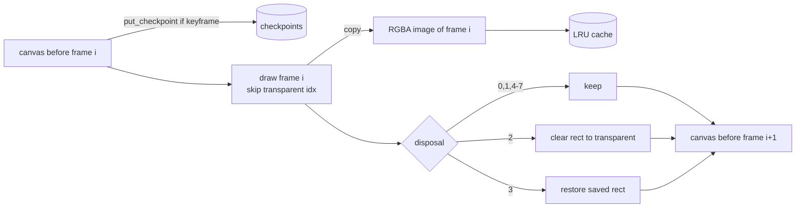
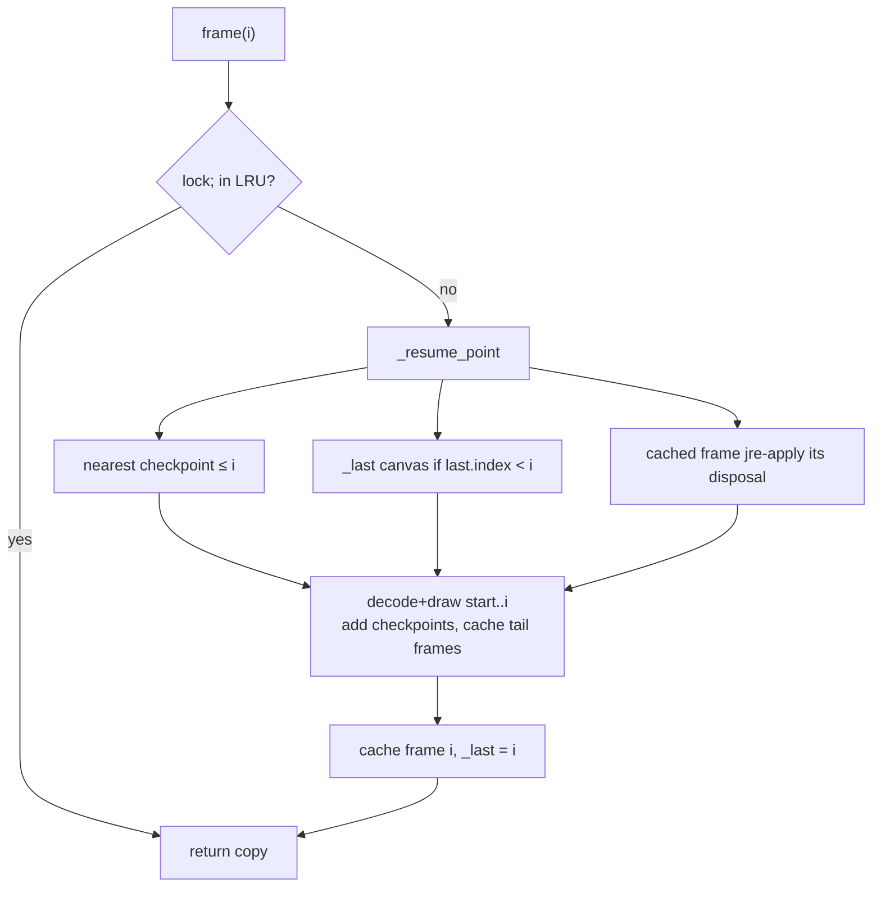

# `src/gif_editor/core/decoder.py`

> Opens a GIF file, validates it, and serves fully composited RGBA frames (with browser disposal semantics) from a thread-safe, byte-budgeted cache.

## Where it sits
- **Layer:** core (pure Python + Pillow + numpy, no Qt)
- **Used by:** `core/pipeline.py` (`GifSource`, `SourceMeta`), `core/selftest.py`, `ui/document.py` (holds the open `GifSource`), the M2 widgets via `Document.source`, many tests.
- **Uses:** no project modules. From Pillow it uses only the C LZW decoder (via `Image.Image.frombytes(..., "gif", ...)`), `Image.MAX_IMAGE_PIXELS`, `Image.fromarray` and `resize`.

## Public API
| Name | Kind | Purpose |
|---|---|---|
| `Limits(max_canvas_side=8192, max_frames=10_000, cache_budget_bytes=512 MiB, keyframe_interval=32)` | frozen dataclass | Safety and memory limits passed to `GifSource.open` (L84-89). |
| `FrameMeta(index, delay_ms, effective_delay_ms, disposal)` | frozen dataclass | Per-frame metadata. `delay_ms` is the raw file value (0 when there is no GCE); `effective_delay_ms` applies the browser rule 0/10 ms → 100 ms (L92-97). |
| `SourceMeta(path, width, height, frame_count, loop, frames, has_transparency)` | frozen dataclass | Whole-file metadata (L100-116). `loop` is the NETSCAPE loop count or `None` when there is no loop block. |
| `SourceMeta.total_duration_ms` | property | Sum of effective delays. |
| `SourceMeta.delays_ms` | property | Tuple of effective delays; this is what `timeline.plan_output` consumes. |
| `GifLoadError` | exception | The file cannot be loaded (missing, not a GIF, too large, no decodable frame…). Message is user-presentable. |
| `GifSource.open(path, limits=Limits())` | classmethod | Read the whole file, parse it, composite every frame once, return a `GifSource` (L552-563). Slow for big files: call off the GUI thread. |
| `GifSource.meta` | property | The `SourceMeta`. |
| `GifSource.warnings` | attribute (`list[str]`) | Non-fatal problems found while loading (truncation, corrupt LZW, junk after the last frame, missing trailer). |
| `GifSource.frame(i)` | method | Composited RGBA frame `i` at canvas size. Returns a **copy** the caller may mutate (L614-621). `IndexError` if out of range, `ValueError` after `close()`. |
| `GifSource.thumbnail(i, max_side=96)` | method | RGBA thumbnail that fits in `max_side` (never upscaled), cached per `(i, max_side)` (L672-688). |
| `GifSource.close()` / context manager | method | Drops the file bytes and all caches. Idempotent. |

## How it works

### Why we do not let Pillow composite
Pillow 12.x can decode GIFs and composite frames when you `seek()`, but its compositing is not what browsers show. If the first frame has no transparency index, Pillow keeps an RGB canvas (no alpha), so disposal 2 ("restore to background") paints an **opaque** colour into the frame rectangle and later frames lose their transparency. Browsers start from a fully transparent canvas and clear disposal-2 rectangles to transparent. `tests/core/test_corpus.py` pins this difference with two strict xfails. Users compare our editor with what their browser shows, so the decoder copies browser behaviour. Pillow is used only for the LZW decompression, which is fast C code.

The second reason is random access. Pillow's GIF reader only seeks forward and recomposites from frame 0 when you go backwards. Scrubbing a timeline needs fast backward seeks, so we keep our own canvas checkpoints.

### Step 1: read and parse (`open` → `_parse`, L215-330)
1. `open` reads the **whole file into memory** and closes it straight away. No file handle stays open, so on Windows the user can overwrite or delete the source while it is loaded (`test_source_file_released_after_open`). Later changes on disk are ignored.
2. `_read_header` checks the `GIF87a`/`GIF89a` signature and reads the logical screen size and flags.
3. Canvas guards: size must be > 0, `w*h ≤ 2 * Image.MAX_IMAGE_PIXELS` (Pillow's decompression-bomb threshold, about 179 Mpx by default), and each side must be ≤ `max_canvas_side`.
4. The global colour table, if present, becomes a `(256, 4)` RGBA lookup table (`_make_lut`). Missing entries stay opaque black, which is why an index beyond the table decodes as opaque black (`test_no_global_palette_and_out_of_table_index`).
5. The block loop walks the file:
   - `0x21` extension: `_skip_sub_blocks` finds its end. A **GCE** (`0xF9`) is stored as `(disposal, delay_ms, transparent_index)` until the next image uses it. An application extension `NETSCAPE2.0` or `ANIMEXTS1.0` with sub-block id 1 sets `loop`. Comments and plain-text extensions are skipped.
   - `0x2C` image descriptor: read left/top/width/height. **`_check_frame_size` runs before anything is allocated** (see Limits below). Then the local colour table (if any), the LZW minimum code size, and the byte range `[data_start, data_end)` of the image-data sub-blocks. The data itself is not decoded here.
   - `0x3B` trailer: stop.
   - Any other byte: stop with an "Unexpected data" warning and keep the frames found so far.
6. If the bytes run out inside a block (`_Truncated`), the partial frame is dropped with a warning. With zero frames the result is a `GifLoadError`. If no trailer was seen and nothing else was reported, a "missing GIF trailer" warning is added.

The parser is pure Python but cheap: it only touches header bytes and sub-block length bytes.

### Step 2: decode one frame's indices (`_decode_indices`, L356-398)
- Only the part of the frame that lies on the canvas is needed (`vis_w × vis_h`). A frame entirely off the canvas is not decoded at all: it still counts as a frame with its delay and disposal, but even corrupt LZW data in it is ignored (`test_off_canvas_frame_is_not_decoded`).
- For a **non-interlaced** frame the target image has only `vis_h` rows. Pillow's decoder stops cleanly once the image is full, so rows below the canvas are never decoded. An **interlaced** frame stores rows out of order (see [the primer](../../../../05-gif-primer.md#interlacing)), so all `f.height` rows are decoded and then cropped. The per-frame size cap bounds that cost.
- The actual decoding is `im.frombytes(blob, "gif", bits, interlace, -1)` on a `"P"` image. These are the same decoder arguments that Pillow's own `GifImagePlugin` builds for its tile. This is an undocumented internal, which is why `core/selftest.py` exists.
- **Short or corrupt LZW data:** Pillow raises `ValueError` but has written a prefix of the pixels in decode order. Browsers show those pixels, so we do too. To find how many pixels were written without a second frame-sized buffer, the image is decoded into a buffer filled with 0 and scanned from the end for the last non-0 pixel (`_written_end`). The scan is then repeated after re-decoding into a buffer filled with 255, because the last real pixel might itself be 0. The larger of the two positions is the count `n`. A rank array maps each visible pixel to its decode position, and `written = position < n` becomes a boolean mask. `test_short_lzw_partially_off_canvas` exercises this for both interlaced and non-interlaced frames.

### Step 3: composite (`_Compositor`, L401-451)
The canvas is an `(H, W, 4)` uint8 numpy array that starts **fully transparent** (zeros).
- `draw` clips the frame rectangle to the canvas. If disposal is 3 it saves a copy of the region first. It then maps indices to colours through the frame's LUT. The LUT is viewed as `uint32`, so each pixel is one 32-bit gather (about 5× faster than gathering 4-byte rows). Pixels equal to the transparent index, and pixels not written by short data, are masked out; the rest are copied into the canvas.
- `dispose` runs **after** the frame has been captured as an output image: disposal 2 sets the rectangle to `0` (transparent), disposal 3 restores the saved region, and 0, 1 and the undefined 4-7 leave it as is.

### Step 4: index pass (`_index`, L565-603)
`open` composites **every** frame once, eagerly:
- This validates the data: a frame whose LZW stream raises a decode error ends the load there with a warning. If it is frame 0, the result is `GifLoadError`.
- It computes `has_transparency`: does any composited frame have any pixel with alpha < 255? Note that this includes canvas areas never painted (for example a first frame smaller than the canvas).
- It fills the cache (checkpoints plus LRU) and remembers the final canvas as `_last`.

Cost: the docstring cites about 1.2 s for 150 frames of 1280×720 on a dev machine. `test_open_performance_500x500x200` bounds a 500×500×200 file at < 6 s (measured about 0.3 s).

### Step 5: the cache (`_FrameCache`, L461-524)
Every cached item is a full canvas, so its cost is `frame_bytes = w*h*4`.
- **LRU** of composited RGBA images (`OrderedDict`), evicted oldest-first while `used_bytes > budget`.
- **Checkpoints:** for every `keyframe_interval`-th frame, the canvas *before* that frame is drawn. Checkpoints are pinned (never evicted by the LRU) and limited to **a quarter of the budget** (`pin_budget`). When the next checkpoint would not fit, the interval is **doubled** and every checkpoint not on the new grid is dropped. Checkpoints therefore stay spread across the whole animation instead of crowding the start (`test_checkpoints_spread_when_budget_is_small`). If a single frame is bigger than `pin_budget`, there are no checkpoints at all.
- `put` refuses an image when the checkpoints leave no room for it. This keeps `used_bytes ≤ budget` as an invariant, which several tests assert after every access.

### Step 6: cache miss (`frame` → `_render` → `_resume_point`, L614-670)
To render frame `i` we need the canvas state just before it. `_resume_point` picks the latest known state at or before `i`:
1. the nearest checkpoint `k ≤ i`;
2. or, if later, `_last` (the canvas left by the previous render) when `_last.index < i`; this makes forward playback O(1) per frame;
3. or, scanning back from `i-1`, a **cached frame `j` whose disposal is not 3**. Its post-disposal canvas can be derived from the image itself by applying disposal (2 clears the rect, 0/1 keep). Disposal 3 needs the pre-frame state, which is not stored, so those frames are skipped.

`_render` then decodes and draws frames `start..i`. Along the way it records missing checkpoints, and it also caches the frames just before `i` (half of the free LRU room). Scrubbing backwards then hits the cache instead of recompositing from the checkpoint each time. A backward seek costs at most about `keyframe_interval` frame decodes instead of O(i).

### Thumbnails
`thumbnail` scales by `min(1, max_side / max(w, h))` with LANCZOS and caches per `(i, max_side)`. The thumbnail cache is **not** budgeted, but thumbnails are tiny (96 px ≈ 36 KiB each). The resize runs outside the lock, so two threads may compute the same thumbnail; that is harmless.

## Invariants & gotchas
- **Limits / DoS.** Every image descriptor is checked while parsing (`_check_frame_size`, L194-212): side ≤ `max_canvas_side`, area ≤ `2 * MAX_IMAGE_PIXELS`, and area ≤ `max(4 * canvas area, 16 Mpx)`. Any violation, even after good frames, rejects the **whole** file. Before this fix a 40-byte file could make the decoder allocate about 1.25 GB (dev log, review finding 3, `5a464d8`). `test_descriptor_bomb_peak_rss_in_subprocess` measures real RSS because Pillow's C allocations are invisible to `tracemalloc`.
- The bomb guard follows `Image.MAX_IMAGE_PIXELS` at call time. Setting it to `None` disables that check, but the side and slack limits still apply.
- **Thread safety:** all decoding and cache mutation happen under one `threading.Lock` per source. Concurrent `frame()` calls are therefore serialised, not parallel. `frame()` always returns a copy, so callers never share mutable images.
- `_check_index` requires a real `int`. A `numpy.int64` raises `IndexError`; convert with `int()` first.
- `frame()` after `close()` raises `ValueError("GifSource is closed")` on a cache miss. Cache hits are impossible after close because the caches are cleared.
- `has_transparency` is "any composited pixel has alpha < 255", not "the file declares a transparency index". A file with a transparency index that never shows can be `False`; a first frame smaller than the canvas makes it `True`.
- Decode errors that appear in `_render` (they should not happen, since `_index` already decoded every frame) are raised as `GifLoadError`.
- `GifImagePlugin.LOADING_STRATEGY` is never touched (`test_loading_strategy_restored`).
- The entry point is the **instance** method `Image.Image.frombytes(data, "gif", bits, interlace, -1)` on a pre-allocated `"P"` image (not the module-level `Image.frombytes`). The selftest test monkeypatches `Image.Image.frombytes` accordingly. (Until the end of M2 the module docstring wrongly named the module-level function; corrected.)

## Tests
- `tests/core/test_decoder.py`: metadata and effective delays, loop present/absent/count, disposal recording, colours vs Pillow on opaque full-canvas GIFs, copy semantics, index errors, thumbnails, not-a-GIF/garbage/missing file, frame and canvas limits, transparency detection, truncation, LRU correctness under a tiny budget and zero budget, 6-thread stress, file released after open, close semantics.
- `tests/core/test_decoder_corpus.py`: every valid corpus entry matches the reference compositor (also scrubbing backwards with a tiny cache), the disposal-2 frames Pillow gets wrong, truncated/invalid/huge entries, a random 60-frame mix of every feature, checkpoint spreading, off-canvas and oversized frames, short LZW data, unknown blocks, GIF87a, descriptor bombs (time, `tracemalloc`, RSS), and open performance.
- **Gaps:** no test for `ANIMEXTS1.0` loop blocks; no test of the thumbnail cache's memory growth; `_render`'s `GifLoadError` path is not reachable from tests.

## History
- `f7a81ac`: first version, built on Pillow's seek and an LRU.
- `212b23f`: rewrite with our own block parser and a numpy compositor with browser disposal semantics, plus keyframe checkpoints ([dev log, Wave 2](../../../../04-development-log.md#wave-2-decoder-rewrite-212b23f)).
- `5a464d8`: per-frame descriptor limits; the file is read into memory and the handle released (review findings 3 and 6).
