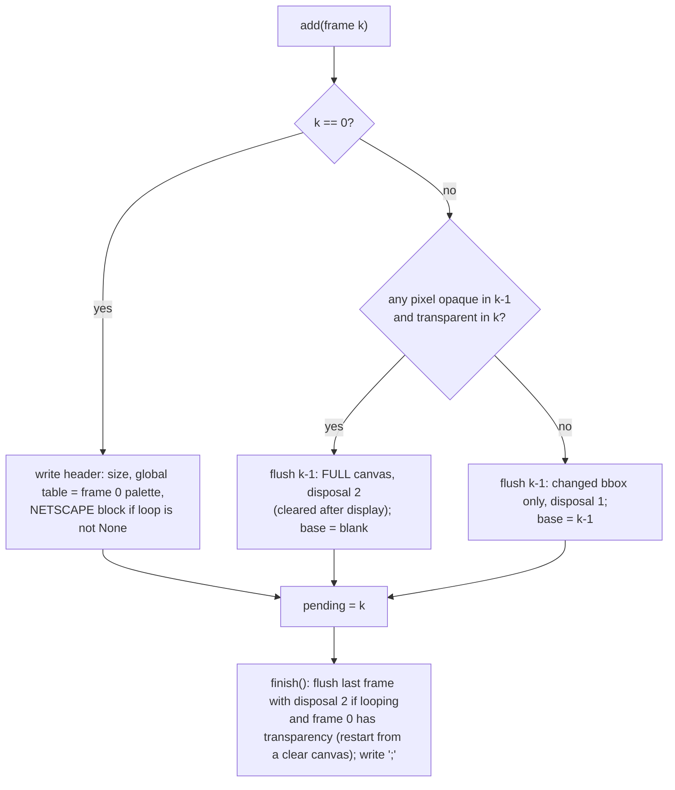

# `src/gif_editor/core/encoder.py`

> Our own animated-GIF writer: it streams lossless difference frames to a temporary file, supports progress, cancellation and a verify hook, and replaces the destination atomically.

## Where it sits
- **Layer:** core (Pillow + numpy, no Qt)
- **Used by:** `core/pipeline.py` (`write_gif` for Generate, `write_stream` for the size estimate, `read_back` for verification), `core/selftest.py`. `estimate_size` here is **not called by the application**: the M3 summary uses `pipeline.estimate_size` instead (see below).
- **Uses:** no project modules. From Pillow: `GifImagePlugin.getdata` (an undocumented "legacy" helper) for one frame's GCE + image descriptor + LZW data, and `Image.open` in `read_back`.

## Public API
| Name | Kind | Purpose |
|---|---|---|
| `Cancelled` | exception | Raised when the `cancel` event is set. |
| `write_stream(fp, frames, *, loop=0, total=None, progress=None, cancel=None) -> int` | function | Encode an animated GIF into an **already open binary stream** (a file or a `BytesIO`) and return the frame count (L290-327). The body of `write_gif` without any file handling. |
| `write_gif(frames, path, *, loop=0, total=None, progress=None, cancel=None, verify=None)` | function | Write the GIF atomically and return the final `Path` (L330-400). Delegates the encoding to `write_stream`. |
| `read_back(path)` | function | `(frame_count, durations_ms)` of a GIF as Pillow reads it (L403-411). Used for verification. |
| `estimate_size(sample_frames, total_frames)` | function | Byte estimate for a `total_frames` GIF from already-quantized sample frames (L414-440). Superseded in the app by `pipeline.estimate_size`; still exported and tested. |
| `MIN_DELAY_CS = 2`, `MAX_DELAY_CS = 0xFFFF`, `MAX_LOOP = 0xFFFF` | constants | Validation limits. |

`write_gif` arguments:
| Arg | Meaning |
|---|---|
| `frames` | Iterable of `(image, delay_cs)`. Image mode must be `"P"`, all images the same size, `delay_cs` an `int` in 2..65535 (`bool` is rejected). Consumed lazily. |
| `loop` | NETSCAPE loop count (0 = forever), or `None` = no loop block at all (plays once). |
| `total` | Passed through to `progress` as the second argument. |
| `progress(done, total)` | Called after each frame is consumed. |
| `cancel` | `threading.Event`, checked before each frame, after the last one, and before and after `verify`. |
| `verify(tmp_path)` | Runs on the complete temporary file before `os.replace`. Any exception aborts the write and leaves the destination untouched. |

## How it works

### Why not `Image.save(save_all=True)`?
Pillow 12.3's multi-frame writer has several problems for us (found in `cca60c1`):
- It crops each frame after the first to a "delta" box by comparing against the **RGB colour of the first frame's transparent index**. Opaque pixels of that colour get cropped away and viewers show them as transparent (`test_opaque_border_matching_first_transparent_colour_survives`).
- A later frame consisting entirely of that colour makes Pillow write a **second GIF header** mid-file, which produces a corrupt file.
- It merges identical consecutive frames, which changes the frame count and breaks our verification.
- It collects every frame in memory before writing.

So this module writes the container bytes itself (header, logical screen, global table, NETSCAPE block, trailer) and asks Pillow only for each frame's GCE, image descriptor and LZW-compressed data via `GifImagePlugin.getdata`. `getdata` never writes interlaced frames, so the output is never interlaced.

### `write_stream`: the encoder without the file
`write_stream(fp, frames, ...)` is the part of writing a GIF that does not care where the bytes go:
1. Validate `loop` (`None` or an int in 0..65535; `bool` rejected).
2. Create a `_Writer(fp, loop)` and pull frames through `_iter_checked` (each one validated by `_check_frame`: mode `"P"`, same size as the first, delay an int in 2..65535 cs).
3. Before each frame call `cancel()` if given. Here `cancel` is a plain **callable that raises** to abort, not an `Event`, so the caller decides what "cancelled" means and which exception to raise.
4. `writer.add(img, delay)`, then `progress(done, total)`.
5. Zero frames → `ValueError("cannot write a GIF with no frames")`. Otherwise `writer.finish()` (last frame + trailer `;`) and return the frame count.

**Why it exists (M3):** the size estimate must encode frames exactly as Generate would, but only to count bytes. Before M3 this loop lived inside `write_gif`, which always creates a temp file in the destination folder. Splitting it out lets `pipeline._encoded_size` encode into a `BytesIO` with the identical writer (same validation, colour tables, differencing and disposal), so the estimate measures the real encoder and never touches the disk. `write_gif` now delegates to it, so there is still one encoder.

Note: `write_stream` is not listed in `__all__` (which is `Cancelled`, `estimate_size`, `read_back`, `write_gif`). That only affects `from encoder import *`; `pipeline.py` and the tests import it by name.

### Atomic write (`write_gif`)
1. Validate `loop`.
2. Open `.<name>.<uuid>.tmp` **in the destination directory** with mode `"x+b"` (exclusive create). Same directory means `os.replace` is an atomic rename on the same volume.
3. Call `write_stream(fp, frames, loop=..., total=..., progress=..., cancel=check_cancel)`, where `check_cancel` raises `Cancelled` if the `threading.Event` is set. So for each frame: check cancel, validate it, `_Writer.add`, then report progress.
4. Zero frames → `ValueError` (from `write_stream`). Otherwise `write_stream` has written the last frame and the trailer; `write_gif` then does `flush` + `fsync`.
5. Check cancel, run `verify(tmp)`, check cancel again, then `os.replace(tmp, dest)`.
6. On **any** exception (including `Cancelled` and `KeyboardInterrupt`), the temporary file is deleted and the exception re-raised. An existing destination is never touched unless everything succeeded.

### Lossless difference frames (`_Writer`, L175-276)
Each input frame becomes a `_Record`: its index array, its palette (padded to 768 bytes), its own transparency index, `need` (how many colour-table entries it needs), and a packed `uint32` RGBA image `rgba` in which transparent pixels are `0`. All comparisons use these **decoded colours**, not indices, so the output is lossless whatever palettes the frames use.

With disposal 1 ("do not dispose"), the canvas a viewer shows after frame k−1 is exactly frame k−1. So frame k only needs the bounding box of the pixels whose RGBA differs from frame k−1. Inside that box, unchanged pixels are set to a **marker index** declared as the frame's transparency index ("keep what is under me"). Long runs of the same marker compress well with LZW.

A diff over a kept canvas can never turn an opaque pixel **transparent**, because a transparent pixel means "keep". That is why the writer has a **one-frame look-ahead**: frame k−1 is written only when frame k arrives, and then we know whether k needs a clear canvas.

`_flush` details:
- **Rectangle:** the full canvas for frame 0 or for a disposal-2 frame (a disposal-2 rect must cover everything that has to be cleared); otherwise `_bbox(changed)`, or a 1×1 rect when nothing changed. Frames are never merged, so the frame count and delays stay exact.
- **Colour table:** frame 0's palette, padded to a power of two (`_table_entries`), is the **global table**. A later frame whose palette is byte-identical and fits needs no local table. That is always the case with a `render.Palette`, which is why the pipeline's output has only a global table. Other frames get a local table.
- **Marker** (`_marker`): the frame's own transparency index if it has one. This is safe because changed pixels are never transparent (that case went through the blank-canvas path). Otherwise it picks the highest table index not used by any changed pixel inside the rect. If there is none and the frame has a local table, it tries a table one size larger. If all 256 indices are used, there is no marker and the unchanged pixels are written with their own (identical) indices, which is still lossless (`test_full_palette_partial_change_lossless`).
- **Why frame 0 always declares a transparency index when one is free:** Pillow's GIF reader only produces RGBA frames when frame 0 declares one. It also fills disposal-2 areas with an opaque colour unless the disposed frame declares one. Declaring an unused index keeps Pillow-based readers (including our verifier) correct (`test_transparency_only_in_later_frames`).

### `estimate_size` (the M1 helper, not used by the app)
It encodes the given sample with the same `_Writer` into a `BytesIO`, records the byte position after each flush, and extrapolates: `header + first frame + average(other frames) × (total − 1) + trailer`. Like the M3 estimator it encodes the sample as one stream, so later frames cost their difference. The accuracy depends on how representative the sample is; on noise frames it lands within 35 % (`test_estimate_size_within_tolerance`).

It needs frames that are already rendered and quantized, and it does not choose which frames to sample. The M3 summary card needs both, plus the shared palette, so it uses [`pipeline.estimate_size`](pipeline.md#estimate_size-and-_encoded_size), which renders a contiguous middle run with the real pipeline and measures it through `write_stream`. This function is kept because it is public and tested; removing it is a code change for a later milestone.

## Invariants & gotchas
- **Lossless:** decoding the output with browser semantics yields exactly the input frames' colours, with transparent pixels as alpha 0. `test_random_animation_lossless` checks this over 24 random animations, with shared and per-frame permuted palettes, with and without looping.
- Output frame count == input frame count; output delays == input `delay_cs` × 10 ms.
- `loop=None` writes no NETSCAPE block; `loop=0` loops forever. The pipeline passes the **source's** loop value through.
- The temporary file name starts with `.`, so it is hidden on POSIX. On Windows it is visible for the duration of the write.
- Memory is constant in the frame count: only the pending frame, the base canvas and the current frame are held.
- `getdata` is an undocumented Pillow API. `_write_frame` checks that the first chunk starts with a GCE (`!\xf9\x04`) and raises `RuntimeError` otherwise; `core/selftest.py` checks the whole round trip.
- `read_back` relies on Pillow's frame counting. Pillow does not merge frames when *reading*, so it works as a verifier for our writer.

## Tests
- `tests/core/test_estimate.py` ([page](../../../tests/core/test_estimate.md)): `test_write_stream_writes_to_a_buffer` (frame count, read-back of the buffer's bytes, empty input → `ValueError`). `write_gif` delegating to `write_stream` is covered by every `write_gif` test.
- `tests/core/test_encoder.py` (62 cases): basic write and read-back, str paths, loop values, identical frames kept, transparency (first frame, later frames, the Pillow border bug), the disposal choices per frame, progress and laziness, cancel (mid-way, after the last frame), cleanup on generator errors, overwrite, validation (delays, sizes, mode, empty), non-ASCII file names, a 256-colour palette, `read_back` of a static GIF, `estimate_size`, `loop=None`, verify success and failure, diff rectangles, local vs global tables, random lossless animations, full-palette diffs. It includes its own minimal block parser `gif_frames()` to inspect rects, disposal and tables.
- **Gaps:** no test that `fsync` happens; no Windows-specific test of `os.replace` over a file that is open elsewhere; no test of estimate accuracy on real-world (non-noise) content.

## History
- `cca60c1`: atomic streaming writer with our own container; Pillow is used only for LZW.
- `8e7d34c`: lossless difference frames, global-table reuse, disposal-2 look-ahead (review finding 2).
- `f7056d9`: `verify` hook and `loop=None` (review findings 7 and 8). See [dev log](../../../../04-development-log.md#independent-review--fixes).
- `b9021ca` (M3): the encoding loop moved out of `write_gif` into `write_stream`, so the size estimate can encode into memory with the same code. Behaviour of `write_gif` is unchanged. See [dev log, Milestone 3](../../../../04-development-log.md#milestone-3-crop-and-live-preview).
