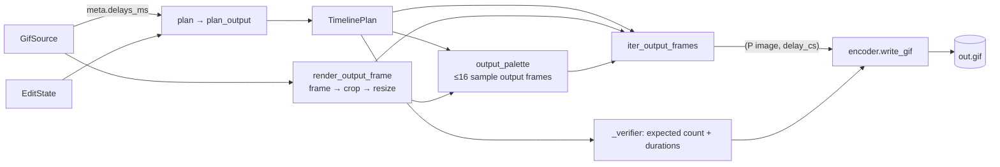

# `src/gif_editor/core/pipeline.py`

> The glue that turns a `GifSource` plus an `EditState` into a summary, preview frames, a written GIF, or a single-frame PNG.

## Where it sits
- **Layer:** core (no Qt)
- **Used by:** `ui/document.py` (`plan`, `summarize`, `Summary`). M2/M3 widgets are expected to call `generate`, `export_frame_png` and `render_output_frame` through workers. `tests/core/test_pipeline.py`.
- **Uses:** `core/decoder.py`, `core/encoder.py`, `core/models.py`, `core/render.py`, `core/timeline.py`.

## Public API
| Name | Kind | Purpose |
|---|---|---|
| `Summary(frame_count, duration_ms, width, height, warnings)` | frozen dataclass | What Generate would produce (exact except for the file size). |
| `GenerateResult(path, frame_count, duration_ms, width, height, size_bytes, warnings)` | frozen dataclass | What Generate did produce. |
| `plan(meta, state)` | function | `state.validate(...)` against the source, then `timeline.plan_output(meta.delays_ms, state)` (L59-62). `ValueError` if the state is invalid. |
| `summarize(meta, state)` | function | `plan` + `render.output_dimensions` → `Summary` (L65-68). Cheap; safe on the GUI thread. |
| `render_output_frame(source, src_index, state)` | function | Composited source frame with crop + resize (RGBA). Meant for the edited preview too, so the preview matches the output (L71-73). |
| `output_palette(source, state, timeline)` | function | One shared `render.Palette` from ≤ 16 evenly spaced **output** frames (L76-88). |
| `iter_output_frames(source, state, timeline, palette=None)` | generator | Lazily yields `("P" image, delay_cs)` for every planned frame (L91-110). |
| `generate(source, state, out_path, *, progress=None, cancel=None)` | function | Write the edited GIF atomically, verified, and return a `GenerateResult` (L127-164). |
| `export_frame_png(source, index, out_path, state=None)` | function | Save one composited frame as RGBA PNG, original or with crop/resize, atomically (L167-190). |

## How it works

`generate` step by step:
1. `plan(meta, state)` validates the state and builds the timeline. An empty timeline raises `ValueError("nothing to generate: <warnings>")` before any file is touched.
2. `iter_output_frames` (a generator, so frames are produced as the encoder pulls them):
   - builds the shared palette first: it renders ≤ 16 sample output frames and reserves a transparent slot when `source.meta.has_transparency`, so every frame can be mapped;
   - then, for every planned frame: render (crop → resize), `quantize` onto the palette, passing the previous `(rgba, p)` pair so unchanged pixels keep their index (no dither shimmer), and yield `(p, delay_cs)`.
3. `write_gif(..., loop=meta.loop, total=frame_count, progress, cancel, verify=_verifier(timeline))`. The **source's** loop value is kept: `None` (no loop block, plays once) stays `None` (Gate 1 default; review finding 8).
4. `_verifier` reads the temporary file back with Pillow and compares the frame count and every duration with the plan. A mismatch raises `RuntimeError` and the destination stays untouched (review finding 7).
5. Return the `GenerateResult` with the real file size.

`export_frame_png` follows the same pattern: render, save to `.<name>.<uuid>.tmp`, `os.replace`, and delete the temporary file in `finally`. PNG keeps full colour and 8-bit alpha; no quantization.

## Invariants & gotchas
- **What you see is what you get:** the summary, preview and Generate all go through `plan` → `plan_output` and `render_output_frame`. Do not build a second frame selector anywhere.
- `plan()` validates against the source (crop inside the canvas, deleted indices < frame count). `EditState.with_` alone only checks field ranges.
- Palette sample frames are rendered once for the palette and again in the main loop. The decoder's LRU makes the second pass cheap for small GIFs. For huge ones it costs up to 16 extra renders.
- The transparent slot is reserved when the *source* has transparency anywhere, even if the cropped area is opaque. That wastes at most one palette entry.
- `generate` is blocking, CPU-heavy work: run it with `ui/workers.run_async` and pass a `threading.Event` for cancel. `progress` is called from the worker thread.
- `export_frame_png` validates the **whole** state, even though it only uses crop and size.

## Tests
- `tests/core/test_pipeline.py`: identity round trip (count, durations, colours); combined edits match `summarize`/`plan`; FPS resample; invalid states; cancel leaves no output; transparency preserved; loop preserved incl. `None`; verify failure/temp-before-replace; PNG export raw and edited; every valid corpus entry generates a GIF matching its summary; re-save size ≤ 1.5× Pillow's optimized size and zero flicker; output is exactly the quantized frames; transparent moving sprite lossless.
- **Gaps:** `progress` values from `generate` other than the cancel test; `output_palette` on an empty timeline (`ValueError`) is not tested; PNG export with an invalid state.

## History
- `f9add66`: written by the orchestrator to wire the M1 modules together.
- `8e7d34c`: shared palette + `previous` (size and flicker fix).
- `f7056d9`: verify before replace, source loop preserved. See [dev log](../../../../04-development-log.md#independent-review--fixes).
