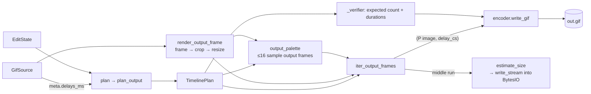
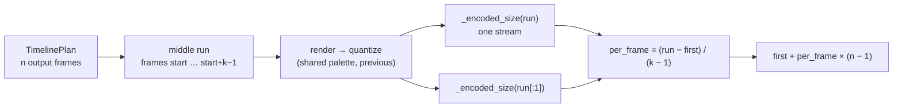

# `src/gif_editor/core/pipeline.py`

> The glue that turns a `GifSource` plus an `EditState` into a summary, preview frames, a written GIF, or a single-frame PNG.

## Where it sits
- **Layer:** core (no Qt)
- **Used by:** `ui/document.py` (`plan`, `summarize`, `Summary`); `ui/main_window.py` (`generate` on a worker, `export_frame_png`, `GenerateResult`); `ui/inspector/preview.py` (`estimate_size` on a worker). `tests/core/test_pipeline.py`, `tests/core/test_estimate.py`.
- **Uses:** `core/decoder.py`, `core/encoder.py` (`write_gif`, `write_stream`, `read_back`), `core/models.py`, `core/render.py`, `core/timeline.py`.

## Public API
| Name | Kind | Purpose |
|---|---|---|
| `Summary(frame_count, duration_ms, width, height, warnings)` | frozen dataclass | What Generate would produce (exact except for the file size). |
| `GenerateResult(path, frame_count, duration_ms, width, height, size_bytes, warnings)` | frozen dataclass | What Generate did produce. |
| `plan(meta, state)` | function | `state.validate(...)` against the source, then `timeline.plan_output(meta.delays_ms, state)` (L62-65). `ValueError` if the state is invalid. |
| `summarize(meta, state)` | function | `plan` + `render.output_dimensions` → `Summary` (L68-71). Cheap; safe on the GUI thread. |
| `render_output_frame(source, src_index, state)` | function | Composited source frame with crop + resize (RGBA). The same crop + resize as Generate (L74-76). (The M3 `PreviewService` calls `render.render_frame` with a crop/size it captured itself, which is the same operation.) |
| `output_palette(source, state, timeline)` | function | One shared `render.Palette` from ≤ 16 evenly spaced **output** frames (L79-91). |
| `iter_output_frames(source, state, timeline, palette=None)` | generator | Lazily yields `("P" image, delay_cs)` for every planned frame (L94-113). |
| `estimate_size(source, state, timeline, *, samples=ESTIMATE_SAMPLES)` | function | Rough output size in bytes, by encoding a short contiguous run of real output frames in memory and extrapolating (L116-163). `0` for an empty plan. |
| `ESTIMATE_SAMPLES` | constant | `5`: length of the run `estimate_size` encodes. |
| `_encoded_size(frames)` | private function | Bytes the real encoder produces for a list of `(P image, delay_cs)`, via `encoder.write_stream` into a `BytesIO` (L166-170). |
| `generate(source, state, out_path, *, progress=None, cancel=None)` | function | Write the edited GIF atomically, verified, and return a `GenerateResult` (L187-224). |
| `export_frame_png(source, index, out_path, state=None)` | function | Save one composited frame as RGBA PNG, original or with crop/resize, atomically (L227-250). |

## How it works

`generate` step by step:
1. `plan(meta, state)` validates the state and builds the timeline. An empty timeline raises `ValueError("nothing to generate: <warnings>")` before any file is touched.
2. `iter_output_frames` (a generator, so frames are produced as the encoder pulls them):
   - builds the shared palette first: it renders ≤ 16 sample output frames and reserves a transparent slot when `source.meta.has_transparency`, so every frame can be mapped;
   - then, for every planned frame: render (crop → resize), `quantize` onto the palette, passing the previous `(rgba, p)` pair so unchanged pixels keep their index (no dither shimmer), and yield `(p, delay_cs)`.
3. `write_gif(..., loop=meta.loop, total=frame_count, progress, cancel, verify=_verifier(timeline))`. The **source's** loop value is kept: `None` (no loop block, plays once) stays `None` (Gate 1 default; review finding 8).
4. `_verifier` reads the temporary file back with Pillow and compares the frame count and every duration with the plan. A mismatch raises `RuntimeError` and the destination stays untouched (review finding 7).
5. Return the `GenerateResult` with the real file size.

`export_frame_png` follows the same pattern: render, save to `.<name>.<uuid>.tmp`, `os.replace`, and delete the temporary file in `finally`. PNG keeps full colour and 8-bit alpha; no quantization.

### `estimate_size` and `_encoded_size`
The summary card shows "Size: ≈ 1.24 MB". The exact size is only known after LZW-compressing every frame, which is what Generate does and can take seconds. `estimate_size` gets close by running the **real** pipeline on a few frames and extrapolating.

Algorithm (`n` = output frame count from the timeline, `k = min(samples, n)`):
1. `n == 0` → return `0` (nothing to write; the UI shows no size line).
2. Pick a **contiguous** run of `k` output frames from the **middle** of the timeline: `start = (n − k) // 2`.
3. Build the same shared palette as Generate (`output_palette`) and pull frames from `iter_output_frames` up to the end of the run, keeping only the run. The frames are rendered, cropped, resized and quantized exactly as Generate does, including the anti-shimmer `previous` link.
4. `run_bytes = _encoded_size(run)`: the whole run encoded as **one** GIF stream.
   `first_bytes = _encoded_size(run[:1])`: the run's first frame alone (header + global table + one full frame + trailer).
5. `per_frame = (run_bytes − first_bytes) / (k − 1)` (clamped at ≥ 0; with `k == 1`, `per_frame = first_bytes`).
6. Return `first_bytes + per_frame × (n − 1)`.

**Why one stream, and why the marginal cost.** The encoder stores every frame after the first as a *difference* from the previous one: only the changed rectangle, with unchanged pixels marked transparent (see [encoder](encoder.md#lossless-difference-frames-_writer-l175-276)). A GIF with a static background and a small moving sprite therefore costs one full first frame plus many tiny frames. Encoding sample frames *one at a time* turns each of them into a full first frame and charges the whole picture again for every frame. The first version did exactly that and **overestimated a static-background GIF by 3.4×**. Encoding the run as one stream gives each later frame its true difference cost, and subtracting the cost of the run's first frame leaves the marginal cost of one more frame. The run is contiguous for the same reason: frames far apart differ more than neighbours, so a spread-out sample would overstate the per-frame difference.

**Why the middle.** The code does not record a reason. The likely one: openings are often unrepresentative (a title card, a fade-in), so the middle is a better guess for "typical" content. It is still a guess: see the accuracy below.

**Measured accuracy (M3, by hand on generated GIFs):** estimate / real = **1.00–1.18** on the photo-like and flat (static background) cases, and **0.67** (an underestimate) on a heavily cropped long case, where five middle frames are a small and unrepresentative sample of a long GIF. One estimate took **4–80 ms**. The UI therefore always labels it "≈ … (estimate)".

`_encoded_size` writes to an `io.BytesIO` through `encoder.write_stream`, the same code path `write_gif` uses for files, so the bytes counted are the bytes Generate would write for those frames, and no file is ever touched (`test_estimate_never_writes_files`).

## Invariants & gotchas
- **What you see is what you get:** the summary, preview and Generate all go through `plan` → `plan_output` and `render_output_frame`. Do not build a second frame selector anywhere.
- `plan()` validates against the source (crop inside the canvas, deleted indices < frame count). `EditState.with_` alone only checks field ranges.
- Palette sample frames are rendered once for the palette and again in the main loop. The decoder's LRU makes the second pass cheap for small GIFs. For huge ones it costs up to 16 extra renders.
- The transparent slot is reserved when the *source* has transparency anywhere, even if the cropped area is opaque. That wastes at most one palette entry.
- `generate` is blocking, CPU-heavy work: run it with `ui/workers.run_async` and pass a `threading.Event` for cancel. `progress` is called from the worker thread.
- `export_frame_png` validates the **whole** state, even though it only uses crop and size.
- **`estimate_size` renders only what it measures.** `iter_output_frames` is a sequential generator (each frame is quantized against the previous one), so iterating the full timeline to reach the middle run would render every frame before it (about half the GIF; this was the first M3 version). Instead the timeline is sliced to the run with `dataclasses.replace(timeline, frames=timeline.frames[start:start+k])`, so only the `k` run frames plus up to 16 palette samples are rendered, whatever the GIF's length (`test_estimate_renders_only_its_sample` counts them). Callers still run it off the GUI thread for very large frames (`PreviewService` does, debounced).
- `estimate_size` takes the `timeline` as an argument instead of planning itself, so the caller can plan once on the GUI thread (where `ValueError` for an invalid state is handled) and pass the result to the worker.
- Its docstring's first paragraph still says "the first frame plus `samples − 1` evenly spaced frames" and "`first + average_per_frame × (count − 1)`"; the code (and the docstring's second paragraph) use a contiguous middle run and the run's own first frame. The code is the truth; this page describes the code.

## Tests
- `tests/core/test_pipeline.py`: identity round trip (count, durations, colours); combined edits match `summarize`/`plan`; FPS resample; invalid states; cancel leaves no output; transparency preserved; loop preserved incl. `None`; verify failure/temp-before-replace; PNG export raw and edited; every valid corpus entry generates a GIF matching its summary; re-save size ≤ 1.5× Pillow's optimized size and zero flicker; output is exactly the quantized frames; transparent moving sprite lossless.
- `tests/core/test_estimate.py` ([page](../../../tests/core/test_estimate.md)): estimate within ×0.5–×2 of the real size (dither on/off) and ×0.4–×1.6 on a 60-frame GIF in < 1.5 s; edits move it the right way; all deleted → 0; only the sample run + palette samples are rendered (counted on a 200-frame GIF); no files written; `write_stream` into a buffer.
- **Gaps:** `progress` values from `generate` other than the cancel test; `output_palette` on an empty timeline (`ValueError`) is not tested; PNG export with an invalid state; the estimate on content whose middle is unrepresentative.

## History
- `f9add66`: written by the orchestrator to wire the M1 modules together.
- `8e7d34c`: shared palette + `previous` (size and flicker fix).
- `f7056d9`: verify before replace, source loop preserved. See [dev log](../../../../04-development-log.md#independent-review--fixes).
- `b9021ca` (M3): `estimate_size` and `_encoded_size`. The first draft measured sample frames individually and overestimated a static-background GIF by 3.4×; it now encodes a contiguous run as one stream and uses the marginal cost. See [dev log, Milestone 3](../../../../04-development-log.md#milestone-3-crop-and-live-preview).
