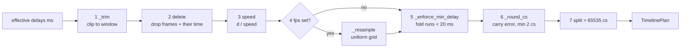

# `src/gif_editor/core/timeline.py`

> The timing engine. It is the only code that decides which source frames appear in the output and how long each one lasts.

## Where it sits
- **Layer:** core (pure Python, stdlib only)
- **Used by:** `core/pipeline.py` (`plan`, `summarize`, `generate` all go through `plan_output`), `ui/document.py` (`Document.plan()` and the `TimelinePlan` type). The M2 timebar and player are expected to use `frame_at_time` / `start_times_ms`.
- **Uses:** `core/models.py` (`EditState`).

## Public API
| Name | Kind | Purpose |
|---|---|---|
| `MIN_DELAY_MS = 20`, `MIN_DELAY_CS = 2`, `MAX_DELAY_CS = 65535`, `ROUNDING_WARN_MS = 5.0` | constants | Timing limits (L55-58). |
| `OutputFrame(src_index, delay_cs)` | frozen dataclass | One output frame: which source frame to show, for how many centiseconds. |
| `TimelinePlan(frames, duration_ms, warnings=())` | frozen dataclass | The plan. `duration_ms == sum(delays_cs) * 10`. Properties: `frame_count`, `src_indices`, `delays_cs`. |
| `plan_output(delays_ms, state)` | function | Build the plan from **effective** source delays and an `EditState` (L218-264). Raises `ValueError` for any delay < 1 ms. Never raises for an empty result: returns an empty plan with a warning instead. |
| `start_times_ms(delays_ms)` | function | Cumulative start time of each source frame. |
| `frame_at_time(delays_ms, t_ms)` | function | Index of the source frame visible at source time `t_ms`, clamped to `[0, n-1]` (binary search). `ValueError` on an empty list. |

## How it works
Input: one delay per source frame in ms, which in practice is `SourceMeta.delays_ms`, i.e. *effective* delays where 0 and 10 ms have already become 100 ms. Working representation: a list of `(src_index, duration_ms)` with float durations, so no rounding happens until step 6.

1. **Trim** (`_trim`, L111-127). The window is `[start, min(start + duration, total))` in **source** time; `duration=None` means "to the end". Every frame that overlaps the window is kept with its **clipped** duration: a frame half-visible at the start becomes shorter, as does the one at the end. The output therefore covers exactly the window. `start ≥ total` gives an empty plan with a "beyond the end" warning. *Why clip instead of dropping partial frames:* dropping lost time and made Duration lie (review finding 4, `e8bcb7e`).
2. **Delete.** Frames whose source index is in `state.deleted` are removed together with their (clipped) time, so the GIF gets shorter. This is a Gate 1 product decision. If nothing survives: empty plan, "All frames in the selection are deleted". Indices that don't exist are ignored here; `EditState.validate` rejects them earlier in the pipeline.
3. **Speed.** Each duration is divided by `state.speed`, in floats.
4. **FPS cap** (`_resample`, L130-151), only when `state.fps` is set. Step `T = 1000 / fps`.
   - If every frame already lasts `≥ T`, the timeline is returned **unchanged**. The cap never slows down or duplicates anything, it only removes frames.
   - Otherwise ticks are placed at `0, T, 2T, …`. Each tick shows the frame visible at that instant. A frame that no tick lands in is dropped. Consecutive ticks on the same frame merge, so every output frame lasts a whole multiple of `T`, and the last one is cut at the total duration.
   - If the final frame is then shorter than `T`, it is merged into the previous frame (unless it is the only one). Result: every frame lasts `≥ T` (except a sole frame), the order is preserved, and the total is exact.
   - Dropping frames here is what the user asked for, so no warning is added.
   - *Why a strict grid:* the first version kept original start times, so the effective frame rate was not actually capped (review finding 1).
5. **Minimum delay** (`_enforce_min_delay`, L154-189). GIF delays below 20 ms are clamped by browsers (see [primer](../../../../05-gif-primer.md#delays-centiseconds-and-browser-clamping)), so a run of short frames is grouped left to right until the group reaches 20 ms. The group's **first** frame is emitted with the group's total time. A short run that never reaches 20 ms is folded into the previous emitted frame, or into the next frame when it is at the very start. A timeline shorter than 20 ms in total becomes one frame. Total time is preserved. A warning reports how many frames were dropped.
6. **Centisecond rounding with error carry** (`_round_cs`, L192-215). Rather than rounding each delay on its own (errors would accumulate), it rounds the **cumulative end time**: `cs[k] = round(end[k]/10) − round(end[k−1]/10)` (round half up via `floor(x + 0.5)`). The total error is therefore always < 10 ms, even over thousands of frames (`test_rounding_never_accumulates`). A delay that would come out below 2 cs is raised to 2 cs and the excess ("debt") is subtracted from the following frames. Debt left at the end is taken back from earlier frames, last to first, never below 2 cs. A warning is added when any frame deviates by more than 5 ms from its exact duration.
7. **GIF max delay** (L252-263). The delay field is 16 bits, so at most 65535 cs (655.35 s). A longer delay is split into the fewest `OutputFrame`s with the **same `src_index`** and near-equal parts. This is the only case where a source frame appears twice. Warning: "Long frame split". (Review finding 5: Generate used to crash on these.)

### Worked example (from `test_combined_pipeline`)
40 frames × 50 ms (2000 ms), trim start 200 ms, duration 1000 ms, delete {4,5,6,7}, speed 2×, fps 10:
- trim → frames 4..23 (1000 ms);
- delete → frames 8..23 (800 ms);
- speed → 25 ms each (400 ms);
- fps 10 → ticks every 100 ms land on frames 8, 12, 16, 20;
- result: `src_indices (8, 12, 16, 20)`, delays 10 cs each, 400 ms.

### Where the plan's timing model maps to code
| `docs/02-plan.md` timing step | Implemented in |
|---|---|
| 1 Trim (source time, window) | `_trim` |
| 2 Delete removes time | `plan_output` L230-234 |
| 3 Speed divides delays | `plan_output` L236-237 |
| 4 FPS resample, cap ≤ 50 and ≤ source rate, drop only | `_resample` (≤ 50 is enforced by `EditState` validation; "≤ source rate" is the early-return when every frame is already ≥ T) |
| 5 Round to cs with carry, min 20 ms, warnings | `_enforce_min_delay` + `_round_cs` |
| 6 Output duration derived | `TimelinePlan.duration_ms` |
| (not in plan) 65535 cs limit | split loop in `plan_output` |

## Invariants & gotchas
- **Single source of truth (AGENTS.md):** nothing else may decide frame selection or delays. Summary, preview and encoder must all call `plan_output` (through `pipeline.plan`).
- Pure and deterministic: the same input gives an equal `TimelinePlan` (`test_deterministic`).
- Output guarantees: every `delay_cs ≥ 2`; `src_indices` strictly increasing except for max-delay splits; `duration_ms == sum(delays_cs) * 10`; `|duration − exact| < 10 ms` when the exact duration is ≥ 20 ms.
- Pass **effective** delays (`meta.delays_ms`), not raw ones. A raw 0 would raise `ValueError`.
- `frame_at_time` / `start_times_ms` work in **source** time and ignore trim, delete and speed. They are for mapping the timebar to source frames, not for output playback.
- Floats use `_EPS = 1e-6` tolerance in comparisons so that, for example, a 41.666… ms frame counts as reaching the 41.666… ms step.
- Performance: two plans of 10 000 frames each in < 50 ms (`test_performance_10k_frames`).
- Warnings are plain English strings intended for the UI summary. At most two appear in the randomized tests.

## Tests
- `tests/core/test_timeline.py` (112 cases): helpers, identity, a trim table (13 cases), delete, speed with frame folding, fps (grids, partial ticks, 30→24 fps, 400 random cases checking the cap), max-delay split, rounding (carry, 2 cs minimum), a combined pipeline, 600 randomized property checks against an independent overlap model, determinism, performance.
- **Gaps:** the "Delays rounded" warning is not asserted directly; the debt back-propagation at the very end of `_round_cs` is only covered indirectly.

## History
- `c06ef17`: first version.
- `e8bcb7e`: a strict FPS grid (the cap actually caps), partial frames kept on trim, over-long delays split. See [dev log, review fixes](../../../../04-development-log.md#independent-review--fixes).
