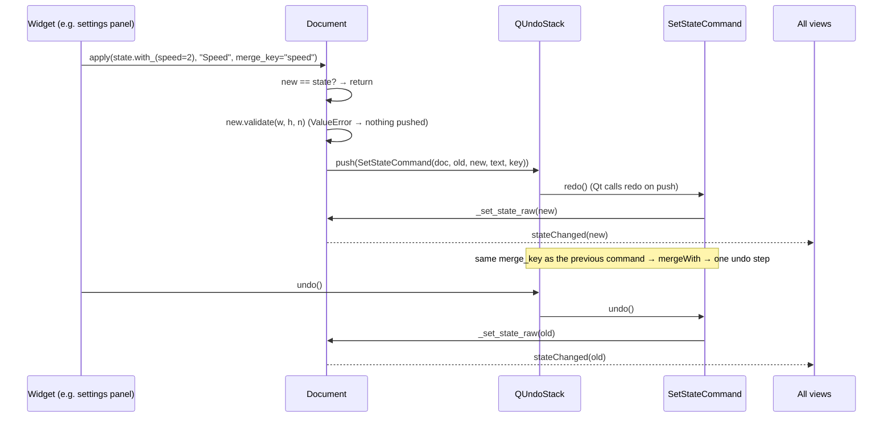

# `src/gif_editor/ui/document.py`

> `Document` is the hub of the UI. It owns the open source, the current `EditState`, the undo stack, the current frame and the selection. Widgets talk only to it.

## Where it sits
- **Layer:** ui (Qt: `QObject`, `Signal`, `QUndoStack`)
- **Used by:** every M2 widget (settings panel, canvas, timebar, filmstrip, transport, player) and `ui/main_window.py` (which creates it); `ui/commands.py` (calls `_set_state_raw`); `tests/ui/conftest.py`, `tests/ui/test_document.py`.
- **Uses:** `core/decoder.py` (`GifSource`, `SourceMeta`), `core/models.py` (`EditState`), `core/pipeline.py` (`plan`, `summarize`, `Summary`), `core/timeline.py` (`TimelinePlan`), `ui/commands.py` (`SetStateCommand`).

## Public API
| Name | Kind | Purpose |
|---|---|---|
| `Document(parent=None)` | QObject | Starts empty: no source, `EditState()`, index 0, empty selection. |
| `source` / `meta` / `path` / `is_open` | properties | The open `GifSource` (or `None`), its `SourceMeta`, its path, and whether one is open. |
| `set_source(source, path)` | method | Adopt an **already opened** source and reset everything: state, index, selection, undo stack. The previous source is closed. Emits all four signals. |
| `close()` | method | Close the source and reset. Emits all four signals, like `set_source`. No-op if nothing is open. |
| `state` | property | The current `EditState`. |
| `apply(new, text, merge_key=None)` | method | **The only way to change the state.** No-op if `new == state`. Validates against the source (`ValueError`, nothing changes), then pushes a `SetStateCommand`. |
| `delete_frames(indices)` | method | Add indices to `deleted` as one undo step ("Delete N frame(s)"). `ValueError` if that would delete every frame. No-op if all were already deleted. |
| `restore_frames(indices)` | method | Remove indices from `deleted` ("Restore N frame(s)"). |
| `set_trim(start_ms, duration_ms, *, merge_key="trim")` | method | Set the trim window. Clamps the start to ≥ 0. By default consecutive calls merge into **one** undo step (meant for spinbox scrubbing; see gotchas). |
| `current_index` / `set_current_index(i)` | property / method | The shared playhead as a **source** frame index. Clamped to `[0, n-1]`; ignored when nothing is open; emits only on change. |
| `selection` / `set_selection(indices)` | property / method | Selected source indices (filmstrip; Delete acts on them). Emits only on change. |
| `plan()` | method | `pipeline.plan(meta, state)` or `None`. |
| `summary()` | method | `pipeline.summarize(meta, state)` or `None`. |
| `frame_start_ms(i)` | method | Source-time start of frame `i` (sum of effective delays before it). Asserts a source is open. |
| `undo_stack` | attribute | `QUndoStack`. Connect Undo/Redo actions to it (`createUndoAction`/`createRedoAction`). |

Signals:
- `sourceChanged()`: a file was opened or closed. Every widget must **fully refresh**.
- `stateChanged(EditState)`: after every apply, undo or redo, and after open/close.
- `currentIndexChanged(int)`: the playhead moved (source index).
- `selectionChanged(frozenset)`: the selection changed.

## How it works

- Widgets never call each other. The filmstrip does not tell the canvas which frame is selected. It calls `doc.set_current_index(i)`, and the canvas reacts to `currentIndexChanged`. This keeps the views consistent and makes undo work from anywhere.
- The current frame and the selection are **view state**, not edits. They are not in `EditState` and not on the undo stack.
- Opening a file is two steps on purpose: `GifSource.open` is slow (it composites every frame), so the caller opens it in a worker (`run_async`) and only then calls `set_source` on the GUI thread.

## Invariants & gotchas
- `_set_state_raw` is private to `SetStateCommand`. Calling it directly bypasses undo.
- `apply` validates only when a source is open. With no source, only `with_`'s field checks have run.
- `set_source` and `close()` emit the same four signals in the same order: `sourceChanged`, `stateChanged(EditState())`, `currentIndexChanged(0)`, `selectionChanged(frozenset())`. A widget that only listens to `currentIndexChanged` (e.g. the transport label) is therefore reset on close too. `currentIndexChanged(0)` fires even if the index was already 0, unlike `set_current_index`, which emits only on change.
- **`set_trim`'s default `merge_key="trim"`** is intended for **spinbox scrubbing** (the settings panel's Start/Duration spins pass `"trim"`), where holding an arrow key should be one undo step. Callers with discrete gestures pass their own key or `None`: the timebar passes a fresh `"trim-drag-N"` per drag (one undo step per drag, never merged with the next drag), and the filmstrip menu and the main window's I/O/Reset actions pass `None` (one step per click). A side effect of the shared `"trim"` key: two separate edits of the Start spin with nothing in between also merge.
- `set_source` closes the *old* source after swapping. A worker still decoding from the old source would then get `ValueError("GifSource is closed")` on a cache miss, so cancel or ignore stale results.
- `set_trim(..., duration_ms=0)` raises `ValueError` from `with_`. Widgets should pass `None` for "to the end".
- `delete_frames` refuses to delete **all** frames, but the trim window plus deletions can still produce an empty plan. `summary().frame_count == 0` and its warnings say why.
- `frame_start_ms` is O(i). Use `timeline.start_times_ms(meta.delays_ms)` once for many lookups.
- Signals carry Python objects (`Signal(object)`). Connect slots on the GUI thread only. `Document` is not thread-safe.

## Tests
- `tests/ui/test_document.py`: open resets everything; apply/undo/redo; no-op apply; an invalid state is rejected without a push; a merge key collapses a gesture; a gesture back to the start is dropped; delete/restore + undo + "cannot delete all"; index clamping + signal; selection signal; `frame_start_ms`; a closed document.
- `tests/ui/test_main_window.py` covers `close()` through the Close action (document closed, actions disabled, title reset) and `set_source` replacing an open source (`test_reopen_replaces_document`).
- **Gaps:** a direct test of the four `close()` signals; that the old source is closed on replace; `restore_frames` no-op.

## History
- `0137178`: written by the orchestrator as the M2 foundation ([dev log, Milestone 2](../../../../04-development-log.md#milestone-2-window-and-inspector)).
- `be70f38`: `close()` now also emits `currentIndexChanged(0)` and `selectionChanged`, so index/selection listeners reset on close (found while integrating the main window).
