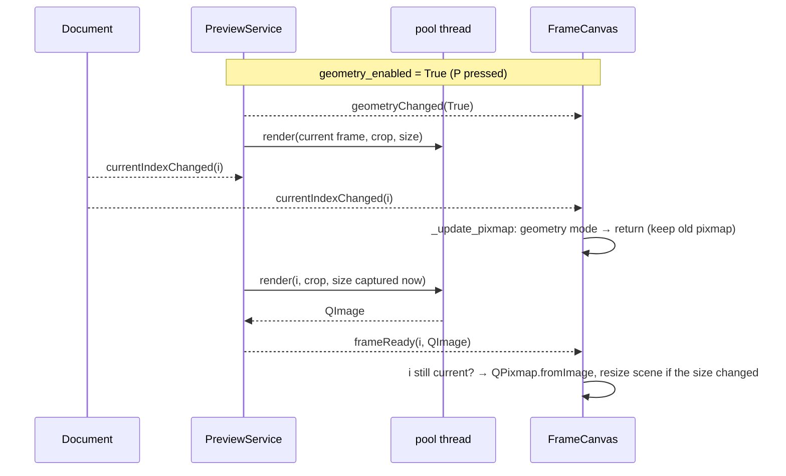

# `src/gif_editor/ui/inspector/canvas.py`

> The zoomable, pannable viewer that shows the current frame in the inspector panel: the source frame normally, or the cropped/resized output frame while "Preview edits" is on.

## Where it sits
- **Layer:** ui (Qt)
- **Used by:** `ui/inspector/inspector.py` (places it in the right panel); `ui/main_window.py` (wires View → Fit / 100% / Zoom in / Zoom out actions to the zoom API, calls `set_preview(self.preview)`, and adds the `CropItem` to `canvas.scene()`).
- **Uses:** `ui/document.py` (`Document`: source, current index, state, signals), `ui/qt_image.py` (`pil_to_qimage`, `checkerboard_brush`). Optionally a `PreviewService` (`ui/inspector/preview.py`), duck-typed: the canvas only uses its `geometry_enabled`, `frameReady` and `geometryChanged` and does not import the module.

## Public API
| Name | Kind | Purpose |
|---|---|---|
| `FrameCanvas(doc, parent=None)` | class (`QGraphicsView`) | The viewer widget. |
| `.image_item` | property → `QGraphicsPixmapItem` | The item showing the frame, at scene (0, 0). Parent your overlays to it. |
| `.zoom` | property → `float` | Current zoom: logical screen px per image px (1.0 = 100%). |
| `.fit_mode` | property → `bool` | True after `zoom_fit()`; False after any manual zoom. |
| `.placeholder_visible` | property → `bool` | True when no GIF is open (the placeholder text is drawn). |
| `.deleted_overlay_visible` | property → `bool` | True when the current frame is in `doc.state.deleted`. |
| `.geometry_preview` | property → `bool` | True while a preview service is attached **and** its `geometry_enabled` is on, i.e. the canvas shows the output frame. |
| `set_preview(preview)` | method | Attach a `PreviewService`: connects its `frameReady` and `geometryChanged`. Call once (the main window does). Without it the canvas behaves exactly as in M2. |
| `zoom_fit()` | method | Fit the whole image into the viewport with a 16 px margin; enter fit mode. |
| `zoom_actual()` | method | 100%. |
| `set_zoom(factor)` | method | Set zoom, clamped to `MIN_ZOOM`=0.05 … `MAX_ZOOM`=32. Leaves fit mode. |
| `zoom_in()` / `zoom_out()` | method | Multiply / divide zoom by `ZOOM_STEP`=1.25. |
| `image_rect() -> QRectF` | method | Bounds of the shown image in scene coords: the **source canvas** `QRectF(0, 0, W, H)` normally, the **output frame** size in geometry-preview mode; empty when nothing is open. |
| `map_to_image(view_pos) -> QPointF` | method | Viewport position (QPoint or QPointF, logical px) → image pixel coords. Not clamped: may lie outside the image. |
| `MIN_ZOOM`, `MAX_ZOOM`, `ZOOM_STEP`, `FIT_MARGIN`, `PLACEHOLDER_TEXT`, `DELETED_TINT` | constants | Tunables used above. |

Signals: `zoomChanged(float)`: fires whenever the effective (clamped) zoom changes, including fit-to-window on load or resize. It does not fire when the zoom is set to the value it already has.

## How it works

### Qt background for newcomers
A `QGraphicsView` is a scrollable window onto a `QGraphicsScene`. The scene holds
*items* (here, one pixmap item) in its own coordinate system. The view has a
*transform* (here, a uniform scale) that maps scene coordinates to the screen. Zooming
just changes that transform, and the scrollbars appear by themselves when the scaled
scene is bigger than the viewport (the visible inner area of the view).

### Coordinates: scene = image pixels
The scene rect is set to exactly `image_rect()` and the pixmap item sits at (0, 0)
unscaled, so **scene point (x, y) is source pixel (x, y)**. This is the key design
choice. Every overlay, hit test and crop calculation can then work in source pixels
with no zoom maths, and HiDPI scaling is entirely Qt's job.

### Showing a frame
1. `doc.currentIndexChanged` → `_update_pixmap()`.
2. It calls `doc.source.frame(i)` (a Pillow RGBA image), converts it with
   `pil_to_qimage`, then `QPixmap.fromImage`. It runs on the GUI thread, which is the
   only thread allowed to create QPixmaps.
3. This is **synchronous on purpose**. `GifSource` caches composited frames, and when
   the whole GIF fits in the cache budget the decoder composites them eagerly at open,
   so a fetch is usually a cache hit plus a byte copy. Very large GIFs can miss the
   cache, and a backwards seek then re-composites from a keyframe. M3/M4 may move the
   fetch off-thread (`run_async`, then convert to a pixmap in `on_done`) and show the
   filmstrip thumbnail in the meantime.

### Geometry-preview mode (M3)
"Preview edits" (P) previews the whole output: the `Player` plays the output timing, and the canvas shows each frame **as Generate will write it**, cropped and then resized. The canvas does not render that itself. `PreviewService` renders it on the thread pool and hands back a `QImage`.



- **`set_preview(preview)`** stores the service and connects `frameReady → _on_preview_frame` and `geometryChanged → _on_geometry_changed`.
- **`geometry_preview`** is derived (`preview is not None and preview.geometry_enabled`), never stored, so it cannot disagree with the service.
- **`_on_preview_frame(index, image)`** ignores the image unless geometry mode is on **and** `index == doc.current_index`. A late frame from an earlier playhead position is dropped, so fast scrubbing never shows a stale frame. Otherwise it builds the `QPixmap` (GUI thread, as required) and, if the pixmap size changed, calls `_resize_scene()` (new scene rect, re-fit in fit mode).
- **`_on_geometry_changed(enabled)`**: when geometry turns **off**, it immediately re-reads the source frame and resizes the scene back to the source canvas. When it turns **on** it does nothing: the service requests the current frame itself and the result arrives via `frameReady`.
- **`image_rect()` returns the OUTPUT size in this mode** (the size of the pixmap on screen). The scene rect, the checkerboard, `zoom_fit` and the deleted overlay all use `image_rect()`, so they wrap the image actually shown. The scene is then *output* pixels, not source pixels.

**Why the canvas does not request frames itself in this mode.** `PreviewService` already listens to `Document.currentIndexChanged` and calls `request_frame` while geometry is on. An earlier wiring also requested from the canvas's own `_on_current_changed`, which rendered **every frame twice**. Now `_update_pixmap` simply returns in geometry mode, keeping the previous pixmap until the new one arrives, so there is no flash of the uncropped frame either.

**Why the crop rectangle must hide in this mode.** `CropItem` works in *source* pixels (scene = source image). In geometry mode the scene is the already-cropped, resized output image, so a source-pixel rectangle would be drawn in the wrong place and at the wrong scale, and dragging it would write nonsense crops. The main window hides it (`_update_crop_tool`: tool enabled only if the action is checked **and** `not preview.geometry_enabled`). The canvas itself knows nothing about the crop item.

### On `sourceChanged`
A GIF was opened or closed. The canvas re-fetches the pixmap (or clears it), resets the
scene rect and returns to fit mode, so a freshly loaded GIF is always fully visible.
When nothing is open, the zoom resets to 1.0.

### Painting layers (back to front)
1. `drawBackground`: the whole viewport is filled with the palette's `Window` colour,
   darkened (`darker(150)`). Then the image's on-screen rectangle is filled with the
   checkerboard, so transparent pixels are visible. The painter's transform is reset
   first, so the checker cells stay 8 logical px whatever the zoom. That is why
   `ViewportUpdateMode` is `FullViewportUpdate`: Qt's default scroll optimisation would
   copy ("blit") already-painted pixels when you scroll, and a viewport-aligned pattern
   would then tear.
2. The pixmap item. Its `transformationMode` is `SmoothTransformation` when zoom < 1
   (filtering avoids aliasing when shrinking) and `FastTransformation`
   (nearest-neighbour) when zoom ≥ 1, so enlarged pixels stay crisp squares. That
   matters for pixel art and for placing a crop exactly.
3. `drawForeground`: with no source, the centred placeholder
   *"Open a GIF (Ctrl+O) or drop it here"* is drawn. If the current frame is deleted,
   a semi-transparent red tint covers the image and a red "Deleted" badge is drawn in
   the top-left of the visible part of the image. `doc.stateChanged` triggers a
   repaint, so deleting, restoring and undo all update it immediately.

### Zoom
`_apply_zoom` clamps the factor, calls `setTransform(QTransform.fromScale(z, z))`,
updates the transformation mode and emits `zoomChanged` if the value changed.
`setTransform` respects `transformationAnchor`. Normally that is `AnchorViewCenter`.
For Ctrl+wheel it is switched to `AnchorUnderMouse` for the duration of the call, so
the pixel under the cursor stays put. One wheel notch (120 units of `angleDelta`) is
one 1.25× step, and high-resolution touchpads give fractional steps. A plain wheel goes
to the base class, which scrolls.

`fit_mode` is a remembered intent. While it is True, `resizeEvent` re-fits, so the image
follows the splitter or window size. Any manual zoom (`set_zoom`, `zoom_in/out`,
`zoom_actual`, Ctrl+wheel) clears it.

### Panning
Qt's built-in `ScrollHandDrag` drag mode pans with the **left** button. Two ways to use it:
- **Space + left-drag:** pressing Space (not an auto-repeat) turns on
  `ScrollHandDrag`, and releasing it turns it off. Losing focus while Space is held also
  ends it, so the mode can't get stuck.
- **Middle-drag:** a middle press turns on `ScrollHandDrag` and is re-issued to the
  base class as a *left* press. Moves and the release are re-issued the same way.

While panning, `setInteractive(False)` stops scene items from receiving the mouse
events. A middle- or space-drag over the future crop rectangle must pan, not move the
crop. Hand-drag still works in non-interactive mode because `QGraphicsView` handles it
itself.

### Drag-and-drop
The canvas calls `setAcceptDrops(False)` on itself **and on its viewport**.
`QGraphicsView` accepts drops on its viewport by default, which would swallow file
drops meant for the main window. With both refusing, Qt delivers the drag to the first
ancestor that accepts drops (the main window).

### Overlays: the crop rectangle (M3)
The real overlay is `CropItem` ([page](crop_item.md)). It is hosted by the **main window**, not by `FrameCanvas`:
```python
# ui/main_window.py
self.crop_item = CropItem(self.doc)
self.inspector.canvas.scene().addItem(self.crop_item)  # at (0, 0): item coords == image px
```
The canvas has no reference to it and no crop code. Rules for any overlay:
- Add it to `canvas.scene()` at (0, 0), or parent it to `canvas.image_item`; the
  coordinates are the same. It then pans and zooms with the image for free.
- Use **cosmetic pens** (`pen.setCosmetic(True)`) so outlines stay 1 logical px at any
  zoom. For handles of constant screen size, set
  `QGraphicsItem.ItemIgnoresTransformations` on the handle items.
- To convert a mouse position from a view event, use `canvas.map_to_image(pos)`. Item
  events already have `event.pos()` / `event.scenePos()` in image pixels. Round and
  clamp to `image_rect()` before building a `CropRect`.
- Write to `Document` once, on mouse **release**, with a per-drag merge key. `CropItem` uses `"crop-drag-N"` (N grows on every press) so one drag is one undo step and never merges with the next drag or with the crop panel's spinbox key `"crop"`.
- Keyboard crop editing is **not** routed through `FrameCanvas.keyPressEvent`. Nudge and resize are window actions (Crop menu) on **Ctrl+arrows** and **Ctrl+Shift+arrows** that call `CropItem.nudge`/`resize`; plain arrows stay frame stepping.
- An overlay that works in source pixels must hide in geometry-preview mode (above).
- If the dimmed outside area is painted in `drawForeground` instead, override it in a
  subclass and call `super().drawForeground` first, so the deleted overlay still shows.

## Invariants & gotchas
- Scene coordinates are image pixels: **source** pixels normally, **output** pixels in geometry-preview mode. Never scale or move `image_item`; zoom only through the view transform.
- Talks only to `Document` and never modifies it (display-only widget).
- QPixmaps are created only here on the GUI thread. The preview service hands over a `QImage` (`frameReady`), converted in `_on_preview_frame`.
- `set_preview` connects signals each time it is called; call it once per service.
- `zoom_fit()` is a no-op (apart from setting `fit_mode`) while the viewport has no usable size. The first real `resizeEvent` then performs the fit.
- `zoomChanged` reports the *clamped* value.
- **Space conflict (known limitation):** the main window binds Space to play/pause with a window-wide `QAction`. Window shortcuts are matched before the focused widget's `keyPressEvent`, so inside the app Space toggles playback and **Space+drag does not pan**; use **middle-drag**, which always works. Space+drag still works when the canvas is used on its own (as in `test_canvas.py`). See [main_window](../main_window.md#invariants--gotchas).
- `Window.darker(150)` follows the Fusion palette, so a dark palette gives a darker surround automatically.

## Tests
- `tests/ui/test_canvas.py`: frame pixels after an index change; accessibility name and drop refusal; fit on load, fit geometry and re-fit on resize; `zoom_actual`, clamping, steps and `zoomChanged`; `fit_mode` flipping; transformation mode around 1.0; deleted-overlay state, including undo; empty-document placeholder; clearing on `close()`; `map_to_image` at 1× and 2×; Ctrl+wheel vs plain wheel; Space and middle-drag hand-drag; an actual middle-drag pan.
- `tests/ui/test_m3_integration.py` ([page](../../../../tests/ui/test_m3_integration.md)): geometry mode shows the output-size frame, `image_rect()` is the output size, it follows the playhead and crop edits/undo, and turning it off restores the source frame immediately.
- Gaps: pixel-level checks of the painted overlay, badge and checkerboard (only checked for crash-free painting); real HiDPI scale factors (M4).

## History
- M2: created. Synchronous frame fetch relying on `GifSource`'s cache. Scene = image-pixel coordinates chosen so the M3 crop overlay needs no zoom maths.
- `3adb5bd` (M3): geometry-preview mode (`set_preview`, `geometry_preview`, `_on_preview_frame`, `_on_geometry_changed`, `_resize_scene`); `image_rect()` follows the shown image. The canvas stopped requesting preview frames itself after that rendered every frame twice. See [dev log, Milestone 3](../../../../../04-development-log.md#milestone-3-crop-and-live-preview).
