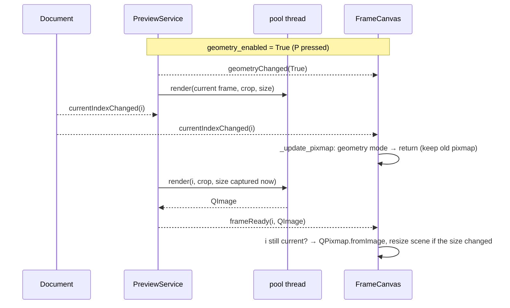

# `src/gif_editor/ui/inspector/canvas.py`

> The zoomable, pannable viewer that shows the current frame in the inspector panel: the source frame normally, or the cropped/resized output frame while "Preview edits" is on.

## Where it sits
- **Layer:** ui (Qt)
- **Used by:** `ui/inspector/inspector.py` (places it in the right panel); `ui/main_window.py` (wires View → Fit / 100% / Zoom in / Zoom out actions to the zoom API, calls `set_preview(self.preview)`, and adds the `CropItem` to `canvas.scene()`).
- **Uses:** `ui/document.py` (`Document`: source, current index, state, signals), `ui/qt_image.py` (`pil_to_qimage`, `checkerboard_brush`). Optionally a `PreviewService` (`ui/inspector/preview.py`), duck-typed: the canvas only uses its `geometry_enabled`, `request_frame`, `frameReady` and `geometryChanged` and does not import the module. `GifSource.frames_to_decode` (core) to decide whether a frame is cheap enough for the GUI thread.

## Public API
| Name | Kind | Purpose |
|---|---|---|
| `FrameCanvas(doc, parent=None)` | class (`QGraphicsView`) | The viewer widget. |
| `.image_item` | property → `QGraphicsPixmapItem` | The item showing the frame, at scene (0, 0). Parent your overlays to it. |
| `.zoom` | property → `float` | Current zoom: logical screen px per image px (1.0 = 100%). |
| `.fit_mode` | property → `bool` | True after `zoom_fit()`; False after any manual zoom. |
| `.placeholder_visible` | property → `bool` | True when no GIF is open (the placeholder text is drawn). |
| `.deleted_overlay_visible` | property → `bool` | True when the current frame is in `doc.state.deleted`. |
| `.geometry_preview` | property → `bool` | True while a preview service is attached **and** its `geometry_enabled` is on, i.e. the canvas shows the output frame. |
| `set_preview(preview)` | method | Attach a `PreviewService`: connects its `frameReady` and `geometryChanged`. Call once (the main window does). Without it the canvas behaves exactly as in M2. |
| `zoom_fit()` | method | Fit the whole image into the viewport with a 16 px margin; enter fit mode. |
| `zoom_actual()` | method | 100%. |
| `set_zoom(factor)` | method | Set zoom, clamped to `MIN_ZOOM`=0.05 … `MAX_ZOOM`=32. Leaves fit mode. |
| `zoom_in()` / `zoom_out()` | method | Multiply / divide zoom by `ZOOM_STEP`=1.25. |
| `image_rect() -> QRectF` | method | Bounds of the shown image in scene coords: the **source canvas** `QRectF(0, 0, W, H)` normally, the **output frame** size in geometry-preview mode; empty when nothing is open. |
| `map_to_image(view_pos) -> QPointF` | method | Viewport position (QPoint or QPointF, logical px) → image pixel coords. Not clamped: may lie outside the image. |
| `MIN_ZOOM`, `MAX_ZOOM`, `ZOOM_STEP`, `FIT_MARGIN`, `PLACEHOLDER_TEXT`, `DELETED_TINT` | constants | Tunables used above. |
| `SYNC_DECODE_PIXELS = 4_000_000` | constant (M4) | Above this much compositing work (`frames_to_decode(i)` × canvas pixels, about 25 ms of decoding) a source frame is rendered in the background instead of on the GUI thread. |

Signals:
- `zoomChanged(float)`: fires whenever the effective (clamped) zoom changes, including fit-to-window on load or resize. It does not fire when the zoom is set to the value it already has.
- `spaceTapped()` (M4): Space was pressed and released over the canvas **without** a mouse press in between. The canvas takes Space away from the window's play/pause shortcut (so Space+drag can pan); the main window connects this signal to `player.toggle`, so a plain tap still plays and pauses.

## How it works

### Qt background for newcomers
A `QGraphicsView` is a scrollable window onto a `QGraphicsScene`. The scene holds
*items* (here, one pixmap item) in its own coordinate system. The view has a
*transform* (here, a uniform scale) that maps scene coordinates to the screen. Zooming
just changes that transform, and the scrollbars appear by themselves when the scaled
scene is bigger than the viewport (the visible inner area of the view).

### Coordinates: scene = image pixels
The scene rect is set to exactly `image_rect()` and the pixmap item sits at (0, 0)
unscaled, so **scene point (x, y) is source pixel (x, y)**. This is the key design
choice. Every overlay, hit test and crop calculation can then work in source pixels
with no zoom maths, and HiDPI scaling is entirely Qt's job.

### Showing a frame
1. `doc.currentIndexChanged` → `_update_pixmap()`.
2. In geometry-preview mode it returns at once (next section). Otherwise it asks the
   decoder what the frame would cost: `cost = source.frames_to_decode(i) × W × H`.
3. **Cheap** (`cost ≤ SYNC_DECODE_PIXELS`, or no preview service attached): it calls
   `doc.source.frame(i)` (a Pillow RGBA image), converts it with `pil_to_qimage`, then
   `QPixmap.fromImage`, all on the GUI thread, which is the only thread allowed to create
   QPixmaps. This covers almost everything: `GifSource` caches composited frames (when the
   whole GIF fits in the cache budget it composites them all at open), and during playback
   the next frame costs 1. Stepping and playing therefore show the frame immediately.
4. **Expensive**: the frame goes off-thread (next section). The old pixmap stays up.

### Async source frames (M4)
*The problem:* the stress probe ([page](../../../../scripts/stress_probe.md)) scrubbed
backwards through a 1920×1080×200 GIF, which is bigger than the decoder's 512 MiB cache.
Each step re-composited up to ~30 full frames from a checkpoint **on the GUI thread**:
worst stall 384 ms, 10 stalls over 100 ms. The window froze while scrubbing.

*The fix* (`5c40830`): above `SYNC_DECODE_PIXELS` the canvas sets
`_awaiting_source = i` and calls `preview.request_frame(i)`. With geometry off, the
`PreviewService` renders the **plain source frame** (no crop, no resize) on the pool and
emits `frameReady(i, QImage)`; at most one render runs at a time and only the latest
pending index is kept (latest request wins), so fast scrubbing never queues dozens of
decodes. `_on_preview_frame` accepts the image in non-geometry mode only if
`i == _awaiting_source` **and** `i` is still the current index, then clears
`_awaiting_source`. A cheap frame shown in the meantime also clears it, so a late
expensive frame cannot overwrite a newer one.

*Why `frames_to_decode` must not block:* the first version still stalled **643 ms**,
because `frames_to_decode` waited for the decoder lock, and the lock was held by the very
background render the canvas had just requested. It now returns `GifSource.BUSY` (a huge
cost) when the lock is taken, so "someone is decoding" means "go asynchronous". Result:
worst stall **28 ms**, none over 100 ms. See the
[decoder page](../../core/decoder.md#frames_to_decode-and-busy).

*Why 4,000,000:* it is roughly 25 ms of compositing (frames × pixels), comfortably above
"one 1080p frame" (2.07 Mpx: the next frame during playback stays synchronous) and below
the point where a stall becomes visible. Small GIFs never reach it.

### Geometry-preview mode (M3)
"Preview edits" (P) previews the whole output: the `Player` plays the output timing, and the canvas shows each frame **as Generate will write it**, cropped and then resized. The canvas does not render that itself. `PreviewService` renders it on the thread pool and hands back a `QImage`.



- **`set_preview(preview)`** stores the service and connects `frameReady → _on_preview_frame` and `geometryChanged → _on_geometry_changed`.
- **`geometry_preview`** is derived (`preview is not None and preview.geometry_enabled`), never stored, so it cannot disagree with the service.
- **`_on_preview_frame(index, image)`** ignores the image unless `index == doc.current_index` **and** either geometry mode is on or `index` is the source frame it is waiting for (`_awaiting_source`, previous section). A late frame from an earlier playhead position is dropped, so fast scrubbing never shows a stale frame. Otherwise it builds the `QPixmap` (GUI thread, as required) and, if the pixmap size changed, calls `_resize_scene()` (new scene rect, re-fit in fit mode).
- **`_on_geometry_changed(enabled)`**: when geometry turns **off**, it immediately calls `_update_pixmap()` (synchronous for a cheap frame, otherwise a background request as above) and resizes the scene back to the source canvas. When it turns **on** it does nothing: the service requests the current frame itself and the result arrives via `frameReady`.
- **`image_rect()` returns the OUTPUT size in this mode** (the size of the pixmap on screen). The scene rect, the checkerboard, `zoom_fit` and the deleted overlay all use `image_rect()`, so they wrap the image actually shown. The scene is then *output* pixels, not source pixels.

**Why the canvas does not request frames itself in this mode.** `PreviewService` already listens to `Document.currentIndexChanged` and calls `request_frame` while geometry is on. An earlier wiring also requested from the canvas's own `_on_current_changed`, which rendered **every frame twice**. Now `_update_pixmap` simply returns in geometry mode, keeping the previous pixmap until the new one arrives, so there is no flash of the uncropped frame either.

**Why the crop rectangle must hide in this mode.** `CropItem` works in *source* pixels (scene = source image). In geometry mode the scene is the already-cropped, resized output image, so a source-pixel rectangle would be drawn in the wrong place and at the wrong scale, and dragging it would write nonsense crops. The main window hides it (`_update_crop_tool`: tool enabled only if the action is checked **and** `not preview.geometry_enabled`). The canvas itself knows nothing about the crop item.

### On `sourceChanged`
A GIF was opened or closed. The canvas re-fetches the pixmap (or clears it), resets the
scene rect and returns to fit mode, so a freshly loaded GIF is always fully visible.
When nothing is open, the zoom resets to 1.0.

### Painting layers (back to front)
1. `drawBackground`: the whole viewport is filled with the palette's `Window` colour,
   darkened (`darker(150)`). Then the image's on-screen rectangle is filled with the
   checkerboard, so transparent pixels are visible. The painter's transform is reset
   first, so the checker cells stay 8 logical px whatever the zoom. That is why
   `ViewportUpdateMode` is `FullViewportUpdate`: Qt's default scroll optimisation would
   copy ("blit") already-painted pixels when you scroll, and a viewport-aligned pattern
   would then tear.
2. The pixmap item. Its `transformationMode` is `SmoothTransformation` when zoom < 1
   (filtering avoids aliasing when shrinking) and `FastTransformation`
   (nearest-neighbour) when zoom ≥ 1, so enlarged pixels stay crisp squares. That
   matters for pixel art and for placing a crop exactly.
3. `drawForeground`: with no source, the centred placeholder
   *"Open a GIF (Ctrl+O) or drop it here"* is drawn. If the current frame is deleted,
   a semi-transparent red tint covers the image and a red "Deleted" badge is drawn in
   the top-left of the visible part of the image. `doc.stateChanged` triggers a
   repaint, so deleting, restoring and undo all update it immediately.

### Zoom
`_apply_zoom` clamps the factor, calls `setTransform(QTransform.fromScale(z, z))`,
updates the transformation mode and emits `zoomChanged` if the value changed.
`setTransform` respects `transformationAnchor`. Normally that is `AnchorViewCenter`.
For Ctrl+wheel it is switched to `AnchorUnderMouse` for the duration of the call, so
the pixel under the cursor stays put. One wheel notch (120 units of `angleDelta`) is
one 1.25× step, and high-resolution touchpads give fractional steps. A plain wheel goes
to the base class, which scrolls.

`fit_mode` is a remembered intent. While it is True, `resizeEvent` re-fits, so the image
follows the splitter or window size. Any manual zoom (`set_zoom`, `zoom_in/out`,
`zoom_actual`, Ctrl+wheel) clears it.

### Panning
Qt's built-in `ScrollHandDrag` drag mode pans with the **left** button. Two ways to use it:
- **Space + left-drag:** pressing Space (not an auto-repeat) turns on
  `ScrollHandDrag`, and releasing it turns it off. Losing focus while Space is held also
  ends it, so the mode can't get stuck.
- **How the canvas gets Space at all (M4, `0b07218`).** The main window binds Space to
  play/pause with a window-wide `QAction`. Before Qt fires a shortcut it sends the focused
  widget a `ShortcutOverride` event; if the widget accepts it, the key is delivered to the
  widget as a normal key press and the shortcut does not fire. `FrameCanvas.event()`
  accepts `ShortcutOverride` for **plain Space** (no modifiers) **while a file is open**.
  Until M4 nothing claimed it, so the window shortcut ate every Space press and Space+drag
  could never start.
- **A tap still plays.** `keyPressEvent` sets `_space_held` and clears `_space_dragged`;
  any mouse press while Space is held sets `_space_dragged`. On release, if Space was held
  and no mouse button went down, the canvas emits `spaceTapped`, which the main window
  connects to `player.toggle`. So: Space tap = play/pause, Space+drag = pan without
  toggling playback. When another widget has focus (filmstrip, timebar…), the window
  shortcut still handles Space as before. With no file open the canvas does not claim Space.
- **Middle-drag:** a middle press turns on `ScrollHandDrag` and is re-issued to the
  base class as a *left* press. Moves and the release are re-issued the same way.

While panning, `setInteractive(False)` stops scene items from receiving the mouse
events. A middle- or space-drag over the future crop rectangle must pan, not move the
crop. Hand-drag still works in non-interactive mode because `QGraphicsView` handles it
itself.

### Drag-and-drop
The canvas calls `setAcceptDrops(False)` on itself **and on its viewport**.
`QGraphicsView` accepts drops on its viewport by default, which would swallow file
drops meant for the main window. With both refusing, Qt delivers the drag to the first
ancestor that accepts drops (the main window).

### Overlays: the crop rectangle (M3)
The real overlay is `CropItem` ([page](crop_item.md)). It is hosted by the **main window**, not by `FrameCanvas`:
```python
# ui/main_window.py
self.crop_item = CropItem(self.doc)
self.inspector.canvas.scene().addItem(self.crop_item)  # at (0, 0): item coords == image px
```
The canvas has no reference to it and no crop code. Rules for any overlay:
- Add it to `canvas.scene()` at (0, 0), or parent it to `canvas.image_item`; the
  coordinates are the same. It then pans and zooms with the image for free.
- Use **cosmetic pens** (`pen.setCosmetic(True)`) so outlines stay 1 logical px at any
  zoom. For handles of constant screen size, set
  `QGraphicsItem.ItemIgnoresTransformations` on the handle items.
- To convert a mouse position from a view event, use `canvas.map_to_image(pos)`. Item
  events already have `event.pos()` / `event.scenePos()` in image pixels. Round and
  clamp to `image_rect()` before building a `CropRect`.
- Write to `Document` once, on mouse **release**, with a per-drag merge key. `CropItem` uses `"crop-drag-N"` (N grows on every press) so one drag is one undo step and never merges with the next drag or with the crop panel's spinbox key `"crop"`.
- Keyboard crop editing is **not** routed through `FrameCanvas.keyPressEvent`. Nudge and resize are window actions (Crop menu) on **Ctrl+arrows** and **Ctrl+Shift+arrows** that call `CropItem.nudge`/`resize`; plain arrows stay frame stepping.
- An overlay that works in source pixels must hide in geometry-preview mode (above).
- If the dimmed outside area is painted in `drawForeground` instead, override it in a
  subclass and call `super().drawForeground` first, so the deleted overlay still shows.

## Invariants & gotchas
- Scene coordinates are image pixels: **source** pixels normally, **output** pixels in geometry-preview mode. Never scale or move `image_item`; zoom only through the view transform.
- Talks only to `Document` and never modifies it (display-only widget).
- QPixmaps are created only here on the GUI thread. The preview service hands over a `QImage` (`frameReady`), converted in `_on_preview_frame`.
- `set_preview` connects signals each time it is called; call it once per service.
- `zoom_fit()` is a no-op (apart from setting `fit_mode`) while the viewport has no usable size. The first real `resizeEvent` then performs the fit.
- `zoomChanged` reports the *clamped* value.
- **Space and the window shortcut:** the canvas accepts the `ShortcutOverride` for plain Space while a file is open, so the window's play/pause action never sees Space while the canvas has focus; the canvas re-emits a tap as `spaceTapped`. Anyone embedding `FrameCanvas` elsewhere must connect `spaceTapped` or Space will do nothing but pan. (Until M4 this was a known limitation: Space+drag did not pan inside the app.)
- **Async source frames:** while `_awaiting_source` is set the canvas still shows the previous frame; if the render fails (`frameFailed`) it keeps showing it. Only frames requested by the canvas itself are accepted in non-geometry mode.
- `frames_to_decode` is a snapshot; the cost may change before `frame(i)` runs. That only matters for a borderline frame and never blocks for long.
- `Window.darker(150)` follows the Fusion palette, so a dark palette gives a darker surround automatically.

## Tests
- `tests/ui/test_canvas.py`: frame pixels after an index change; accessibility name and drop refusal; fit on load, fit geometry and re-fit on resize; `zoom_actual`, clamping, steps and `zoomChanged`; `fit_mode` flipping; transformation mode around 1.0; deleted-overlay state, including undo; empty-document placeholder; clearing on `close()`; `map_to_image` at 1× and 2×; Ctrl+wheel vs plain wheel; Space and middle-drag hand-drag; an actual middle-drag pan; (M4) an expensive frame (tiny `SYNC_DECODE_PIXELS`, no cache) is decoded only on a pool thread, `_awaiting_source` is set until it arrives with the right pixels, and the next frame in sequence is decoded synchronously on the GUI thread.
- `tests/ui/test_m3_integration.py` ([page](../../../../tests/ui/test_m3_integration.md)): geometry mode shows the output-size frame, `image_rect()` is the output size, it follows the playhead and crop edits/undo, and turning it off restores the source frame immediately.
- `tests/ui/test_main_window.py` (M4): Space tap on the canvas plays and pauses; Space+drag on a zoomed canvas pans and does **not** start playback (this test fails with the `ShortcutOverride` fix disabled); Space with the filmstrip focused still plays.
- HiDPI: the whole file also runs at 150 % and 200 % via `scripts/test-hidpi.sh`.
- Gaps: pixel-level checks of the painted overlay, badge and checkerboard (only checked for crash-free painting); `frameFailed` while awaiting a source frame.

## History
- M2: created. Synchronous frame fetch relying on `GifSource`'s cache. Scene = image-pixel coordinates chosen so the M3 crop overlay needs no zoom maths.
- `3adb5bd` (M3): geometry-preview mode (`set_preview`, `geometry_preview`, `_on_preview_frame`, `_on_geometry_changed`, `_resize_scene`); `image_rect()` follows the shown image. The canvas stopped requesting preview frames itself after that rendered every frame twice. See [dev log, Milestone 3](../../../../../04-development-log.md#milestone-3-crop-and-live-preview).
- `0b07218` (M4): Space+drag pans inside the app (`event()` claims the `ShortcutOverride`), `spaceTapped` for play/pause.
- `5c40830` (M4): expensive source frames render off the GUI thread (`SYNC_DECODE_PIXELS`, `_awaiting_source`); scrub stall on a 1080p GIF 384 ms → 28 ms. See [dev log, Milestone 4](../../../../../04-development-log.md#milestone-4-hardening).
