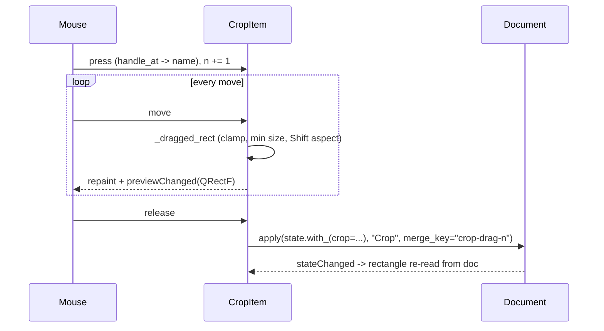

# `src/gif_editor/ui/inspector/crop_item.py`

> The interactive crop rectangle drawn over the frame canvas: drag to move, drag one of 8 handles to resize, with the outside dimmed. It keeps `doc.state.crop` and the picture in sync.

## Where it sits
- **Layer:** ui (Qt)
- **Used by:** `ui/main_window.py`, which creates it and adds it to the canvas scene (`canvas.scene().addItem(...)`; `FrameCanvas` itself has no crop code), calls `activate()`, `reset()`, `nudge()`, `resize()`, `set_tool_enabled()`, and listens to `cropActiveChanged` and `previewChanged`.
- **Uses:** `ui/document.py` (`Document`: `state`, `apply`, `meta`, `is_open`, `sourceChanged`, `stateChanged`), `core/models.py` (`CropRect`). It never imports `crop_panel.py`; the two meet only through `doc.state.crop`.

## Public API
| Name | Kind | Purpose |
|---|---|---|
| `CropItem(doc: Document, parent: QGraphicsItem \| None = None)` | class (`QGraphicsObject`) | The overlay. Add it to the canvas scene at (0, 0) (or parent it to `canvas.image_item`). |
| `.crop_active -> bool` | property | `doc.state.crop is not None` (False with no file). Not named `active`/`isActive`: `QGraphicsItem.isActive()` already exists and means Qt focus activation. |
| `.tool_enabled -> bool` | property | Whether the crop tool is on. |
| `.dragging -> bool` | property | True between a press on the rectangle and its release. |
| `.crop_rect() -> QRect` | method | The rectangle shown right now, integer image pixels (live during a drag). |
| `.image_size() -> tuple[int, int]` | method | Source canvas size, `(0, 0)` with no file. |
| `.handle_at(scene_pos: QPointF) -> str \| None` | method | `'tl','t','tr','r','br','b','bl','l'`, `'move'` (interior) or `None`. |
| `.nudge(dx: int, dy: int) -> None` | method | Move the crop by whole pixels, clamped; one undo step. |
| `.resize(dw: int, dh: int) -> None` | method | Grow/shrink the right/bottom edges, clamped, min 1 px; one undo step. |
| `.activate() -> None` | method | No crop yet → crop 10 % inside each edge (one undo step). |
| `.reset() -> None` | method | `crop=None` (one undo step). |
| `.set_tool_enabled(enabled: bool) -> None` | method | Off = hidden and deaf to the mouse; abandons a running drag. |
| `CURSORS`, `HANDLE_PX`, `HANDLE_HIT_PX`, `MIN_DRAG_SIZE`, `DIM_COLOR`, `TIMES` | module constants | Cursor per part, 9-px handle, 13-px hit square, 8-px drag minimum, 50 % black, `×`. |

Signals (Qt files):
- `previewChanged(QRectF)`: on every pointer move that changes the rectangle during a drag (image px). Nothing is written to the Document at that moment.
- `cropActiveChanged(bool)`: when `doc.state.crop` switches between `None` and a rectangle (only on change; from any source: drag, panel, undo).

No keyboard shortcuts are installed here; the host maps arrow keys to `nudge`/`resize`.

## How it works

### Coordinates: scene == image pixels
`FrameCanvas` puts the frame pixmap at scene (0, 0) and zooms only by changing the *view* transform. The item sits at (0, 0) with no transform, so a point in item coordinates is an image pixel and the rectangle maps straight onto `CropRect(x, y, w, h)`. The rectangle is stored as an integer `QRect`; pointer offsets are rounded to whole pixels, so every value written to the Document is an `int`.

### Painting (`paint`)
1. **Dimming:** `QPainterPath(image) − QPainterPath(crop)` gives the area that will be cropped away; it is filled with 50 % black. With no crop the rectangle is the full image, so nothing is dimmed.
2. **Rule of thirds:** two vertical and two horizontal lines, only while dragging.
3. **Border:** a 1-px *cosmetic* pen (1 screen pixel at any zoom) drawn twice: black solid, then white dashed. One of the two always contrasts with the image.

`boundingRect()` is the whole image (the dimming covers it) plus `BOUNDS_MARGIN` (12 image px, enough for half a cosmetic pixel at the canvas' 5 % minimum zoom). It changes only when the image size changes, and `prepareGeometryChange()` is called right before that. Moving the rectangle only needs `update()`.

### Handles and label that keep their screen size
The 8 handles (`_HandleItem`) and the size label (`_LabelItem`) are **child items** with `ItemIgnoresTransformations`. Qt places their origin at `pos()` in the parent's (image-pixel) coordinates but draws them in screen pixels, so a handle is ~9 px at 5 % and at 3200 %. No code needs to react to zoom changes. A handle's bounding rect is the 13-px *hit* square, so presses that land on the part of a handle outside the image (where the parent has no area) still arrive; the handle forwards press/move/release to the parent, which decides with `handle_at`.

The label shows `W×H`, and `W×H @ X,Y` while dragging: white text on a semi-opaque dark rounded plate, just inside the top-left corner. It accepts no mouse buttons, so a click on it is a move.

### Hit testing (`handle_at`)
The hit tolerance is `HANDLE_HIT_PX / 2` **screen** pixels, divided by the zoom read from the first view (`scene().views()[0].transform().m11()`; 1.0 when there is no view). So handles are equally easy to grab at any zoom. Corners win over edges, edges win over the interior. An edge can be grabbed anywhere along its length, not only at its midpoint handle.

Hover cursors: the parent sets `SizeAllCursor` over the interior and the edge/corner cursors from `CURSORS` along the borders; each handle child also carries its own cursor, which Qt shows while the pointer is over it.

### A drag

- **Move:** the press rectangle shifted by the offset, clamped so it stays in the image.
- **Resize:** the dragged edges move; the opposite edges stay fixed. Each moving edge is clamped to the image and to `MIN_DRAG_SIZE` (8 px) from its opposite edge, so the rectangle can never invert. On images smaller than 8 px on a side, the minimum is the image size on that side.
- **Shift (keep aspect):** uses the ratio the rectangle had at the press. For a corner, the axis the pointer moved more along drives and the other follows; the opposite corner stays fixed. For an edge, that edge's axis drives and the perpendicular size grows from the top/left edge. The size is then limited by the minimum and by the room up to the image edges, then rounded. That rounding can make the ratio up to 1 px off.

**Why no Document writes during a drag?** Each `apply` pushes an undo command and emits `stateChanged`, which makes the crop panel, settings summary and preview refresh at mouse-move rate. Writing only on release keeps the drag smooth and yields exactly one command per gesture.

**Why a per-drag merge key `crop-drag-N`?** `commands.py` merges *any* consecutive commands with the same key. The crop panel uses `"crop"` for spinbox scrubbing, so a shared key would let a spinbox edit right after a drag fold into the drag's undo step (and with one fixed drag key, two drags in a row would become one step). A counter that grows on every press gives each drag its own key. This is the same pattern as the timebar's `trim-drag-N`. Since a drag writes only once, the key exists purely to never merge.

**Why `merge_key=None` for `nudge`/`resize`/`activate`/`reset`?** They are discrete actions. Each arrow-key press must be undoable on its own and must never merge into a preceding drag or scrub.

A rectangle that ends up covering the full image is stored as `crop=None` (the canonical "no crop", see `crop_panel.md`). If `apply` raises `ValueError` (it should not, the item clamps), the rectangle is re-read from the unchanged Document.

### Following the Document
On `sourceChanged` the item re-reads the image size, cancels any drag, re-reads the rectangle and sets visibility (`doc.is_open and tool_enabled`). On `stateChanged` it re-reads `doc.state.crop` (full image when `None`), so undo/redo and the crop panel move the rectangle. **Mid-drag `stateChanged` is ignored** for the rectangle (the pointer wins, no snapping back). On release the item always re-reads the Document, so an ignored change still shows if the drag did not move. `cropActiveChanged` is evaluated on every `stateChanged`/`sourceChanged` and emitted only when the value flips.

## Invariants & gotchas
- The rectangle is always inside the image with `w, h ≥ 1` (drags: `≥ min(8, image side)`); all values are ints.
- Never call `doc.apply` from `_move`. The one-write-per-drag contract is tested.
- `crop_active`, not `active`/`isActive`: overriding `QGraphicsItem.isActive` would break Qt's focus logic.
- The canvas switches itself to non-interactive while space/middle panning, so a pan never reaches this item.
- Hit tolerance depends on `views()[0]`; if the scene is ever shown in two views with different zooms, the first one wins.
- A very small crop at low zoom is all handles (corners win), so it can only be resized, not moved, by mouse. Zoom in or use `nudge`.
- With a 1-2 px image side, `activate()` cannot inset that side; for a 1×1 or 2×2 image it is a no-op.
- `_HandleItem` and `_LabelItem` are private. Tests may read `_label.text`.

## Tests
- `tests/ui/test_crop_item.py`: initial state and visibility, move/resize/Shift drags through real viewport mouse events at zoom 4, one undo step per drag and two for two drags, no merge with the panel's `"crop"` key, clamping and the 8×8 minimum, full image → `None`, `handle_at` at zoom 1 and 4 (and with no view), hover cursors, dragging a handle outside the image, `activate`/`reset` signals, undo/redo, `nudge`/`resize`, mid-drag `stateChanged`, `set_tool_enabled`, painting at 0.5/1/4× and the dimming pixel check. See [`tests/ui/test_crop_item.md`](../../../../tests/ui/test_crop_item.md).
- Gaps: no pixel check of handle size, border or label legibility; no HiDPI (device pixel ratio > 1) check.

## History
- M3: created. Per-drag merge key `crop-drag-N` was chosen over the shared `"crop"` key proposed in `crop_panel.md` (decision #6) so a drag never merges with a following spinbox edit. Child items with `ItemIgnoresTransformations` were chosen over dividing sizes by the zoom so no zoom-change plumbing is needed.
