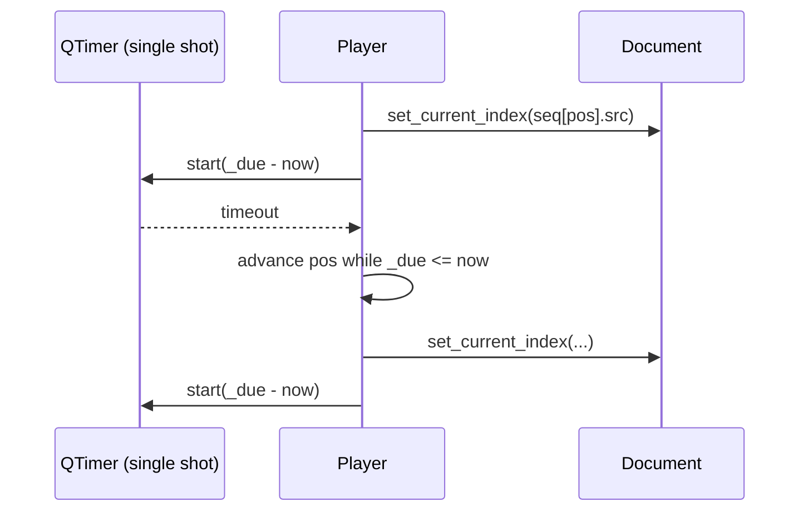

# `src/gif_editor/ui/inspector/player.py`

> The playback engine: a non-visual `Player` that moves the document's current frame forward on a timer, looping forever, either through every source frame or through the edited output timeline.

## Where it sits
- **Layer:** ui (Qt)
- **Used by:** `ui/inspector/transport.py` (buttons call it, it mirrors its state); the main window creates one `Player` per `Document` and binds the Home / Left / Space / Right / End shortcuts to `go_first()`, `step(-1)`, `toggle()`, `step(1)`, `go_last()`.
- **Uses:** `ui/document.py` (`Document`: `meta.delays_ms`, `plan()`, `current_index`, `set_current_index()`, signals).

## Public API
| Name | Kind | Purpose |
|---|---|---|
| `Player(doc, parent=None, *, clock=None, time_scale=1.0)` | class (`QObject`) | Create the engine. `clock` (callable returning monotonic ms as float) and `time_scale` (every delay × factor) exist for tests. `time_scale <= 0` → `ValueError`. |
| `.is_playing` | property (read-only) | `True` while the timer drives the frame. |
| `.preview_edits` | property (read/write, default `False`) | `False`: play all source frames. `True`: play `doc.plan()` (output timing). |
| `.set_preview_edits(value)` | method | Same as assigning `preview_edits`; handy as a slot for `QCheckBox.toggled`. |
| `.sequence()` | method → `list[(src_index, ms)]` | What would be played right now (already multiplied by `time_scale`). Empty if nothing is open or the plan is empty. |
| `.play()` | method | Start from the current frame (or the next frame that is in the sequence). With an empty sequence it does not start and emits `playingChanged(False)`. |
| `.pause()` | method | Stop the timer; the current frame stays. |
| `.toggle()` | method | `play()` if paused, else `pause()`. |
| `.stop()` | method | `pause()` then `go_first()`. |
| `.go_first()` / `.go_last()` | methods | Show the first / last frame of the current sequence (playback continues if playing). |
| `.step(n)` | method | Move `n` frames within the current sequence, wrapping at both ends. |

Signals:
- `playingChanged(bool)`: playback started (`True`) or stopped (`False`). Also emitted with `False` when `play()` refuses to start because there is nothing to play, so a checked play button can un-check itself.
- `previewEditsChanged(bool)`: `preview_edits` changed (only on a real change).

## How it works

### Which frames are played (the "sequence")
`sequence()` builds a list of `(source index, duration in ms)` pairs:

- **Source mode** (`preview_edits == False`): `[(i, meta.delays_ms[i]) for every frame]`. `delays_ms` are the *effective* delays (0/10 ms GIF delays already turned into 100 ms, like browsers do).
- **Preview mode** (`preview_edits == True`): `[(f.src_index, f.delay_cs * 10) for f in doc.plan().frames]`. `plan()` is the same `plan_output()` the encoder uses, so trimmed and deleted frames are absent and speed/FPS are already applied. The preview therefore has exactly the output timing. (Crop and resize preview are Milestone 3.)

The sequence is recomputed whenever playback starts, when `preview_edits` changes, and on `stateChanged` while previewing.

### The timer: why a single-shot timer plus an ideal timeline
GIF frames have different delays, so a fixed-interval `QTimer` doesn't fit. Instead one **single-shot** `QTimer` is re-armed after every frame with the time until the next frame should appear. It uses `Qt.PreciseTimer` because the default "coarse" timer may be off by up to 5 % — visible jitter at 20 ms frames.

A naive "show frame, then wait `delay` ms" loop slowly drifts: each timeout fires a bit late and the lateness adds up. So the player keeps `_due`, the clock time at which the visible frame *should* end on an ideal timeline that started when you pressed Play. On each timeout:

1. Read the clock (`QElapsedTimer`, monotonic, nanosecond resolution, converted to ms).
2. If the timer woke up more than 1 ms early, re-arm for the remainder and return.
3. If we are later than one whole loop of the sequence (debugger pause, laptop sleep), *rebase*: `_due = now`. Without this, the player would fast-forward through many loops in one go.
4. Advance one frame: `_pos += 1` (wrapping), `_due += duration(_pos)`.
5. While `_due <= now` keep advancing. This is the "skip ahead" — if we were late by more than a frame, the frames whose time is already over are skipped, so playback catches up instead of lagging.
6. Show `_seq[_pos]` via `doc.set_current_index()` and re-arm the timer for `_due - now`.

Because `_due` is advanced by ideal durations, never by "now + delay", a late timeout does not push later frames back: the error never accumulates.

### Where playback starts
`play()` looks for the current frame in the sequence. If it is not there (e.g. preview mode and the current frame is deleted or trimmed away), it starts at the nearest *following* frame of the sequence, and wraps to the first frame if nothing follows.

### Reacting to the document
- `sourceChanged` (open/close): `pause()`. A new file must never start playing on its own.
- `stateChanged` while playing in preview mode: rebuild the sequence and continue from the current frame. If the current frame is still in the plan, its remaining time is kept (`_due` unchanged). If it disappeared (just deleted), playback jumps to the next kept frame. If the plan became empty, playback pauses (emits `playingChanged(False)`).
- `currentIndexChanged` from *someone else* while playing (the user clicks the filmstrip or scrubs the timebar): the player continues from that frame with a fresh timing base. To tell its own index changes apart from the user's, the player sets `_setting_index` around every `set_current_index` call it makes.

### Stepping
`step(n)` works on the sequence with consecutive repeats collapsed (a delay above 655.35 s is split by the planner into several entries of the same frame; without collapsing, one step would not change the picture). If the current frame is in the sequence, the target is `pos + n`. If not, the next kept frame counts as `+1` and the previous kept frame as `-1`. The index wraps with modulo, so Left on the first frame goes to the last. If playing, timing restarts from the new frame.

## Invariants & gotchas
- **The player never edits `EditState`.** It only calls `doc.set_current_index()`; it is not undoable and needs no command.
- Everything runs on the GUI thread. The work per tick is tiny (a list index plus a signal); the expensive part (decoding the frame to show) belongs to the canvas, which should use `run_async` and drop stale results.
- `plan()` is computed on every `stateChanged` while previewing. It is pure Python and fast for normal GIFs; very long GIFs (thousands of frames) during a continuous drag may cost a few ms per change.
- Source order is assumed in plans (the planner never reorders), which `step()` relies on to find "the next kept frame".
- `time_scale` multiplies durations returned by `sequence()`; the app always uses `1.0`.
- `doc.set_current_index` emits only when the index changes. A one-frame sequence therefore plays "silently" (no signals) — correct, the picture doesn't change.

## Tests
- `tests/ui/test_player.py`: source-order playback with looping (real timer, `time_scale=0.2`), preview mode skips deleted frames and follows `plan.src_indices`, pause, toggle signals, empty plan (on play and while playing), `sourceChanged` stops, stepping with wrap and around deleted frames, start from a deleted frame, start from the current frame, drift compensation / skip-ahead / early wake-up / rebase after a huge delay (fake clock), resync on `stateChanged`, external scrub, `stop()`, `go_first/go_last`, `previewEditsChanged`, plan delays in `sequence()`.
- Gap: real timing accuracy is not measured (CI machines are too noisy); the drift logic is verified with a fake clock instead.

## History
- Milestone 2: created. Single-shot `PreciseTimer` + ideal timeline chosen over a repeating timer to support variable delays without drift. Preview mode plays timing only; geometry preview is planned for M3. `go_first`/`go_last` added beyond the original spec so the transport bar and Home/End shortcuts can jump within the *current* sequence.
