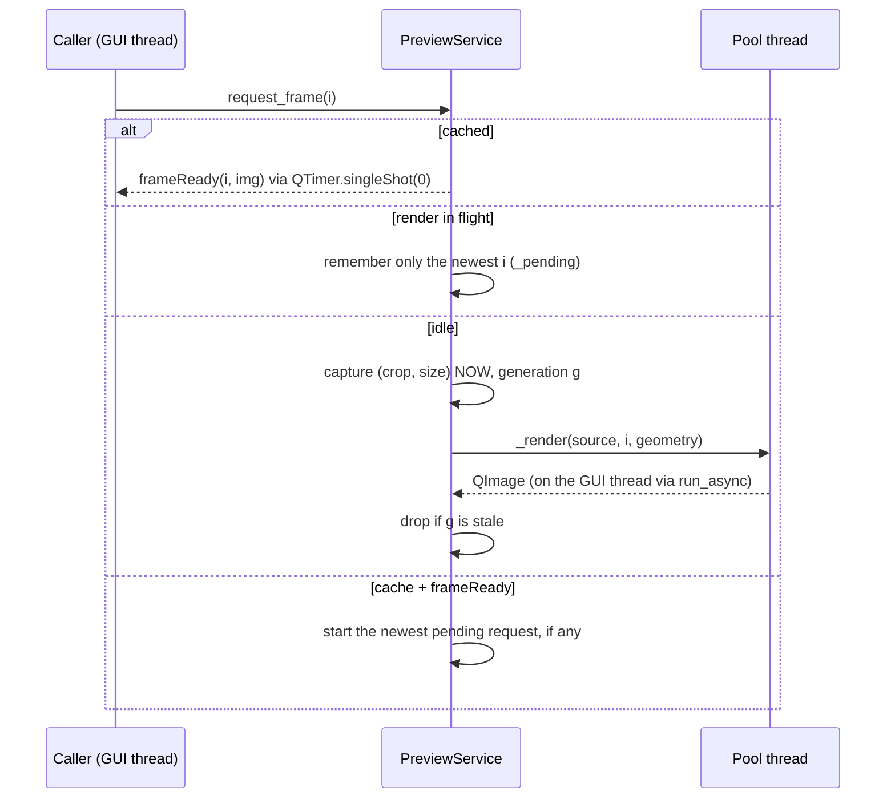

# `src/gif_editor/ui/inspector/preview.py`

> A non-visual service that renders the *output look* of a frame (crop + resize) off the GUI thread, and keeps a debounced estimate of the output file size.

## Where it sits
- **Layer:** ui (Qt), but it owns no widget.
- **Used by:** `ui/main_window.py`, which owns it and hands it to `FrameCanvas.set_preview` (the canvas shows `frameReady` images while the geometry preview is on) and to `SettingsPanel(preview=...)` (the summary card shows `estimated_bytes`); `Player.previewEditsChanged` drives `set_geometry_enabled`.
- **Uses:** `ui/document.py` (reads `source`, `state`, `plan()`, `current_index`), `core/render.render_frame`, `core/pipeline.estimate_size`, `ui/workers.run_async`, `ui/qt_image.pil_to_qimage`.

## Public API
| Name | Kind | Purpose |
|---|---|---|
| `PreviewService(doc, parent=None, *, cache_size=32, debounce_ms=250)` | class (`QObject`) | Binds to `doc`. `cache_size`/`debounce_ms` are test hooks. `ValueError` if `cache_size < 1`. |
| `geometry_enabled` | property (bool, settable) | When True, frames are rendered with the state's crop and size; when False, the plain composited source frame. |
| `set_geometry_enabled(bool)` | slot | Same as the setter, for `QCheckBox.toggled`. |
| `render_preview_frame(i) -> QImage` | method | Synchronous render (uses the cache). `RuntimeError` with nothing open. |
| `request_frame(i)` | method | Asynchronous render; result arrives via `frameReady`. |
| `estimated_bytes` | property (`int \| None`) | Last estimate; `None` when nothing is open or the estimate failed. |
| `estimate_pending` | property (bool) | True while the estimate is debouncing or running. |
| `refresh_estimate()` | method | Schedule a (debounced) estimate. |
| `dispose()` | method | Stop timers, drop work, disconnect from `doc`. Idempotent. |

Signals: `frameReady(int, QImage)`: a rendered or cached frame for that source index. `frameFailed(int, str)`: rendering failed. `estimateChanged()`: the value changed, or a computation started (so a "calculating…" label can appear). `estimateReady()`: a computation finished (or was already known). `geometryChanged(bool)`.

## How it works

### Geometry preview and the cache
`render_frame(frame, crop, size)` is the same function Generate uses, so the preview is exact in geometry (only the palette differs; that is applied at Generate). Rendered `QImage`s are kept in an `OrderedDict` LRU keyed by `(src_index, crop, size)`. `CropRect` and `OutputSize` are frozen dataclasses, so they hash by value: two equal crops share an entry. On `stateChanged`, entries rendered with a different crop/size are dropped, and if the preview is on, the current frame is re-requested immediately so the canvas never shows a stale crop.

### Asynchronous rendering, safely

Three rules keep this correct:
1. **At most one render runs at a time, and only the newest request waits.** Scrubbing a 2000-frame GIF while the preview is on would otherwise queue thousands of decodes; with coalescing it renders roughly one frame per render-time, always the latest.
2. **Generation counter.** Each render captures the counter; anything that invalidates in-flight work (a new file, toggling geometry, a crop change) increments it. A result whose generation no longer matches is dropped, not shown.
3. **The worker reads no live state.** `_render` is a `staticmethod` that receives the source, index and the `(crop, size)` captured on the GUI thread at request time. An earlier version read `self._geometry` and `doc.state` from inside the worker, so a crop change made mid-render could leak into an image labelled with the old request. Fixed during M3 verification, with a regression test.

A cache hit is delivered through `QTimer.singleShot(0, …)` rather than emitted directly, so a caller never re-enters its own code from inside `request_frame`.

### The size estimate
`pipeline.estimate_size` encodes a short run of real output frames in memory and extrapolates (see `core/pipeline.md`). It is too slow to run on every slider step, so:
- `stateChanged` calls `refresh_estimate()`, which (re)starts a single-shot timer (250 ms). A burst of edits produces one computation after the user stops.
- The whole `EditState` (immutable) is compared with the last measured one; an unchanged state is not recomputed (e.g. an edit followed by its undo).
- The job runs through `run_async` with its own generation counter, so an estimate for a previous file or state never lands.
- **It never raises.** Any exception (in planning or in `estimate_size`) becomes `None`, and the UI simply shows no size.
- An empty plan (everything deleted or trimmed) is `0` without starting a job.
- Changing only the current frame does not trigger an estimate.

## Invariants & gotchas
- Only `QImage` crosses threads; no `QPixmap` is created here (QPixmap is GUI-thread only).
- Every signal is emitted on the GUI thread (`run_async` callbacks run there).
- The cache is touched only on the GUI thread.
- Call `dispose()` before dropping the service in tests; it stops the debounce timer, so no callback outlives the widget tree.
- With the preview off, `request_frame` still works (returns the plain frame) but nothing is cached: the decoder already caches source frames.

## Tests
- `tests/ui/test_preview.py` (27 tests): plain vs geometry frames and their pixels; async `frameReady` with index and size; stale generations dropped (also after a source change); cache hits without a worker; burst coalescing; the worker using geometry captured at request time; render failure → `frameFailed`; estimate becomes available, is debounced, is `0`/`None` for an empty plan or closed document, is recomputed on edits but not on frame changes, and never raises; `dispose()` idempotent.
- Gaps: no test on a very large source for timing; the estimate's accuracy is tested in `tests/core/test_estimate.py`, not here.

## History
- Written by a Milestone 3 worker that was killed (PC shutdown) before running its tests or writing this page. The orchestrator verified it afterwards: the code was sound, 4 of its tests were wrong (an identity check across a signal, a `waitUntil` returning a list, two wrong frame indices), and one real thread-safety issue was fixed (see rule 3 above). Commit `e904982`.
