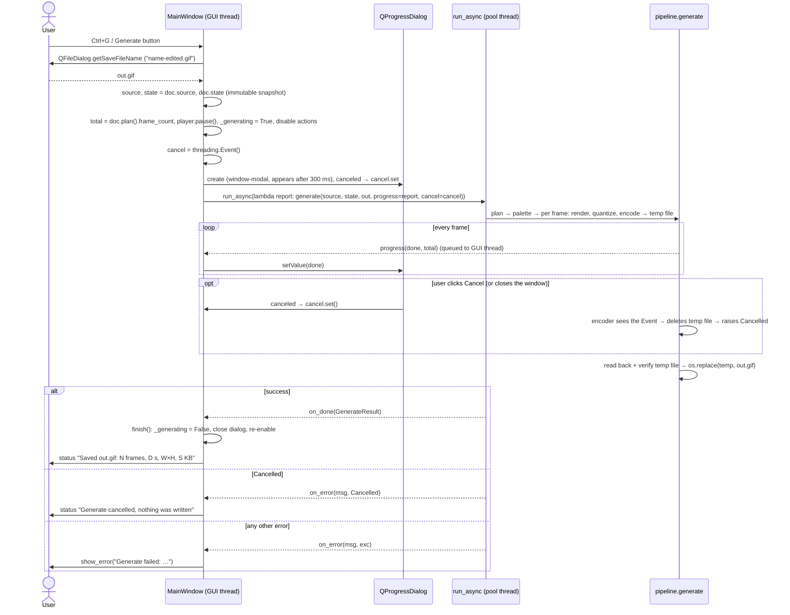

# `src/gif_editor/ui/main_window.py`

> The top-level window. It owns the one `Document` and the one `Player`, lays out the settings panel and the inspector, defines every menu item and keyboard shortcut, and runs the slow jobs (open, Generate) in the background with error dialogs, a progress dialog and cancel.

## Where it sits
- **Layer:** ui (Qt: `QMainWindow`, `QAction`, `QFileDialog`, `QProgressDialog`, `QMessageBox`)
- **Used by:** `gif_editor/app.py` (`MainWindow()`, `show()`, `open_file(argv[1])`, and the `APP_NAME` constant); `tests/ui/test_main_window.py`.
- **Uses:**
  - `ui/document.py` (`Document`), `ui/workers.py` (`run_async`);
  - `ui/settings_panel.py` (`SettingsPanel`), `ui/inspector/inspector.py` (`Inspector`), `ui/inspector/player.py` (`Player`);
  - `core/decoder.py` (`GifSource`), `core/encoder.py` (`Cancelled`), `core/pipeline.py` (`generate`, `export_frame_png`, `GenerateResult`).

## Public API
| Name | Kind | Purpose |
|---|---|---|
| `APP_NAME` | constant | `"GIF Editor"`. Window title and the application name (`app.py`). |
| `GIF_FILTER`, `PNG_FILTER` | constants | File-dialog filters. |
| `MainWindow(doc=None, parent=None)` | class (`QMainWindow`) | The window. Creates its own `Document` unless one is injected. 1300×820 by default. |
| `.doc`, `.player` | attributes | The shared `Document` and `Player`. |
| `.settings`, `.inspector` | attributes | The `SettingsPanel` and `Inspector` (whose children `canvas`, `transport`, `timebar`, `filmstrip` are public too). |
| `.act_*` | `QAction` attributes | One per menu item / shortcut (table below). Tests call `act.trigger()`. |
| `.last_error` | `str \| None` | The message of the last error shown. Lets tests check errors without a blocking dialog. |
| `.last_result` | `GenerateResult \| None` | The result of the last successful Generate. |
| `.is_busy` | property | `True` while a file is loading or a Generate is running. |
| `open_dialog()` | method | File → Open: ask for a `.gif`, then `open_file`. |
| `open_file(path)` | method | Decode `path` on a pool thread, then `doc.set_source` on the GUI thread. Ignored while busy. |
| `generate_dialog()` | method | Ask for an output path (suggests `<name>-edited.gif`, appends `.gif` if missing), then `generate_to`. |
| `generate_to(path)` | method | Run Generate in the background with a cancellable progress dialog. |
| `cancel_generate()` | method | Set the running Generate's cancel `Event` (no-op otherwise). |
| `save_frame_dialog(with_edits)` | method | Ask for a PNG path (suggests `<name>-frame004.png`), then `save_frame_to`. |
| `save_frame_to(path, with_edits=False) -> Path \| None` | method | Write the current source frame as PNG, optionally with crop + resize. Returns the path, or `None` on error. |
| `trim_in_here()`, `trim_out_here()`, `reset_trim()` | methods | Trim at the playhead (`I` / `O`) and reset the trim. |
| `show_error(message, title="GIF Editor")` | method | Non-blocking warning box + status bar message; sets `last_error`. |

Signals: none of its own. It connects to `Document.sourceChanged`, `SettingsPanel.generateRequested`, `TransportBar.saveFrameRequested`, `Filmstrip.errorOccurred` and `FrameCanvas.zoomChanged`.

## How it works

### Layout
```
MainWindow (QMainWindow)
├─ menu bar: File · Edit · Playback · View
├─ central widget: QSplitter (horizontal), initial sizes 320 | 980
│  ├─ QScrollArea (no horizontal scroll bar, min width = panel hint + 24)
│  │  └─ SettingsPanel                      stretch 0: keeps its width
│  └─ Inspector                             stretch 1: takes the extra width
│     ├─ FrameCanvas                        stretch 1: takes the extra height
│     ├─ TransportBar
│     ├─ TimeBar
│     └─ Filmstrip
└─ status bar: messages on the left, permanent zoom label ("100%") on the right
Player (QObject, no widget): owned by the window, passed to the Inspector → TransportBar
```
- The settings panel sits in a `QScrollArea` so that a short window (or a large font) scrolls the panel instead of squashing its spin boxes. The scroll area's minimum width comes from the panel's `minimumSizeHint`, so the splitter can never hide the controls.
- The `Player` is not a widget. The window owns it because both the menu actions and the transport buttons drive it, and there must be exactly one per document.

### Actions and shortcuts
Every action is created by `_action()`, which also calls `self.addAction(act)`. Adding the action to the **window** (not only to a menu) makes its shortcut work anywhere in the window, even while a menu is hidden. Shortcuts given as `QKeySequence.StandardKey` follow the platform convention; the Windows values are shown.

| Menu | Action (`attribute`) | Shortcut | Does |
|---|---|---|---|
| File | Open… (`act_open`) | Ctrl+O | `open_dialog()` |
| File | Generate… (`act_generate`) | Ctrl+G | `generate_dialog()` (also the panel's Generate button) |
| File | Save frame as PNG… (`act_save_frame`) | Ctrl+Shift+S | `save_frame_dialog(False)`: original frame (also the transport's "Save frame…" button) |
| File | Save frame with crop/size… (`act_save_frame_edited`) | — | `save_frame_dialog(True)`: crop + resize applied |
| File | Close (`act_close`) | Ctrl+F4 (standard `Close`) | `doc.close()` |
| File | Quit (`act_quit`) | standard `Quit` (none on Windows; Alt+F4 closes the window) | `self.close()` → `closeEvent` |
| Edit | Undo (`act_undo`) | Ctrl+Z | `undo_stack.undo()`. Menu text shows the step, e.g. "Undo Change trim" |
| Edit | Redo (`act_redo`) | Ctrl+Y | `undo_stack.redo()` |
| Edit | Delete frame(s) (`act_delete`) | Del | `filmstrip.delete_selected()` (selection, or the current frame if none) |
| Edit | Restore frame(s) (`act_restore`) | Ctrl+Shift+Del | `filmstrip.restore_selected()` |
| Edit | Set trim start at playhead (`act_trim_in`) | I | `trim_in_here()` |
| Edit | Set trim end at playhead (`act_trim_out`) | O | `trim_out_here()` |
| Edit | Reset trim (`act_trim_reset`) | — | `reset_trim()` |
| Playback | Play / pause (`act_play`) | Space | `player.toggle()` |
| Playback | Preview edits (`act_preview`, checkable) | P | `player.set_preview_edits(checked)`; kept in sync with `previewEditsChanged` and the transport check box |
| Playback | First frame (`act_first`) | Home | `player.go_first()` |
| Playback | Back 10 frames (`act_prev10`) | Shift+Left | `player.step(-10)` |
| Playback | Previous frame (`act_prev`) | Left | `player.step(-1)` |
| Playback | Next frame (`act_next`) | Right | `player.step(1)` |
| Playback | Forward 10 frames (`act_next10`) | Shift+Right | `player.step(10)` |
| Playback | Last frame (`act_last`) | End | `player.go_last()` |
| View | Zoom to fit (`act_fit`) | Ctrl+0 | `canvas.zoom_fit()` |
| View | Actual size (100%) (`act_actual`) | Ctrl+1 | `canvas.zoom_actual()` |
| View | Zoom in (`act_zoom_in`) | Ctrl++ | `canvas.zoom_in()` |
| View | Zoom out (`act_zoom_out`) | Ctrl+- | `canvas.zoom_out()` |

Notes:
- Navigation goes through the `Player`, not `doc.set_current_index`, so it steps within the *current* sequence: with "Preview edits" on, Left/Right skip trimmed and deleted frames. `step` **wraps** (Right on the last frame goes to the first).
- Undo/Redo come from `QUndoStack.createUndoAction`/`createRedoAction`. The stack enables/disables them and updates their text itself, so they are not in the window's enable list.
- `setShortcut(StandardKey)` binds only the platform's **first** binding. So Close is Ctrl+F4 only (not Ctrl+W), and Redo is Ctrl+Y only: `act_redo.setShortcuts([Redo, "Ctrl+Y"])` adds Ctrl+Y twice on Windows, and Ctrl+Shift+Z is not bound. (Checked with `QKeySequence.keyBindings` in the container; Qt's Windows table gives the same first bindings.)

### Opening a file (async) and drag-and-drop
`GifSource.open` reads and composites every frame, which can take seconds, so it must not run on the GUI thread (AGENTS.md: no more than about 16 ms per event).

1. `open_file(path)` returns immediately if `is_busy`. Otherwise it pauses the player, sets `_loading`, disables the actions, shows "Opening name…" and a busy cursor.
2. `run_async(lambda: GifSource.open(path), on_done=done, on_error=failed)`.
3. `done(source)` (GUI thread): clear `_loading`, `doc.set_source(source, path)` (which resets state, undo, index and selection and closes the previous source), re-enable, and show "Opened name: N frames, W×H" plus any decoder warnings (e.g. a truncated file) in the status bar.
4. `failed(message, exc)`: clear `_loading`, re-enable, `show_error("Could not open name:\n<message>", "Open failed")`. The previous document stays open and untouched, because `set_source` was never called.

Drag-and-drop: `setAcceptDrops(True)` on the window. `dragEnterEvent` accepts the drag only if `_local_gif(urls)` finds a local file ending in `.gif` (case-insensitive), so the cursor shows "no drop" for anything else. `dropEvent` calls `open_file` with the first such file. The canvas and the filmstrip refuse drops, so a drop anywhere over them bubbles up to the window.

### Generate

Why it is safe to keep editing while Generate runs:
- **Immutable snapshot.** `EditState` is a frozen dataclass, so the `state` captured by the lambda can never change. The user may keep editing (undo/redo and the settings panel stay active); the output is the state at the moment Generate started.
- **The source cannot disappear.** Open, Close and drop are refused while `_generating`, and `closeEvent` refuses to close (below). `GifSource` is thread-safe, so the canvas and filmstrip may keep reading frames concurrently.
- **Cancel is cooperative.** The progress dialog's `canceled` signal (Cancel button or Esc) calls `Event.set()` directly; the encoder checks the event between frames and before committing. `encoder.Cancelled` arrives through `on_error` and is reported as a status message, not an error.
- **Atomic write.** `pipeline.generate` writes to a temp file, reads it back and verifies frame count and durations, then `os.replace`s it onto the destination. Cancel, an error or a failed verification deletes the temp file and leaves an existing `out.gif` untouched, so overwriting the source file itself is safe.
- `doc.plan()` is computed up front only for the progress maximum (`max(total, 1)`). An empty plan is not checked here: `generate` raises `ValueError("nothing to generate: …")`, which shows as "Generate failed". (The panel's Generate button is already disabled for an empty output; the Ctrl+G action is not.)
- `setMinimumDuration(300)`: a fast Generate never flashes a dialog.

### Save frame as PNG
`save_frame_to(path, with_edits)` calls `pipeline.export_frame_png(source, doc.current_index, path, state)`:
- **without edits** (`state=None`): the composited source frame at full size, RGBA, so transparency is kept;
- **with edits** (`state=doc.state`): crop then resize, exactly like a Generate frame but in full colour (no palette). Timing edits do not apply to a single frame. In M2 the crop can only be set programmatically (the crop rectangle arrives in M3); the output size can be set in the settings panel.

It always saves the **source** frame under the playhead, even a deleted or trimmed-out one. It runs synchronously on the GUI thread: the frame comes from the decoder's cache, and one PNG encode is quick for normal GIF sizes. The write is atomic (temp file + `os.replace`). `OSError`/`ValueError` (e.g. an unwritable folder) → `show_error("Could not save the frame…")` and `None`.

### Trim at the playhead (I / O)
Trim is stored in **source time** (`trim_start_ms`, `trim_duration_ms`, `None` = to the end), so the actions convert the current frame to times with `doc.frame_start_ms(i)`:
- **I**, `trim_in_here()`: start = start of the current frame. The current *end* is kept: `duration = end - start`, or `None` (to the end) if there was no end or the end is not after the new start.
- **O**, `trim_out_here()`: end = end of the current frame (`start + delays_ms[i]`), so the current frame is *included*. An end at or before the trim start is refused with `show_error("The trim end must be after the trim start.")`. An end at the total duration is stored as `None`.
- **Reset trim**: `set_trim(0, None)`.

All three pass `merge_key=None`, so each press is its own undo step. (`Document.set_trim`'s default key `"trim"` would merge consecutive presses into one.)

### Busy flags and enabled states
Two flags: `_loading` (open in flight) and `_generating`. `_refresh_enabled()` runs after every change of either flag and on `sourceChanged`:
- every action in `_doc_actions` (all except Open, Quit, Undo, Redo) is enabled only if `doc.is_open and not _loading and not _generating`;
- Open is enabled only if neither flag is set;
- Quit is always enabled; Undo/Redo follow the undo stack.

`open_file` and `generate_to` also check the flags themselves, because they can be reached without an action (drag-and-drop, the panel button, tests). `_refresh_title()` sets the title to "name.gif — GIF Editor" (or "GIF Editor") and clears the zoom label when nothing is open.

### Closing while generating
`closeEvent`:
- **while generating:** call `cancel_generate()`, `event.ignore()` (the window stays open) and show "Cancelling Generate… close again in a moment." The worker still holds the source, and its `on_done`/`on_error` callbacks touch the window; cancelling first and letting the encoder clean up its own temp file avoids tearing the window and the source down under a running job. Once `on_error(Cancelled)` arrives the flags are cleared and the next close succeeds.
- **otherwise:** pause the player, `doc.close()` (releases the source), accept.

### Errors: `QMessageBox.open()` and `last_error`
`show_error` builds a `QMessageBox` with `WA_DeleteOnClose` and calls **`open()`**, not `exec()` and not the static `QMessageBox.warning()`:
- `exec()` and the static helpers start a nested event loop and block until the user clicks OK. In a headless test nobody clicks, so the test would hang. `open()` shows a window-modal box and returns at once.
- The message is also stored in `last_error` and shown in the status bar for 8 s, so tests assert on `last_error` instead of inspecting dialogs.
- `WA_DeleteOnClose` frees the box when it is dismissed, so repeated errors do not accumulate hidden dialogs.

The filmstrip's `errorOccurred(str)` (e.g. "Cannot delete every frame") is connected to `show_error`, so widget-level refusals get the same treatment.

## Invariants & gotchas
- **The window wires; widgets don't talk to each other.** The window only connects actions and outward signals (`generateRequested`, `saveFrameRequested`, `errorOccurred`, `zoomChanged`) to its own slots or to widget methods. Shared state flows through `Document`.
- **Call `open_file`/`generate_to` from the GUI thread only** (`run_async` creates its relay on the calling thread).
- **Space is play/pause, so the canvas's Space+drag pan is shadowed.** A window-level shortcut is matched (as a `ShortcutOverride`) before the focused widget gets a `keyPressEvent`, so the canvas never sees Space while `act_play` is enabled; Space toggles playback instead. **Middle-drag pans** and always works. (Verified: with the canvas focused, Space starts playback and the canvas's `_space_held` stays `False`.)
- **Widgets that accept `ShortcutOverride` keep their keys.** Qt asks the focused widget first; if it accepts, the window shortcut does not fire:
  - spin boxes in the settings panel keep Left/Right/Home/End (cursor movement) and single letters (`I`, `O`, `P` are typed, not trim/preview), and Ctrl+Z goes to the spin box's own text undo, not the document;
  - the filmstrip claims Delete/Backspace/Insert and handles them itself (same result as the action: delete or restore the selection).
- **The timebar's own arrow keys are shadowed** in the window: it does not accept `ShortcutOverride`, so Left/Right/Home/End reach the window actions (`player.step`, which wraps) instead of `TimeBar.keyPressEvent` (which clamps). Standalone the timebar still handles them.
- `act_preview` is two-way bound to the player (`toggled → set_preview_edits`, `previewEditsChanged → setChecked`); the transport check box is bound the same way, so all three stay in sync without loops (the player emits only on change).
- `GenerateResult.warnings` (e.g. "N frames dropped") are not shown after Generate; the settings panel's summary already shows the same warnings before Generate.
- The panel's Generate button is *not* disabled while generating (it is not an action); `generate_dialog` simply returns while `_generating` is set.
- Save-frame file names use the 1-based frame number (`-frame004.png` for index 3), matching the transport label.

## Tests
- `tests/ui/test_main_window.py` (14 cases): empty start, async open, bad file, drop, navigation/delete/undo via actions, a real key press reaching an action, I/O trim, Generate end to end, Generate cancel, PNG export with and without edits, preview binding, play/pause + Close, re-open, and `app.main`. See [its page](../../../tests/ui/test_main_window.md).
- **Gaps:** the file dialogs themselves (`*_dialog` methods); `closeEvent` while generating; the progress dialog's Cancel button (the test calls `cancel_generate()`); Generate error path (non-cancel); Save-frame error path.

## History
- `be70f38`: written by the orchestrator to integrate the M2 widgets ([dev log, Milestone 2](../../../../04-development-log.md#milestone-2-window-and-inspector)). Design choices: actions on the window so shortcuts are global; `QMessageBox.open()` + `last_error` for headless tests; the canvas refuses drops so the window handles them; Space kept for play/pause (the common video-player convention) at the cost of Space+drag panning.
