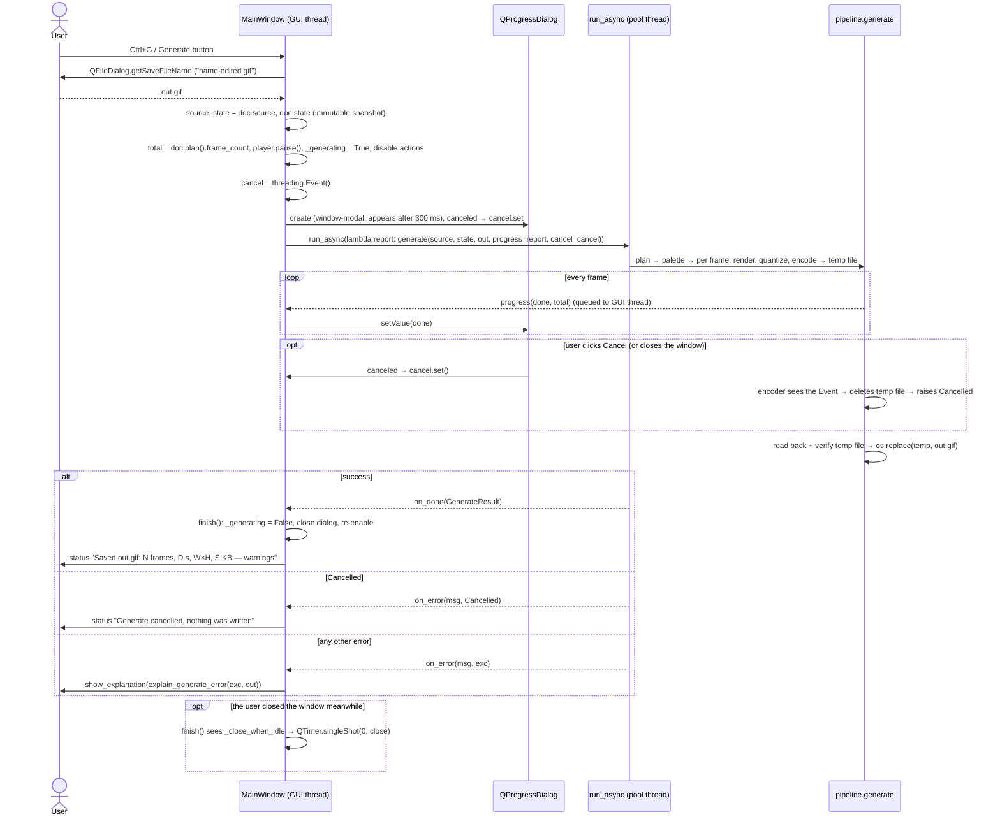

# `src/gif_editor/ui/main_window.py`

> The top-level window. It owns the one `Document`, the one `Player`, the `PreviewService` and the canvas `CropItem`, lays out the settings panel and the inspector, defines every menu item and keyboard shortcut, and runs the slow jobs (open, Generate) in the background with plain-language error dialogs, a progress dialog and cancel. It sizes itself to fit the screen and keeps the Generate button pinned below the settings.

## Where it sits
- **Layer:** ui (Qt: `QMainWindow`, `QAction`, `QFileDialog`, `QProgressDialog`, `QMessageBox`, `QTimer`)
- **Used by:** `gif_editor/app.py` (`MainWindow()`, `show()`, `open_file(argv[1])`, and the `APP_NAME` constant); `tests/ui/test_main_window.py`.
- **Uses:**
  - `ui/document.py` (`Document`), `ui/workers.py` (`run_async`);
  - `ui/settings_panel.py` (`SettingsPanel`), `ui/inspector/inspector.py` (`Inspector`), `ui/inspector/player.py` (`Player`);
  - `ui/inspector/preview.py` (`PreviewService`), `ui/inspector/crop_item.py` (`CropItem`) (M3);
  - `ui/messages.py` (`Explanation`, `explain_load_error`, `explain_load_warnings`, `explain_generate_error`) (M4);
  - `core/decoder.py` (`GifSource`), `core/encoder.py` (`Cancelled`), `core/pipeline.py` (`generate`, `export_frame_png`, `GenerateResult`).

## Public API
| Name | Kind | Purpose |
|---|---|---|
| `APP_NAME` | constant | `"GIF Editor"`. Window title and the application name (`app.py`). |
| `GIF_FILTER`, `PNG_FILTER` | constants | File-dialog filters. |
| `MainWindow(doc=None, parent=None)` | class (`QMainWindow`) | The window. Creates its own `Document` unless one is injected. Opens at `PREFERRED_SIZE` (1300×820), capped at 90 % of the screen and centred (M4). |
| `MainWindow.PREFERRED_SIZE` | class constant | `(1300, 820)` logical px: comfortable on a 1080p screen at 100 %. |
| `.doc`, `.player` | attributes | The shared `Document` and `Player`. |
| `.preview` | attribute | The `PreviewService` (M3): renders cropped/resized frames for the canvas and keeps the size estimate for the settings panel. |
| `.crop_item` | attribute | The `CropItem` (M3) in the canvas scene. |
| `.settings`, `.inspector` | attributes | The `SettingsPanel` and `Inspector` (whose children `canvas`, `transport`, `timebar`, `filmstrip` are public too). |
| `.act_*` | `QAction` attributes | One per menu item / shortcut (table below). Tests call `act.trigger()`. |
| `.last_error` | `str \| None` | Headline + body (`Explanation.text`) of the last error or notice shown. Lets tests check errors without a blocking dialog. |
| `.last_dialog` | `QMessageBox \| None` | The most recent dialog opened by `show_explanation` (M4). Tests read its `detailedText()` and `icon()`. It is deleted when dismissed (`WA_DeleteOnClose`), so do not keep using it after that. |
| `.last_result` | `GenerateResult \| None` | The result of the last successful Generate. |
| `.is_busy` | property | `True` while a file is loading or a Generate is running. |
| `open_dialog()` | method | File → Open: ask for a `.gif`, then `open_file`. |
| `open_file(path)` | method | Decode `path` on a pool thread, then `doc.set_source` on the GUI thread. Ignored while busy. |
| `generate_dialog()` | method | Ask for an output path (suggests `<name>-edited.gif`, appends `.gif` if missing), then `generate_to`. |
| `generate_to(path)` | method | Run Generate in the background with a cancellable progress dialog. |
| `cancel_generate()` | method | Set the running Generate's cancel `Event` (no-op otherwise). |
| `save_frame_dialog(with_edits)` | method | Ask for a PNG path (suggests `<name>-frame004.png`), then `save_frame_to`. |
| `save_frame_to(path, with_edits=False) -> Path \| None` | method | Write the current source frame as PNG, optionally with crop + resize. Returns the path, or `None` on error. |
| `trim_in_here()`, `trim_out_here()`, `reset_trim()` | methods | Trim at the playhead (`I` / `O`) and reset the trim. |
| `show_explanation(expl, icon=Warning) -> QMessageBox` | method (M4) | Non-blocking dialog for an `Explanation`: headline as the text, body as the informative text, details behind **Show Details…**; status bar shows the headline for 8 s; sets `last_error` and `last_dialog`. |
| `show_error(message, title="GIF Editor")` | method | Short form: `show_explanation(Explanation(title, message, ""))` (no body, no details). Used for widget refusals such as "Cannot delete every frame". |

Signals: none of its own. It connects to `Document.sourceChanged`, `SettingsPanel.generateRequested`, `TransportBar.saveFrameRequested`, `Filmstrip.errorOccurred`, `FrameCanvas.zoomChanged`, `FrameCanvas.spaceTapped` (M4, → `player.toggle`), `Player.previewEditsChanged`, `PreviewService.geometryChanged`, `CropItem.cropActiveChanged` and `CropItem.previewChanged`.

## How it works

### Layout
```
MainWindow (QMainWindow)
├─ menu bar: File · Edit · Crop · Playback · View
├─ central widget: QSplitter (horizontal), initial sizes 320 | 980
│  ├─ left column (QWidget + QVBoxLayout)   stretch 0: keeps its width
│  │  ├─ QScrollArea "Output settings" (no horizontal scroll bar, min width = panel hint + 24)
│  │  │  └─ SettingsPanel(doc, preview=preview)
│  │  │     └─ … Output size · CropPanel · Quality · Summary (Size line) …
│  │  └─ Generate button (settings.generate_button, pinned: never scrolls away)
│  └─ Inspector "Frame inspector"          stretch 1: takes the extra width
│     ├─ FrameCanvas                        stretch 1: takes the extra height
│     │  └─ scene: pixmap item + CropItem   (added by the window)
│     ├─ TransportBar
│     ├─ TimeBar
│     └─ Filmstrip
└─ status bar: messages on the left, permanent zoom label ("100%") on the right
Player (QObject, no widget): owned by the window, passed to the Inspector → TransportBar
PreviewService (QObject, no widget): owned by the window; canvas.set_preview(it), SettingsPanel(preview=it)
```
- The settings panel sits in a `QScrollArea` so that a short window (or a large font) scrolls the panel instead of squashing its spin boxes. The scroll area's minimum width comes from the panel's `minimumSizeHint`, so the splitter can never hide the controls.
- **Generate is pinned below the scroll area (M4, `9361dd6`).** The `SettingsPanel` creates and owns `generate_button` (and emits `generateRequested` from it); the window takes it **out of the panel's layout** (`settings.layout().removeWidget(gen)`) and adds it to the left column under the scroll area. *Why:* Generate is the main action. Inside the scroll area it scrolled off the bottom whenever the settings column was taller than the window, which is the normal case at 150 % on a 1080p laptop. The panel still owns the button and its signal, so `SettingsPanel` works unchanged on its own (its tests still find the button in the panel).
- **Accessible names (M4):** the scroll area is "Output settings"; the inspector names itself "Frame inspector" and the crop panel "Crop settings". An accessibility audit found these three containers without a name (a screen reader has nothing to announce for an unnamed container); every other control already had one. The tab order through the panel and the inspector was checked during the same audit and found logical, so it was not changed.
- The `Player` is not a widget. The window owns it because both the menu actions and the transport buttons drive it, and there must be exactly one per document.
- **`PreviewService` is owned here for the same reason (M3):** two widgets consume it (the canvas shows its frames, the settings panel shows its size estimate) and the window's P action drives it. It is created right after the `Player` and handed to both: `SettingsPanel(self.doc, preview=self.preview)` and, in `_connect`, `inspector.canvas.set_preview(self.preview)`. Neither widget creates or controls it.
- **`CropItem` is created here and added to the canvas scene** (`self.inspector.canvas.scene().addItem(self.crop_item)`), not by `FrameCanvas`. The canvas stays a generic viewer, and the window, which owns the crop tool action, the Crop menu and the preview toggle, is the one place that decides when the rectangle is visible.

### Window size and the pinned Generate button
`__init__` ends with `_fit_to_screen()` instead of a fixed `resize(1300, 820)`:
1. `screen = self.screen() or QApplication.primaryScreen()`; with no screen at all, fall back to `PREFERRED_SIZE`.
2. `avail = screen.availableGeometry()` (the desktop minus the taskbar, in **logical** pixels).
3. `w = min(1300, 90 % of avail.width)`, `h = min(820, 90 % of avail.height)`; `resize(w, h)` and move to the centre of `avail`.

*Why:* Windows display scaling shrinks the screen in logical pixels. Measured logical sizes: 1366×768 at 150 % = **911×512**; 1920×1080 at 150 % (the most common laptop setup) = **1280×720**; 1920×1080 at 200 % = **960×540**; 1280×800 at 125 % = **1024×640**. A fixed 1300×820 window is larger than every one of these, so it opened with its bottom edge (the Generate area included) off-screen. The window's minimum size (from the layouts' `minimumSizeHint`) is **779×344**, which fits all of them.

Remaining limitation: at 911×512 the canvas gets only about **184 px** of height, because the filmstrip has a fixed height of 140 px (`Filmstrip.setFixedHeight(140)`) and the transport and timebar take their share. The window is usable but cramped.

### Actions and shortcuts
Every action is created by `_action()`, which also calls `self.addAction(act)`. Adding the action to the **window** (not only to a menu) makes its shortcut work anywhere in the window, even while a menu is hidden. Shortcuts given as `QKeySequence.StandardKey` follow the platform convention; the Windows values are shown.

| Menu | Action (`attribute`) | Shortcut | Does |
|---|---|---|---|
| File | Open… (`act_open`) | Ctrl+O | `open_dialog()` |
| File | Generate… (`act_generate`) | Ctrl+G | `generate_dialog()` (also the panel's Generate button) |
| File | Save frame as PNG… (`act_save_frame`) | Ctrl+Shift+S | `save_frame_dialog(False)`: original frame (also the transport's "Save frame…" button) |
| File | Save frame with crop/size… (`act_save_frame_edited`) | — | `save_frame_dialog(True)`: crop + resize applied |
| File | Close (`act_close`) | Ctrl+W | `doc.close()` |
| File | Quit (`act_quit`) | Ctrl+Q (Alt+F4 also closes the window) | `self.close()` → `closeEvent` |
| Edit | Undo (`act_undo`) | Ctrl+Z | `undo_stack.undo()`. Menu text shows the step, e.g. "Undo Change trim" |
| Edit | Redo (`act_redo`) | Ctrl+Y, Ctrl+Shift+Z | `undo_stack.redo()` |
| Edit | Delete frame(s) (`act_delete`) | Del | `filmstrip.delete_selected()` (selection, or the current frame if none) |
| Edit | Restore frame(s) (`act_restore`) | Ctrl+Shift+Del | `filmstrip.restore_selected()` |
| Edit | Set trim start at playhead (`act_trim_in`) | I | `trim_in_here()` |
| Edit | Set trim end at playhead (`act_trim_out`) | O | `trim_out_here()` |
| Edit | Reset trim (`act_trim_reset`) | — | `reset_trim()` |
| Crop | Crop tool (`act_crop_tool`, checkable) | C | `_on_crop_tool_toggled(checked)`: show/hide the rectangle; turning it on with no crop creates a 10% inset box (rules below) |
| Crop | Remove crop (`act_crop_reset`) | — | `crop_item.reset()`: `crop=None`, one undo step |
| Crop | Move crop left / right / up / down (`act_crop_nudge[0..3]`) | Ctrl+Left / Ctrl+Right / Ctrl+Up / Ctrl+Down | `crop_item.nudge(dx, dy)` by 1 image px, clamped; one undo step per press |
| Crop | Narrow / Widen / Shorten / Lengthen crop (`act_crop_resize[0..3]`) | Ctrl+Shift+Left / Right / Up / Down | `crop_item.resize(dw, dh)` by 1 px, moving the right/bottom edge; one undo step per press |
| Playback | Play / pause (`act_play`) | Space | `player.toggle()`. While the **canvas** has focus it claims Space (for Space+drag panning) and a plain tap arrives as `canvas.spaceTapped → player.toggle` instead (M4) |
| Playback | Preview edits (`act_preview`, checkable) | P | Previews the **whole output**: `player.set_preview_edits(checked)` (timing), and `previewEditsChanged → preview.set_geometry_enabled` (crop + resize on the canvas). Kept in sync with the transport check box |
| Playback | First frame (`act_first`) | Home | `player.go_first()` |
| Playback | Back 10 frames (`act_prev10`) | Shift+Left | `player.step(-10)` |
| Playback | Previous frame (`act_prev`) | Left | `player.step(-1)` |
| Playback | Next frame (`act_next`) | Right | `player.step(1)` |
| Playback | Forward 10 frames (`act_next10`) | Shift+Right | `player.step(10)` |
| Playback | Last frame (`act_last`) | End | `player.go_last()` |
| View | Zoom to fit (`act_fit`) | Ctrl+0 | `canvas.zoom_fit()` |
| View | Actual size (100%) (`act_actual`) | Ctrl+1 | `canvas.zoom_actual()` |
| View | Zoom in (`act_zoom_in`) | Ctrl++ | `canvas.zoom_in()` |
| View | Zoom out (`act_zoom_out`) | Ctrl+- | `canvas.zoom_out()` |

Notes:
- Navigation goes through the `Player`, not `doc.set_current_index`, so it steps within the *current* sequence: with "Preview edits" on, Left/Right skip trimmed and deleted frames. `step` **wraps** (Right on the last frame goes to the first).
- Undo/Redo come from `QUndoStack.createUndoAction`/`createRedoAction`. The stack enables/disables them and updates their text itself, so they are not in the window's enable list.
- `setShortcut(StandardKey)` would bind only the platform's **first** binding, so `_action()` calls `setShortcuts(StandardKey)` (all bindings) for standard keys. Close and Quit use explicit `"Ctrl+W"` / `"Ctrl+Q"` because Qt's Windows table has Ctrl+F4 and no Quit key; Redo is bound to both Ctrl+Y and Ctrl+Shift+Z (`76cd65c`, `test_shortcuts_cover_platform_bindings`).
- **Crop keys use Ctrl because plain arrows are taken:** Left/Right step frames and Shift+Left/Right step 10. Nudge/resize are window actions like every other shortcut; nothing is routed through `FrameCanvas.keyPressEvent`.

### "Preview edits" (P): timing and geometry
In M2, P played the edited timing only. In M3 it previews the whole output, because "what will the GIF look like" includes the crop and the output size:
```
act_preview.toggled ──► player.set_preview_edits(on)          (timing: output frames and delays)
player.previewEditsChanged ──► preview.set_geometry_enabled    (canvas shows crop + resize)
                          └──► act_preview.setChecked          (two-way binding, as in M2)
preview.geometryChanged ──► _update_crop_tool()                (hide the source-pixel rectangle)
```
The geometry follows `previewEditsChanged`, not the action, so the transport's "Preview edits" check box (which drives the player directly) turns geometry on too. While it is on, the canvas scene is the output image, so the crop rectangle is hidden (next section).

### The crop tool (C)
The crop rectangle is a *tool* the user can show or hide; the crop itself is `doc.state.crop`. Rules, all in the window:

| Situation | What happens | Code |
|---|---|---|
| A file is opened (or closed) | Tool **off**, rectangle hidden: a fresh image shows no handles. The action is unchecked with signals blocked, so this does not create a crop. | `_sync_crop_tool` on `sourceChanged` |
| User turns the tool **on** and there is **no crop** | `crop_item.activate()` creates a box 10% inside each edge (`CropRect(4, 3, 32, 24)` on 40×30) as one undo step, so there is something to drag | `_on_crop_tool_toggled` |
| User turns the tool on and a crop exists | The existing crop is shown | `_on_crop_tool_toggled` |
| A crop **appears from elsewhere** (the panel's Crop tick, undo) | Tool turns **on** automatically, so the crop is visible on the canvas | `_on_crop_active_changed(True)` |
| The crop is removed | The tool stays as it was (the user may want to drag a new one) | `_on_crop_active_changed(False)` does nothing |
| "Preview edits" is on | Rectangle **hidden** even if the tool is checked; it comes back when preview ends | `_update_crop_tool`: `set_tool_enabled(checked and not preview.geometry_enabled)` |

While dragging, `CropItem.previewChanged(QRectF)` → `_on_crop_dragged` shows **"Crop W×H at X,Y"** in the status bar for 2 s, updated on every move. The document is not written until the mouse is released (one undo step per drag; see [crop_item](inspector/crop_item.md)).

### Opening a file (async) and drag-and-drop
`GifSource.open` reads and composites every frame, which can take seconds, so it must not run on the GUI thread (AGENTS.md: no more than about 16 ms per event).

1. `open_file(path)` returns immediately if `is_busy`. Otherwise it pauses the player, sets `_loading`, disables the actions, shows "Opening name…" and a busy cursor.
2. `run_async(lambda: GifSource.open(path), on_done=done, on_error=failed)`.
3. `done(source)` (GUI thread): clear `_loading`, `doc.set_source(source, path)` (which resets state, undo, index and selection and closes the previous source), re-enable, and show "Opened name: N frames, W×H" in the status bar. **If the decoder reported warnings** (a truncated file, junk after the frames, bad LZW data) it also shows `explain_load_warnings(...)` as an **Information** dialog: "“name” is damaged; N frames could be loaded." with the warnings as details (M4). Before M4 the warnings were appended to the status line, which disappears after 8 s; a partly-read file changes the result, so it now gets a dialog. (The dialog's headline then also replaces the "Opened…" status line.)
4. `failed(_message, exc)`: clear `_loading`, re-enable, `show_explanation(explain_load_error(exc, path))`: a "Can't open file" dialog with a plain headline chosen by `GifLoadError.kind` ("“x.gif” is not a GIF.", "… is too large to edit (20000×20000 pixels).", "… no longer exists." …) and the decoder's technical message behind Show Details. The previous document stays open and untouched, because `set_source` was never called.

Drag-and-drop: `setAcceptDrops(True)` on the window. `dragEnterEvent` accepts the drag only if `_local_gif(urls)` finds a local file ending in `.gif` (case-insensitive), so the cursor shows "no drop" for anything else. `dropEvent` calls `open_file` with the first such file. The canvas and the filmstrip refuse drops, so a drop anywhere over them bubbles up to the window.

### Generate

Why it is safe to keep editing while Generate runs:
- **Immutable snapshot.** `EditState` is a frozen dataclass, so the `state` captured by the lambda can never change. The user may keep editing (undo/redo and the settings panel stay active); the output is the state at the moment Generate started.
- **The source cannot disappear.** Open, Close and drop are refused while `_generating`, and `closeEvent` defers the close until the worker has reported back (below). `GifSource` is thread-safe, so the canvas and filmstrip may keep reading frames concurrently.
- **Cancel is cooperative.** The progress dialog's `canceled` signal (Cancel button or Esc) calls `Event.set()` directly; the encoder checks the event between frames and before committing. `encoder.Cancelled` arrives through `on_error` and is reported as a status message, not an error.
- **Atomic write.** `pipeline.generate` writes to a temp file, reads it back and verifies frame count and durations, then `os.replace`s it onto the destination. Cancel, an error or a failed verification deletes the temp file and leaves an existing `out.gif` untouched, so overwriting the source file itself is safe.
- **Empty output is refused before any dialog.** `generate_dialog` (Ctrl+G) checks `doc.plan().frame_count == 0` and shows "Nothing to generate: …" instead of opening a file dialog; `generate_to` checks again (it can be called directly) and also uses `plan.frame_count` as the progress maximum. This mirrors the panel's Generate button, which is disabled for an empty output (`76cd65c`).
- `setMinimumDuration(300)`: a fast Generate never flashes a dialog.
- **Errors are explained, not dumped (M4).** A non-cancel failure shows `explain_generate_error(exc, path)`: e.g. "No permission to save in “Folder”.", "The disk is full.", or, for a Windows sharing violation (`winerror` 32/33), "“out.gif” is open in another program." Every such body says **"Nothing was written; any existing file with that name is unchanged."**, which is true because of the atomic write above. See [messages](messages.md).

### Save frame as PNG
`save_frame_to(path, with_edits)` calls `pipeline.export_frame_png(source, doc.current_index, path, state)`:
- **without edits** (`state=None`): the composited source frame at full size, RGBA, so transparency is kept;
- **with edits** (`state=doc.state`): crop then resize, exactly like a Generate frame but in full colour (no palette). Timing edits do not apply to a single frame. The crop comes from the canvas rectangle or the crop panel, the size from the Output size group.

It always saves the **source** frame under the playhead, even a deleted or trimmed-out one. It runs synchronously on the GUI thread: the frame comes from the decoder's cache, and one PNG encode is quick for normal GIF sizes. The write is atomic (temp file + `os.replace`). An `OSError` (e.g. an unwritable folder) → `show_explanation(explain_generate_error(exc, path, "Save failed"))`; a `ValueError` → `show_error("Could not save the frame: …", "Save failed")`. Both return `None`.

### Trim at the playhead (I / O)
Trim is stored in **source time** (`trim_start_ms`, `trim_duration_ms`, `None` = to the end), so the actions convert the current frame to times with `doc.frame_start_ms(i)`:
- **I**, `trim_in_here()`: start = start of the current frame. The current *end* is kept: `duration = end - start`, or `None` (to the end) if there was no end or the end is not after the new start.
- **O**, `trim_out_here()`: end = end of the current frame (`start + delays_ms[i]`), so the current frame is *included*. An end at or before the trim start is refused with `show_error("The trim end must be after the trim start.")`. An end at the total duration is stored as `None`.
- **Reset trim**: `set_trim(0, None)`.

All three pass `merge_key=None`, so each press is its own undo step. (`Document.set_trim`'s default key `"trim"` would merge consecutive presses into one.)

### Busy flags and enabled states
Two flags: `_loading` (open in flight) and `_generating`. `_refresh_enabled()` runs after every change of either flag and on `sourceChanged`:
- every action in `_doc_actions` (all except Open, Quit, Undo, Redo) is enabled only if `doc.is_open and not _loading and not _generating`;
- Open is enabled only if neither flag is set;
- Quit is always enabled; Undo/Redo follow the undo stack.

`open_file` and `generate_to` also check the flags themselves, because they can be reached without an action (drag-and-drop, the panel button, tests). `_refresh_title()` sets the title to "name.gif — GIF Editor" (or "GIF Editor") and clears the zoom label when nothing is open.

### Closing while generating
`closeEvent`:
- **while generating:** call `cancel_generate()`, set `_close_when_idle = True`, `event.ignore()` (the window stays open for now) and show "Cancelling Generate, then closing…". The worker still holds the source, and its `on_done`/`on_error` callbacks touch the window; cancelling first and letting the encoder clean up its own temp file avoids tearing the window and the source down under a running job. When the worker reports back (`on_error(Cancelled)`, or `on_done` if Generate finished first), `finish()` clears the flags and, because `_close_when_idle` is set, calls `QTimer.singleShot(0, self.close)`. That second close takes the normal path. **One click on X is enough** (M4, `9361dd6`); before M4 the close was simply ignored and the user had to close again.
- **otherwise:** pause the player, `doc.close()` (releases the source), accept.

### Errors: `show_explanation`, `QMessageBox.open()` and `last_error`
Since M4 every error and notice goes through `show_explanation(expl, icon)`. The `Explanation` comes from [`ui/messages.py`](messages.md) (or from `show_error`, which wraps a plain message):
- `QMessageBox(icon, expl.title, expl.headline)`: the headline is the main text;
- `setInformativeText(expl.body)` if there is a body (what happened, what to do);
- `setDetailedText(expl.details)` if there are details that differ from the headline. Qt then shows a **Show Details…** button; the technical text is hidden by default (it means nothing to most users) but one click away and selectable for bug reports;
- `last_error = expl.text` (headline + body), status bar shows the headline for 8 s, `last_dialog = box`.

The box has `WA_DeleteOnClose` and is shown with **`open()`**, not `exec()` and not the static `QMessageBox.warning()`:
- `exec()` and the static helpers start a nested event loop and block until the user clicks OK. In a headless test nobody clicks, so the test would hang. `open()` shows a window-modal box and returns at once.
- The message is also stored in `last_error` and shown in the status bar for 8 s, so tests assert on `last_error` instead of inspecting dialogs.
- `WA_DeleteOnClose` frees the box when it is dismissed, so repeated errors do not accumulate hidden dialogs.

The filmstrip's `errorOccurred(str)` (e.g. "Cannot delete every frame") is connected to `show_error`, so widget-level refusals get the same treatment.

## Invariants & gotchas
- **The window wires; widgets don't talk to each other.** The window only connects actions and outward signals (`generateRequested`, `saveFrameRequested`, `errorOccurred`, `zoomChanged`) to its own slots or to widget methods. Shared state flows through `Document`.
- **Call `open_file`/`generate_to` from the GUI thread only** (`run_async` creates its relay on the calling thread).
- **Space: play/pause, and Space+drag pan on the canvas (M4).** A window shortcut fires only if the focused widget does not accept the key's `ShortcutOverride`. The canvas accepts it for plain Space while a file is open, so with the canvas focused Space goes to the canvas: hold + drag pans, a tap emits `spaceTapped`, which the window connects to `player.toggle`. With any other widget focused, `act_play` handles Space as before. (Until M4 the canvas never saw Space, and Space+drag did not pan.)
- **Widgets that accept `ShortcutOverride` keep their keys.** Qt asks the focused widget first; if it accepts, the window shortcut does not fire (the canvas and Space, above, are one example):
  - spin boxes in the settings panel keep Left/Right/Home/End (cursor movement) and single letters (`I`, `O`, `P` are typed, not trim/preview), and Ctrl+Z goes to the spin box's own text undo, not the document;
  - the filmstrip claims Delete/Backspace/Insert and handles them itself (same result as the action: delete or restore the selection).
- **The timebar's own arrow keys are shadowed** in the window: it does not accept `ShortcutOverride`, so Left/Right/Home/End reach the window actions (`player.step`, which wraps) instead of `TimeBar.keyPressEvent` (which clamps). Standalone the timebar still handles them.
- `act_preview` is two-way bound to the player (`toggled → set_preview_edits`, `previewEditsChanged → setChecked`); the transport check box is bound the same way, so all three stay in sync without loops (the player emits only on change).
- `GenerateResult.warnings` (e.g. "N frames dropped") are appended to the "Saved …" status message (15 s), as well as being shown in the summary card before Generate.
- **Crop actions follow the rectangle.** `_update_crop_tool` enables the Ctrl+arrow nudge/resize actions (`_crop_edit_actions`) only while the rectangle is shown: a file is open, the tool is on, "Preview edits" is off and nothing is busy. `CropItem.nudge/resize` require the tool, so leaving them enabled while hidden would make the menu items look usable while doing nothing. "Remove crop" stays enabled with any open file and works with the tool off (`CropItem.reset` does not require the tool). `_refresh_enabled` calls `_update_crop_tool` so a busy state (opening, generating) also hides the rectangle. Covered by `test_crop_edit_actions_follow_visibility` and the two `test_remove_crop_works_*` tests.
- The status-bar drag message comes from `previewChanged`, which fires only while dragging; nudges and panel edits do not show it.
- `show_error` and `show_explanation` both replace `last_dialog`; several errors in a row open several boxes (each deletes itself when dismissed).
- The pinned Generate button is still `settings.generate_button`: code and tests that look it up through the panel keep working, but it is no longer a descendant of the scroll area (asserted by `test_window_fits_small_screen_and_generate_stays_visible`).
- The panel's Generate button is *not* disabled while generating (it is not an action); `generate_dialog` simply returns while `_generating` is set.
- Save-frame file names use the 1-based frame number (`-frame004.png` for index 3), matching the transport label.

## Tests
- `tests/ui/test_main_window.py` (24 cases): empty start, async open, bad file (plain headline + technical details), drop, navigation/delete/undo via actions, a real key press reaching an action, I/O trim, Generate end to end, Generate cancel, shortcut bindings, Ctrl+G refusing an empty output, warnings in the Generate status, PNG export with and without edits, preview binding, play/pause + Close, re-open, `app.main`; M4: truncated file → Information dialog with the warnings as details, a Generate permission error explained (nothing written), close during Generate cancels and then closes by itself, the window fits a 1280×680 screen with Generate visible outside the scroll area, Space tap / Space+drag / Space elsewhere. See [its page](../../../tests/ui/test_main_window.md).
- `tests/ui/test_m3_integration.py` (window part): the crop tool starts off and activates a 10% box; a panel crop turns the tool on; a real mouse drag is one undo step and syncs the panel; Ctrl+arrow nudge/resize; hidden during P; Remove crop and the reset on a new file; Generate writes the canvas crop; P toggles geometry. See [its page](../../../tests/ui/test_m3_integration.md).
- HiDPI: the whole file also runs at 150 % and 200 % (`scripts/test-hidpi.sh`).
- **Gaps:** the file dialogs themselves (`*_dialog` methods); the progress dialog's Cancel button (the test calls `cancel_generate()`); the Save-frame error paths; `_fit_to_screen` with no screen.

## History
- `be70f38`: written by the orchestrator to integrate the M2 widgets ([dev log, Milestone 2](../../../../04-development-log.md#milestone-2-window-and-inspector)). Design choices: actions on the window so shortcuts are global; `QMessageBox.open()` + `last_error` for headless tests; the canvas refuses drops so the window handles them; Space kept for play/pause (the common video-player convention) at the cost of Space+drag panning.
- `76cd65c` (after M2): all platform bindings for standard keys, Close = Ctrl+W, Quit = Ctrl+Q, Redo also Ctrl+Shift+Z; Ctrl+G refuses an empty output; Generate warnings in the status bar.
- `3adb5bd` (M3): `PreviewService` owned here and shared with the canvas and the settings panel; P previews timing **and** geometry.
- `484382d` (M3): `CropItem` in the canvas scene, Crop menu (tool C, Remove crop, Ctrl+arrow nudge, Ctrl+Shift+arrow resize), the crop-tool rules and the drag status message. See [dev log, Milestone 3](../../../../04-development-log.md#milestone-3-crop-and-live-preview).
- `d3f0297` (M4): accessible name for the settings scroll area.
- `95b4f03` (M4): `show_explanation`, `last_dialog`, plain-language open/Generate/Save errors via `ui/messages.py`, Information dialog for a partly-loaded file.
- `9361dd6` (M4): `_fit_to_screen` (90 % of the screen, centred), Generate pinned below the scroll area, close during Generate closes by itself after the cancel (`_close_when_idle`).
- `0b07218` (M4): `canvas.spaceTapped → player.toggle`. See [dev log, Milestone 4](../../../../04-development-log.md#milestone-4-hardening).
