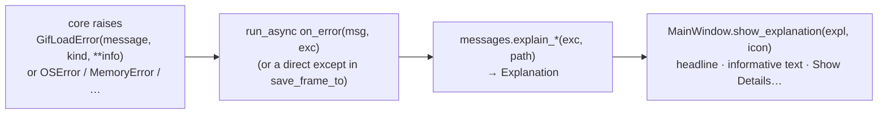

# `src/gif_editor/ui/messages.py`

> Turns technical exceptions (`GifLoadError`, `OSError`, `MemoryError`, anything else) into plain-language explanations for dialogs: a title, a one-line headline, a "what happened / what to do" body, and the original message as details.

## Where it sits
- **Layer:** ui (but **pure Python, no Qt imports**: it only builds data, the main window shows it)
- **Used by:** `ui/main_window.py` (`open_file` failures and partial loads, `generate_to` failures, `save_frame_to` OS errors, and `show_error` builds an `Explanation` too); `tests/ui/test_messages.py`.
- **Uses:** `core/decoder.py` (`GifLoadError` and its `kind` constants); `errno`, `pathlib`.

## Public API
| Name | Kind | Purpose |
|---|---|---|
| `Explanation(title, headline, body, details="")` | frozen dataclass | What to show. `title`: window title. `headline`: bold first line (one sentence, the file name in curly quotes). `body`: what happened and what to do. `details`: the technical text (the exception message), shown behind **Show Details…**. |
| `Explanation.text` | property | `headline + "\n" + body` (or just `headline` if the body is empty). Used for `MainWindow.last_error` and logs. |
| `explain_load_error(exc, path) -> Explanation` | function | Why `path` could not be opened. |
| `explain_load_warnings(warnings, path, frames) -> Explanation` | function | The file opened, but only partly (truncated, junk after the frames…). |
| `explain_generate_error(exc, path, title="Generate failed") -> Explanation` | function | Why writing `path` failed. Also used for Save frame, with `title="Save failed"`. |

`__all__` lists exactly these four names.

## How it works

### Why this module exists
The core raises precise technical errors. `"Canvas 70000x2 exceeds the maximum side of 8192 px"` or `"[Errno 13] Permission denied: '…\\.out.gif.1f3a.tmp'"` are right for logs and tests, but in a dialog they tell a user neither what happened in their terms nor what to do next. Before M4 the window showed them verbatim ("Could not open x.gif:\n<message>"). Now every error dialog has a plain headline and a next step, and nothing is lost: the original message is one click away for bug reports.

The functions are pure (no Qt), so every branch can be unit-tested without a window, and the wording is decided in one place.

### How errors reach the dialog

The UI never parses message text: `GifLoadError.kind` says *why* ([decoder page](../core/decoder.md#gifloaderror-kind-and-info)), and `GifLoadError.info` carries the numbers the sentence needs. `str(exc)` stays unchanged, so tests that match the technical message still pass, and it becomes `details`.

### `explain_load_error` (title "Can't open file")
| `exc` | Headline | Body (what to do) |
|---|---|---|
| `kind == NOT_FOUND` | "“x.gif” no longer exists." | It may have been moved, renamed or deleted. |
| `kind == IS_DIRECTORY` | "“x” is a folder." | Choose a .gif file inside it. |
| `kind == UNREADABLE` | "“x.gif” can't be read." | Permission, or another program has it locked; close it there or open a copy. |
| `kind == EMPTY` | "“x.gif” is empty (0 bytes)." | Often a download or copy that did not finish. |
| `kind == NOT_GIF` | "“x.gif” is not a GIF." | Different format even if the name ends in .gif; convert it or choose another file. |
| `kind == TOO_LARGE` | "“x.gif” is too large to edit (W×H pixels)." | Could use more memory than is safe; "The largest supported size is 8,192 pixels on a side." (numbers from `info`, each part omitted if missing) |
| `kind == TOO_MANY_FRAMES` | "“x.gif” has too many frames." | "The editor supports up to 10,000 frames per GIF." (from `info["max_frames"]`) |
| any other `GifLoadError` (`MALFORMED`, or a kind added later) | "“x.gif” is damaged." | Looks like a GIF but its data is broken; try downloading it again. |
| `MemoryError` | "Not enough memory to open “x.gif”." | Close other programs and try again. |
| anything else | "“x.gif” could not be opened." | An unexpected error; the details help when reporting it. |

`details` is `str(exc)`, or the exception class name if the message is empty. `kind`/`info` are read with `getattr`, so any exception type works.

### `explain_load_warnings` (title "Opened with problems")
Headline "“x.gif” is damaged; N frame(s) could be loaded." (singular for 1). Body: everything readable is shown and can be edited and generated, but anything after the damage is missing, so the result may be shorter than the original. Details: the decoder's warnings, one per line. The main window shows this with an **Information** icon right after a successful open whose `source.warnings` is not empty.

*Why a dialog and not the status bar:* before M4 the warnings were appended to the "Opened…" status-bar line, which vanishes after 8 s. A partly-read file changes the result (the GIF is shorter), so it must not be easy to miss.

### `explain_generate_error` (title "Generate failed" or the given `title`)
Every body ends with (or contains) **"Nothing was written; any existing file with that name is unchanged."** That sentence is true because both writers (`encoder.write_gif` and `pipeline.export_frame_png`) write a temporary file and rename it over the destination only at the very end; on any failure the temp file is deleted. It is said every time because the fear behind a failed save is "did I just lose my file?".

| `exc` | Headline |
|---|---|
| `OSError` with `winerror` 32 or 33 (Windows sharing / lock violation) | "“out.gif” is open in another program." (close it there or choose another name) |
| `OSError` `errno` `EACCES` / `EPERM` | "No permission to save in “folder”." (read-only or protected folder; suggests Pictures or Documents) |
| `ENOSPC` | "The disk is full." |
| `ENOENT` | "The folder “…” no longer exists." |
| `ENAMETOOLONG` | "The file name or path is too long." |
| any other `OSError` | "“out.gif” could not be saved." |
| `MemoryError` | "Not enough memory to generate this GIF." (make the output smaller) |
| anything else | "The GIF could not be generated." |

*Why the `winerror` check comes first:* on Windows a file locked by another program (an image viewer showing the old GIF, for example) fails with `PermissionError`, i.e. `errno == EACCES`. Without the check the user would be told they have no permission to save in a folder where they clearly can; the real fix is to close the other program. Windows sets `OSError.winerror` to 32 (`ERROR_SHARING_VIOLATION`) or 33 (`ERROR_LOCK_VIOLATION`) in that case. The `EACCES` body still mentions "or the file is open in another program" as a fallback.

`encoder.Cancelled` never gets here: the main window handles a cancel with a status-bar message before calling this function.

## Invariants & gotchas
- **No jargon in `headline` or `body`.** `tests/ui/test_messages.py` checks that "Errno", "malformed", "decodable", "exceeds", "Traceback" never appear there. Technical words belong in `details`.
- File names are shown with `Path(path).name` in curly quotes (`_q`), never the full path (long and noisy); the folder in the `EACCES` case is the parent folder's name, the missing folder in the `ENOENT` case is the full parent path.
- Adding a new `GifLoadError.kind` without a branch here is safe: it falls back to "is damaged". Add a branch and a test when the new kind needs different advice.
- Messages are English only; there is no translation layer yet.
- No Qt in this module: keep it that way so the tests stay fast and the wording stays testable.

## Tests
- `tests/ui/test_messages.py` (22 cases): real files for not-a-GIF, empty, missing, folder, too-large header, too-large side, too many frames, header-only (damaged), truncated (warnings); every `errno` branch, Windows `winerror` 32, `MemoryError`, unknown errors, the Save-frame title, `Explanation.text`; the jargon check.
- `tests/ui/test_main_window.py`: the window shows these explanations (not a GIF, truncated file → Information dialog, permission error on Generate).
- **Gaps:** the `UNREADABLE` branch of `explain_load_error` is not tested (it needs a file that exists but cannot be read); `winerror` 33; `MemoryError` while loading through the window.

## History
- `95b4f03` (M4): added, with `MainWindow.show_explanation` and the partial-load notice ([dev log, Milestone 4](../../../../04-development-log.md#milestone-4-hardening)).
