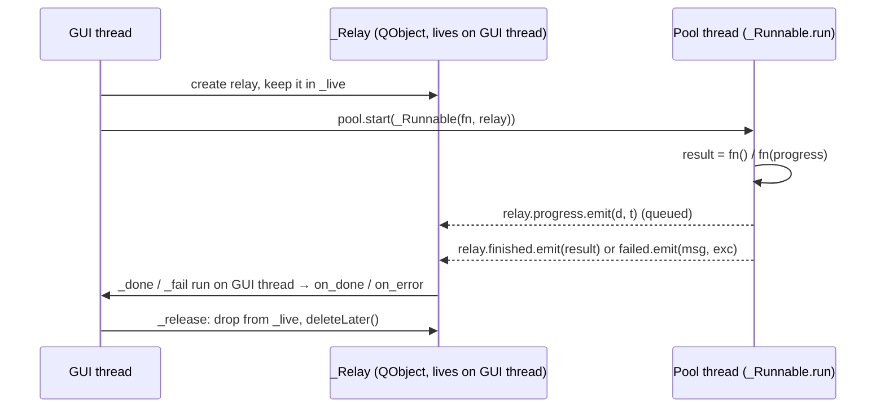

# `src/gif_editor/ui/workers.py`

> `run_async` runs blocking work (decode, thumbnails, Generate) on a thread pool and delivers the result, error and progress back on the GUI thread.

## Where it sits
- **Layer:** ui (Qt: `QObject`, `QRunnable`, `QThreadPool`, `Signal`)
- **Used by:** M2 widgets and the planned `MainWindow` (opening files, thumbnails, Generate); `tests/ui/test_workers.py`.
- **Uses:** nothing in the project.

## Public API
| Name | Kind | Purpose |
|---|---|---|
| `run_async(fn, *, on_done=None, on_error=None, on_progress=None, pool=None)` | function | Run `fn` on `pool` (default `QThreadPool.globalInstance()`). Callbacks run on the thread that called `run_async`, normally the GUI thread. Returns `None` immediately. |

| Callback | Signature | When |
|---|---|---|
| `on_done` | `(result)` | `fn` returned. |
| `on_error` | `(message: str, exc: BaseException)` | `fn` raised anything (also printed to stderr with the traceback). `message` is `str(exc)` or the exception class name. |
| `on_progress` | `(done: int, total: int \| None)` | Each time `fn` calls `progress(done, total)`. If `on_progress` is given, `fn` is called as `fn(progress)`; otherwise as `fn()`. |

## How it works

- **Why a relay object:** Qt delivers a signal emitted from another thread through a **queued connection** to the thread the receiving `QObject` lives in. `_Relay` is created inside `run_async`, i.e. on the GUI thread, so its slots run there. Pool threads never touch widgets.
- **Lifetime:** the module-level `_live` set (guarded by a lock) holds a strong reference to each relay until its task reports back. Otherwise Python could garbage-collect the relay while the worker still emits on it. `_release` runs in a `finally`, so a callback that raises still frees the relay.
- **Cancellation is cooperative:** create a `threading.Event`, capture it in `fn` (e.g. `lambda progress: generate(src, st, path, progress=progress, cancel=ev)`), and set it from the GUI. `fn` should raise (e.g. `encoder.Cancelled`) so that `on_error` fires.

## Invariants & gotchas
- **Call `run_async` from the GUI thread.** The relay's thread affinity decides where callbacks run. Called from a thread without an event loop, the callbacks would never fire.
- **No QPixmap in `fn`.** QPixmap may only be created on the GUI thread. Return PIL images or `QImage`s (`qt_image.pil_to_qimage` is safe in workers) and convert to QPixmap in `on_done`.
- Results are delivered in completion order, not submission order. When the user scrubs quickly, ignore stale results, e.g. by checking that the index is still current.
- `progress` calls are queued one by one. Don't call it per pixel; per frame is fine.
- `fn` catches `BaseException`, so even `KeyboardInterrupt`/`SystemExit` inside a worker becomes `on_error`.
- The global pool's size is the CPU count. `GifSource` serialises its own decoding with a lock, so several decode tasks on one source do not run in parallel.
- The `pool=` parameter exists in code but is not listed in AGENTS.md's interface block.

## Tests
- `tests/ui/test_workers.py`: the result is delivered on the main thread while the work ran elsewhere; errors and progress (order, values) are delivered.
- **Gaps:** relay cleanup (`_live` becomes empty), `pool=` argument, callbacks raising.

## History
- `0137178`: orchestrator M2 foundation.
