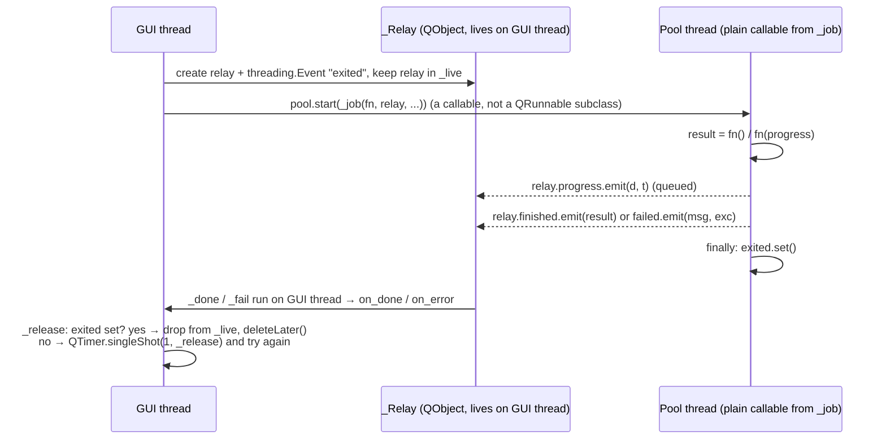

# `src/gif_editor/ui/workers.py`

> `run_async` runs blocking work (decode, thumbnails, preview renders, the size estimate, Generate) on a thread pool and delivers the result, error and progress back on the GUI thread.

## Where it sits
- **Layer:** ui (Qt: `QObject`, `QThreadPool`, `QTimer`, `Signal`)
- **Used by:** `ui/main_window.py` (opening files, Generate with progress), `ui/inspector/filmstrip.py` (thumbnail batches), `ui/inspector/preview.py` (preview frames, plain source frames for the canvas, the size estimate); `tests/ui/test_workers.py`.
- **Uses:** nothing in the project.

## Public API
| Name | Kind | Purpose |
|---|---|---|
| `run_async(fn, *, on_done=None, on_error=None, on_progress=None, pool=None)` | function | Run `fn` on `pool` (default `QThreadPool.globalInstance()`). Callbacks run on the thread that called `run_async`, normally the GUI thread. Returns `None` immediately. |

| Callback | Signature | When |
|---|---|---|
| `on_done` | `(result)` | `fn` returned. |
| `on_error` | `(message: str, exc: BaseException)` | `fn` raised anything. `message` is `str(exc)` or the exception class name. If **no** `on_error` is given, the traceback is printed to stderr instead (so an unhandled failure still leaves a trace); a handled error prints nothing. |
| `on_progress` | `(done: int, total: int \| None)` | Each time `fn` calls `progress(done, total)`. If `on_progress` is given, `fn` is called as `fn(progress)`; otherwise as `fn()`. |

Private pieces: `_Relay` (the `QObject` with the three signals), `_job(fn, relay, with_progress, exited, print_errors)` (builds the plain function a pool thread runs), `_live` + `_lock` (keeps relays alive).

## How it works

- **Why a relay object:** Qt delivers a signal emitted from another thread through a **queued connection** to the thread the receiving `QObject` lives in. `_Relay` is created inside `run_async`, i.e. on the GUI thread, so its slots run there. Pool threads never touch widgets.
- **Why a plain callable, not a `QRunnable` subclass** (`9ab961f`). Until M4 the job was a Python class `_Runnable(QRunnable)` with an overridden `run()`. Qt then calls a Python override on a C++-owned object from a pool thread, and PySide has to keep that object's Python wrapper alive and dispatch the override across threads. During M4 the test suite crashed once (segmentation fault in a native pool thread) and hung once (the GUI thread was garbage-collecting inside `run_async` while a pool thread sat at the entry of `_Runnable.run()`), each roughly once in 20 full runs. `QThreadPool.start(callable)` takes a plain Python function, so there is no wrapper object whose lifetime PySide must manage. **The root cause was not confirmed**: probes with 120,000 tasks reproduced neither failure. This change removes the code path that both incidents pointed at. See the [dev log, Milestone 4](../../../../04-development-log.md#milestone-4-hardening).
- **Lifetime of the relay** (`c4b9329`). The module-level `_live` set (guarded by a lock) holds a strong reference to each relay until its task reports back; otherwise Python could garbage-collect the relay while the worker still emits on it. But the worker emits `finished` and the GUI thread can run `_done` (and want to delete the relay) **before `emit()` has returned on the pool thread**. Deleting a `QObject` while another thread is inside one of its emits is undefined behaviour. So the worker sets the `threading.Event` `exited` in its `finally`, and `_release` frees the relay only once `exited` is set; if it is not yet set, `_release` re-schedules itself with `QTimer.singleShot(1, ...)`. The window is microseconds, so it almost never loops more than once. `_release` runs in a `finally`, so a callback that raises still frees the relay.
- **Cancellation is cooperative:** create a `threading.Event`, capture it in `fn` (e.g. `lambda progress: generate(src, st, path, progress=progress, cancel=ev)`), and set it from the GUI. `fn` should raise (e.g. `encoder.Cancelled`) so that `on_error` fires.

## Invariants & gotchas
- **Never subclass `QRunnable` in Python** for new background work; call `run_async` (AGENTS.md). See above for why.
- **Call `run_async` from the GUI thread.** The relay's thread affinity decides where callbacks run. Called from a thread without an event loop, the callbacks would never fire. `_release`'s `QTimer.singleShot` also needs the GUI event loop.
- **No QPixmap in `fn`.** QPixmap may only be created on the GUI thread. Return PIL images or `QImage`s (`qt_image.pil_to_qimage` is safe in workers) and convert to QPixmap in `on_done`.
- Results are delivered in completion order, not submission order. When the user scrubs quickly, ignore stale results, e.g. by checking that the index is still current.
- `progress` calls are queued one by one. Don't call it per pixel; per frame is fine.
- `fn` catches `BaseException`, so even `KeyboardInterrupt`/`SystemExit` inside a worker becomes `on_error`.
- The global pool's size is the CPU count. `GifSource` serialises its own decoding with a lock, so several decode tasks on one source do not run in parallel.
- Work may still be running when the window closes. `app.main` waits `QThreadPool.globalInstance().waitForDone(10_000)` after `app.exec()` returns, so interpreter teardown never runs under a live pool thread ([app page](../app.md)). In tests, the autouse `_drain_workers` fixture in [`tests/ui/conftest.py`](../../../tests/ui/conftest.md) drains the pool after every UI test.

## Tests
- `tests/ui/test_workers.py`: the result is delivered on the main thread while the work ran elsewhere; errors and progress (order, values) are delivered; 300 tasks all report back and every relay is freed (`_live` ends empty).
- **Gaps:** `pool=` argument; callbacks raising; the `print_errors` switch (traceback only without `on_error`); the `_release` retry path is exercised only by chance (it needs the GUI thread to win the race).

## History
- `0137178`: orchestrator M2 foundation (`_Runnable(QRunnable)` subclass, relay freed in the callback).
- `c4b9329` (M4): relay freed only after the worker has left `emit()` (`exited` event + retry).
- `9ab961f` (M4): pool jobs are plain callables (`QThreadPool.start(callable)`); the `_Runnable` class is gone.
- `5c40830` (M4): a traceback is printed only when no `on_error` handles the error (handled errors such as a refused file no longer spam stderr).
